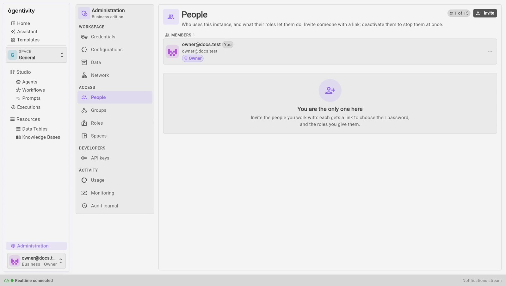
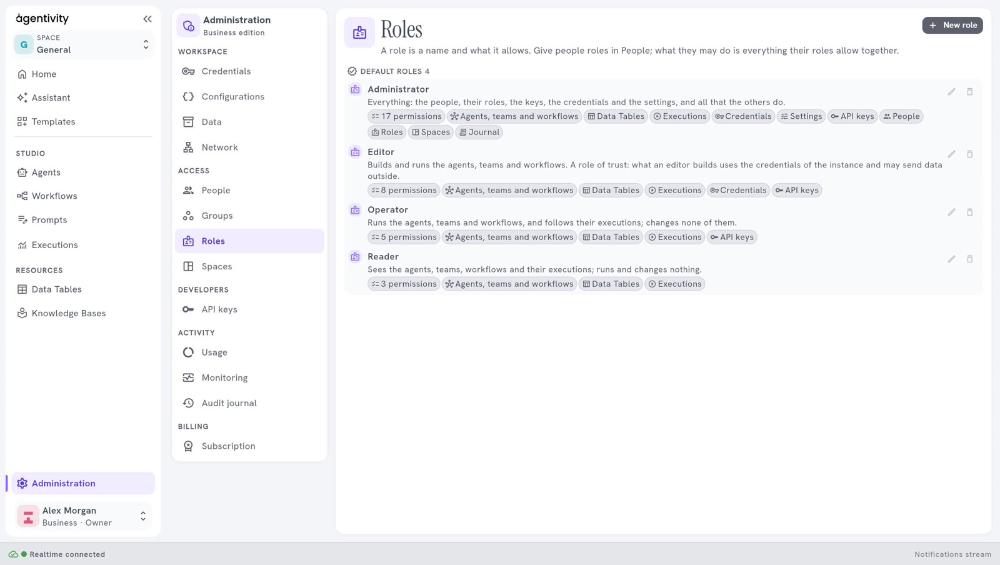
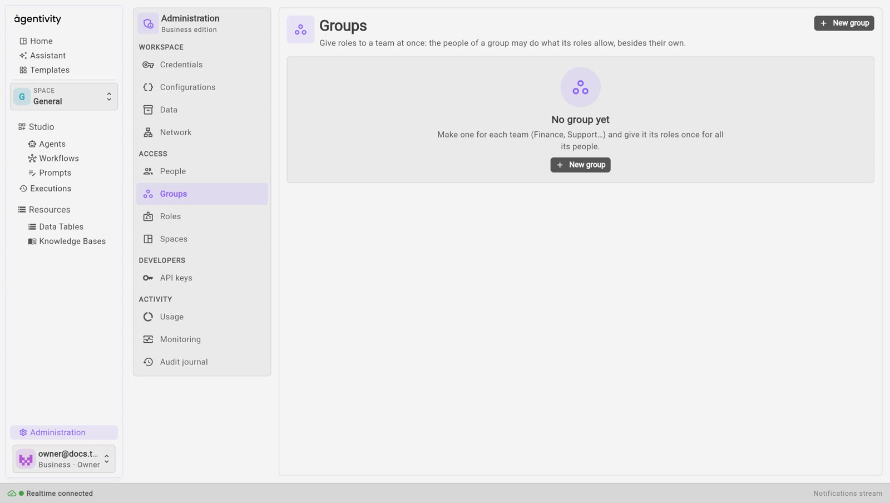
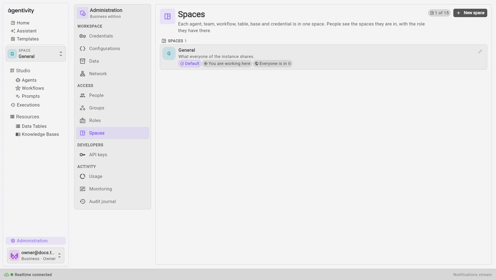

<!-- GENERATED from agentivity_docs/en/administration/people-groups-roles-spaces.md. Do not edit here: edit the source and publish again. -->

This page covers the four panes of the group **Access** in [Administration](/docs/administration/what-administration-is/): **People**, **Groups**, **Roles** and **Spaces**. They exist when the workspace asks for a sign-in, which is the case of every hosted workspace.

## People

**People** lists who uses the workspace, in three lists: **Members**, **Invitations waiting** and **Deactivated**. The counter at the top right, for example **1 of 15**, counts the people and the invitations waiting against what your plan allows. See [Plans and their limits](/docs/hosted/plans-and-limits/).

### Invite someone

1. Select **Invite**.
2. Give their e-mail address and choose their roles.
3. Confirm.

The person gets a link to join and to choose their password. The link works once, for 7 days. When the workspace can send e-mails, the link goes to them by e-mail. Otherwise the Studio shows you the link once, and you give it to them yourself.

The person opens the link and sees **Welcome aboard.** They give their name and choose a password, then select **Join**. If the link has expired or was lost, an administrator invites them again: an invitation that ended shows **Ended: invite again**, and **Revoke the invitation** cancels one that is still waiting.

### Change what a person may do

On the line of a person, the three dots open a menu:

| Entry | What it does |
|---|---|
| **Change roles** | Gives or removes roles. |
| **Make owner** / **No longer owner** | Gives the ownership of the workspace, or takes it away. |
| **Deactivate** | Stops the person at once. They are signed out everywhere, and their API keys are revoked. Nothing of theirs is deleted. |
| **Activate** | Lets a deactivated person back in. |

A person with no role can sign in, and can do nothing else.

**How to know it worked:** a person you deactivated appears in the list **Deactivated**, and they can no longer sign in. After **Activate** they are in **Members** again.

## Roles

A role is a list of rights. **Roles** shows every role and what it lets a person do. Four roles are there from the start:

| Role | What it lets a person do |
|---|---|
| **Administrator** | Everything: the people, their roles, the keys, the credentials, the settings, and all that the others do. |
| **Editor** | Build: read and edit the library and the data, read and start executions, read the credentials, make API keys. It is a role of trust: what an editor builds uses the credentials of the workspace and may send data outside. |
| **Operator** | Use what is built: read the library and the data, read and start executions, make API keys. |
| **Reader** | Look: read the library, the data and the executions. |

Select **New role** to make your own: give it a name and tick the rights it holds. A default role that you delete does not come back. When you delete a role that people hold, the Studio asks you to choose a role to put in its place (**Delete and replace**).

## Groups

A group gives roles to a team at once: the people of a group may do what its roles allow, besides their own. Make one for each team, for example Finance or Support, and give it its roles once for all its people.

1. Select **New group**.
2. Give it a name and say what it is for.
3. Choose its roles and its people.

If you delete a group, its people keep their own roles and lose those they had through the group. Groups come with the Business plan.

## Spaces

A space keeps the work of one team apart from the others. Each agent, team, workflow, table, Knowledge Base and credential is in one space. People see the spaces they are in, with the role they have there. The workspace starts with one space, **General**, which is what everyone of the workspace shares. Spaces come with Pro and Business.

In **Spaces** you can:

- make a space with **New space**, and choose its members, people or groups, each with a role;
- add **Everyone of the workspace** as a member;
- archive a space, and bring it back later. An archived space is not counted against your plan;
- move something to another space;
- choose, for a credential, whether it is for **Every space** or **Only in** one.

You choose the space you work in with the selector at the top of the left menu.

## Good to know

- A person gets the rights of their own roles and of the roles of their groups, together.
- Deactivating someone is reversible. Nothing they made is deleted.
- The people, groups, roles and spaces you make are counted against your plan: see [Plans and their limits](/docs/hosted/plans-and-limits/).

## Next step

[Usage, monitoring and the audit journal](/docs/administration/usage-monitoring-and-audit-journal/).
