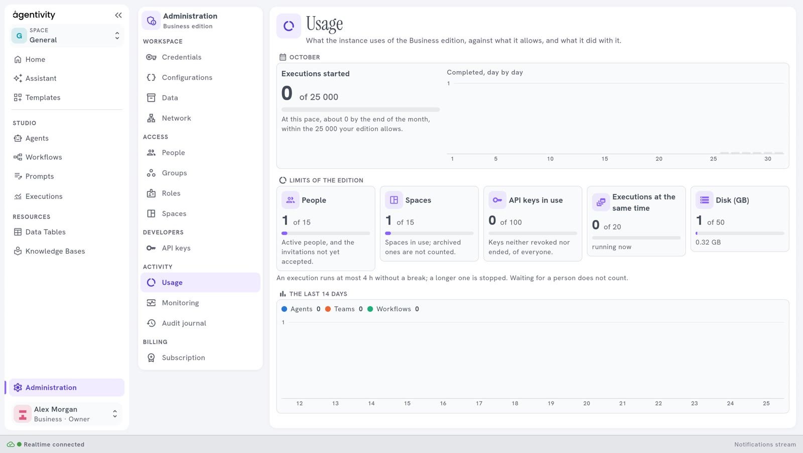
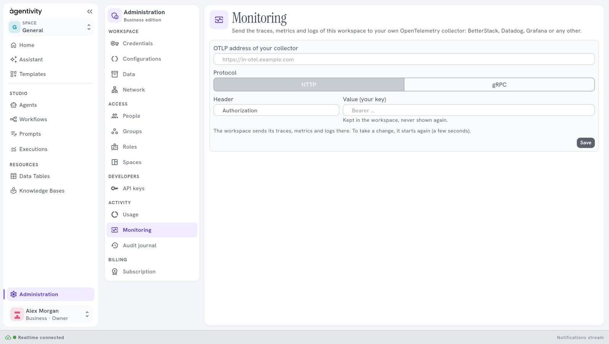
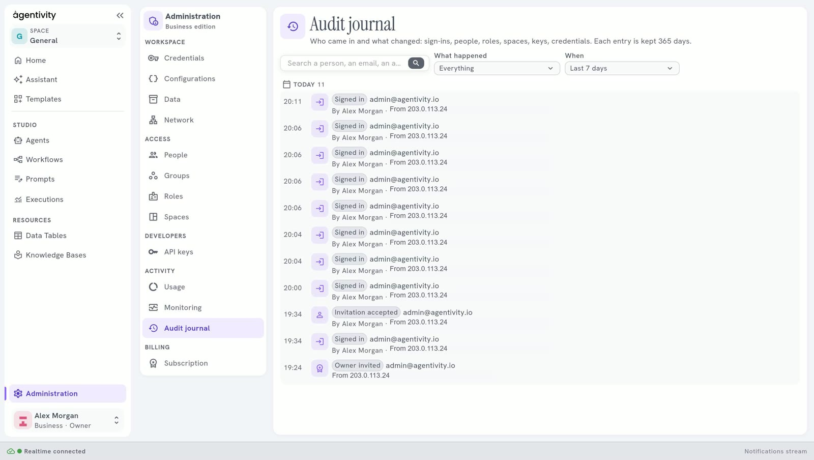

<!-- GENERATED from agentivity_docs/en/administration/usage-monitoring-and-audit-journal.md. Do not edit here: edit the source and publish again. -->

The group **Activity** of [Administration](/docs/administration/what-administration-is/) has three panes: **Usage**, **Monitoring** and **Audit journal**.

## Usage

**Usage** shows what the workspace uses of its plan, and what it did with it. It has four blocks:

- **Executions started** in the current month, against the number your plan allows, with a line such as "At this pace, about N by the end of the month, within the 25 000 your edition allows", and a chart **Completed, day by day**.
- **Limits of the edition**, one card for each limit: **People** (active people and invitations not yet accepted), **Spaces** (archived ones are not counted), **API keys in use** (keys neither revoked nor ended, of everyone), **Executions at the same time** (running now) and **Disk (GB)**.
- **The last 14 days**: executions of agents, teams and workflows.
- **Models this month**: which models were used.

A line under the limits reminds you that an execution runs at most for the length your plan allows without a break, and that a longer one is stopped. An execution that waits for a person does not count. See [Plans and their limits](/docs/hosted/plans-and-limits/).

The month is the calendar month.

## Monitoring

**Monitoring** sends the traces, metrics and logs of the workspace to your own OpenTelemetry collector: BetterStack, Datadog, Grafana or any other. It comes with the Business plan.

1. Give the **OTLP address** of your collector.
2. Choose the **Protocol**, HTTP or gRPC.
3. Give the **Header** (usually Authorization) and its **Value**, which is your key. The value is kept in the workspace and never shown again.
4. Select **Save**.

To take the change, the workspace starts again, which takes a few seconds. **Turn off** stops the sending.

## Audit journal

The **Audit journal** says who came in and what changed: sign-ins, people, roles, spaces, keys and credentials. Each entry is kept 365 days. It comes with the Business plan.

You can search the entries, and filter them by **What happened** and by **When**: the last 24 hours, 7 days, 30 days, or all that is kept. An entry says what happened, who did it and when, for example **Owner created** or **Signed in**.

## Next step

[Workspace panes: credentials, configurations, data and network](/docs/administration/workspace-panes/).
