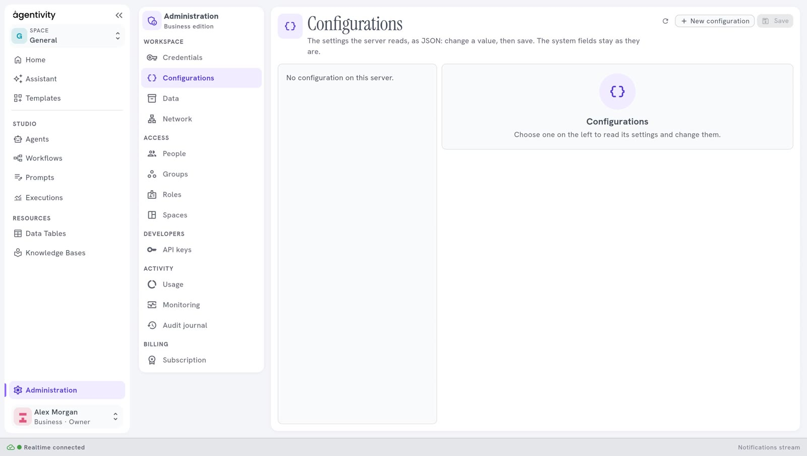
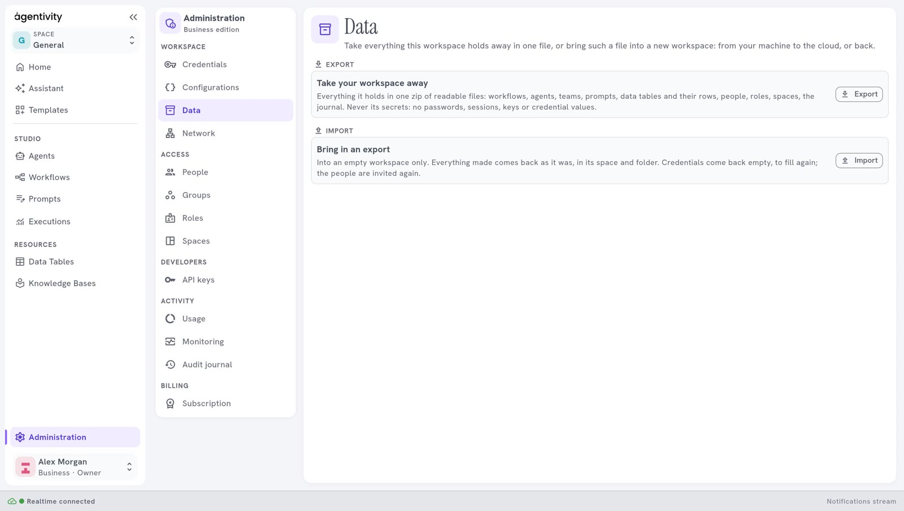
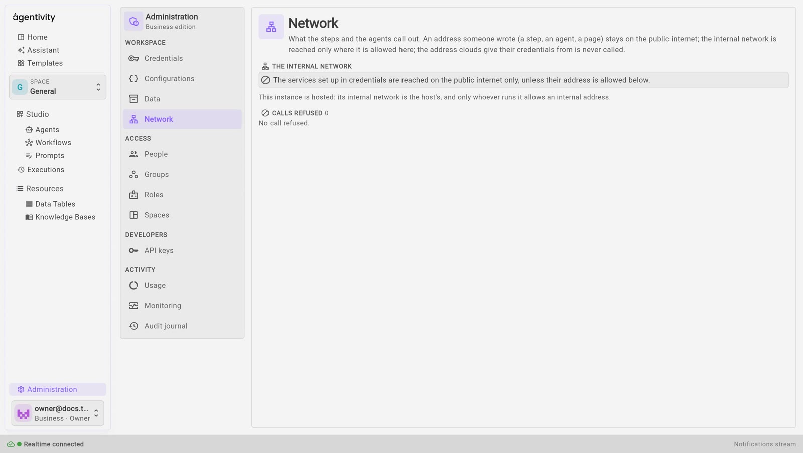

<!-- GENERATED from agentivity_docs/en/administration/workspace-panes.md. Do not edit here: edit the source and publish again. -->

The group **Workspace** of [Administration](/docs/administration/what-administration-is/) has seven panes.

## Credentials

The keys and accounts that your agents, teams and workflows connect with: an AI model, a mailbox, a search service. The pane is the one described in [The Settings screen](/docs/studio/settings-theme-and-controls/) and in [Manage credentials](/docs/guides/manage-credentials/). When spaces are on, a credential is for **Every space** or **Only in** one space.

## Winston

The model that [Winston, your AI builder,](/docs/getting-started/build-your-first-team-with-the-assistant/) thinks with. It uses one of your model connections, and that provider bills it. **Automatic**, the default, takes the first model connection of **Credentials** that holds a key. Choose a connection in the list to keep it.

## Voice dictation

A microphone in the chats: what is said is turned into text, then sent like a typed message. It uses one of your OpenAI connections that holds a key, and OpenAI bills it. Turn on **Offer the mic in the chats** and choose the connection. The mic is offered only when dictation is on.

## Configurations

**Configurations** lets you look at and change settings of the server. On a new workspace the list may be empty and say "No configurations available."

## Place and time

Where a day begins and ends for the people who read the platform: what "today" is, what "the last 30 days" covers in a cockpit, and the day a week starts on. Dates themselves travel in UTC, and each page writes them in the words of whoever reads it.

- **The place**: **Automatic**, the default, lets each person read by their own time, wherever they are. To make everyone read by one place instead, search a city or a country (Paris, New_York, Tokyo) and choose it. The pane then shows the time it is there and which day it is.
- **The week**: **Monday**, **Sunday** or **Saturday**. A chart drawn week by week groups its rows from that day.

You need the right to manage settings.

## Data

**Data** takes everything the workspace holds away in one file, or brings such a file into a new workspace: from your machine to the cloud, or back. Only the owner sees it.

**Export** gives a zip of readable files:

- workflows, agents, teams and prompts;
- Data Tables and their rows;
- people, roles and spaces;
- the journal.

The file never holds a secret: your credentials are not in it.

**Import** works on an empty workspace only. Everything comes back in its space and its folder. What cannot come back whole is said when it is done:

- the credentials come back empty: the message says how many to fill again in **Credentials**;
- the people are not copied with their password: the message lists those to invite again in **People**;
- Knowledge Bases read their sources again;
- what the edition of the new workspace does not have is left in the file, and the message says what.

**How to know it worked:** an import ends with a message that starts with **Brought in:** and lists what came in.

## Network

**Network** is about the calls that your steps and agents make to the outside. It shows the addresses your workspace refused, in a list **Calls refused**, so that you can see what an agent tried to reach. An address of the internal network is allowed only where the person who runs the workspace allows it. On a hosted workspace, the internal network is the host's: only Agentivity can allow an internal address.

The pane needs a sign-in and the right to manage settings.

## Desk

**Desk** sets how [Desk by Agentivity](/docs/desk/agentivity-desk/) looks and what it shows. The Desk comes with the Pro and Business plans: not with Personal, nor with the Community edition.

- **Brand**: the **Name** shown at the top of the Desk (empty: Desk by Agentivity), a **Logo** (PNG, JPEG, WebP or SVG, 300 KB at most, square at best), a **Colour**, and the **Welcome line** over the field of the home.
- **Published to the Desk**: **Everything**, or **Only what I choose**. Only Solutions are published. When you choose and no Solution is chosen, the Desk shows nothing.
- **Cockpits**: the cockpits are not set here. **Open Cockpits** takes you to **Cockpits** in the Studio. See [Build a cockpit](/docs/desk/build-a-cockpit/).
- **Suggestions and time saved**: what the home of the Desk suggests to ask a Solution, and the **Minutes saved each time**. Empty, the time is measured from the work the Solution does.

The pane needs the right to manage settings.

## Next step

[Your account](/docs/administration/your-account-and-api-keys/) and [API keys](/docs/administration/api-keys/).
