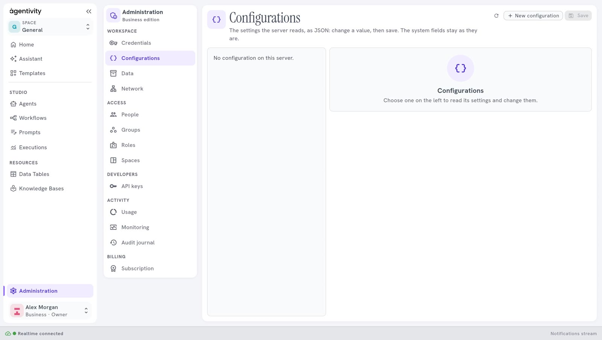
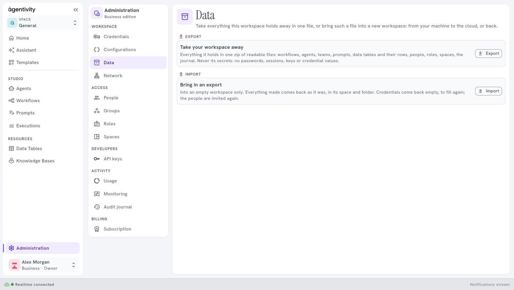
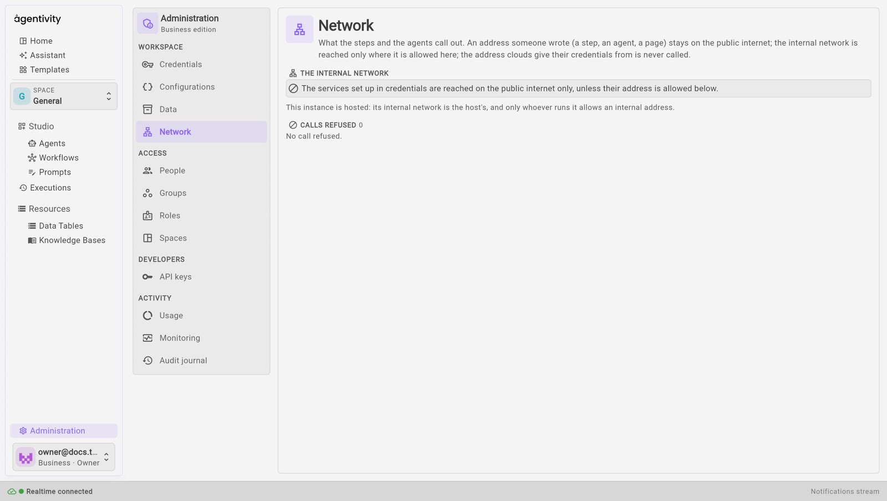

<!-- GENERATED from agentivity_docs/en/administration/workspace-panes.md. Do not edit here: edit the source and publish again. -->

The group **Workspace** of [Administration](/docs/administration/what-administration-is/) has four panes.

## Credentials

The keys and accounts that your agents, teams and workflows connect with: an AI model, a mailbox, a search service. The pane is the one described in [The Settings screen](/docs/studio/settings/) and in [Manage credentials](/docs/guides/manage-credentials/). When spaces are on, a credential is for **Every space** or **Only in** one space.

## Configurations

**Configurations** lets you look at and change settings of the server. On a new workspace the list may be empty and say "No configurations available."

## Data

**Data** takes everything the workspace holds away in one file, or brings such a file into a new workspace: from your machine to the cloud, or back. Only the owner sees it.

**Export** gives a zip of readable files:

- workflows, agents, teams and prompts;
- Data Tables and their rows;
- people, roles and spaces;
- the journal.

The file never holds a secret: your credentials are not in it.

**Import** works on an empty workspace only. Everything comes back in its space and its folder. What cannot come back whole is said when it is done:

- the credentials come back empty: the message says how many to fill again in **Credentials**;
- the people are not copied with their password: the message lists those to invite again in **People**;
- Knowledge Bases read their sources again;
- what the edition of the new workspace does not have is left in the file, and the message says what.

**How to know it worked:** an import ends with a message that starts with **Brought in:** and lists what came in.

## Network

**Network** is about the calls that your steps and agents make to the outside. It shows the addresses your workspace refused, in a list **Calls refused**, so that you can see what an agent tried to reach. An address of the internal network is allowed only where the person who runs the workspace allows it. On a hosted workspace, the internal network is the host's: only Agentivity can allow an internal address.

The pane needs a sign-in and the right to manage settings.

## Next step

[Your account and API keys](/docs/administration/your-account-and-api-keys/).
