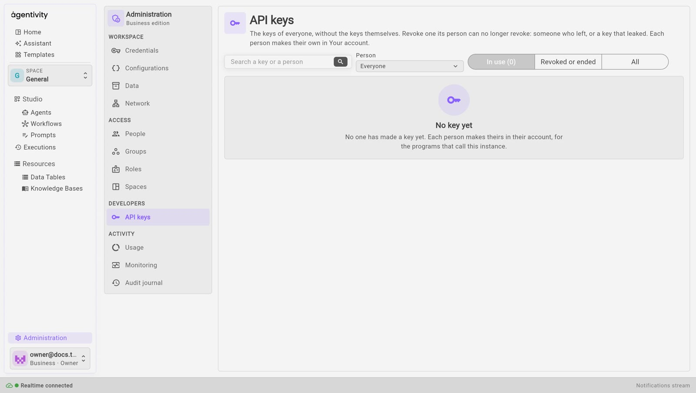

<!-- GENERATED from agentivity_docs/en/administration/your-account-and-api-keys.md. Do not edit here: edit the source and publish again. -->

## Your account

Your name is at the bottom of the left menu. Select it for **Your account**, **Your API keys**, **Appearance**, **Getting started** and **Sign out**.

**Profile** has:

- **Password**: **Change password**. Changing it ends your other sessions. The one you are using stays open.
- **This session**: how you are signed in.
- **What you may do**: the rights your roles give you.
- **Developers**: a link to your API keys.
- **Sign out**.

### Sign in and forgotten password

The sign-in page says **Welcome back.** and asks for your e-mail address and password. If you forgot your password, select **Forgot your password?**, give the e-mail you sign in with, and select **Send me a link**. A link to choose a new password is sent to it, and holds one hour. After **Change and sign in**, your other sessions end. When the workspace cannot send e-mails, the page says that the owner gives you a new password.

If you lost the link of your invitation or of a new workspace, a hosted workspace page tells you to get it again at `www.agentivity.io/find`: see [Find your workspace again](/docs/hosted/start-a-hosted-workspace/).

## API keys

A program that calls your workspace gives its own key, as `Authorization: Bearer <key>`. A key does what you can do, never more, and stops when you revoke it. To make a key, open **Your API keys** under your name, and choose:

| Kind | What it is for |
|---|---|
| **Everything in the API** | A program that does what you do. |
| **Read only** | A program that only reads. |
| **AI assistant (MCP)** | An AI assistant that connects to the workspace. |
| **On a website** | A key safe to put in a web page: it talks to one agent, team or workflow, from the sites you list, with a limit of conversations a minute. Not in the Community edition. |

You also choose when the key ends: **30 days**, **90 days**, **a year** or **Never**. The key is shown once, when you make it: copy it then. **Revoke** stops a key at once.

The pane **API keys** in the group **Developers** of Administration shows the keys of everyone, without the keys themselves, for the people allowed to manage them. How many keys a plan allows is in [Plans and their limits](/docs/hosted/plans-and-limits/).

## Next step

[Subscription](/docs/administration/subscription/).
