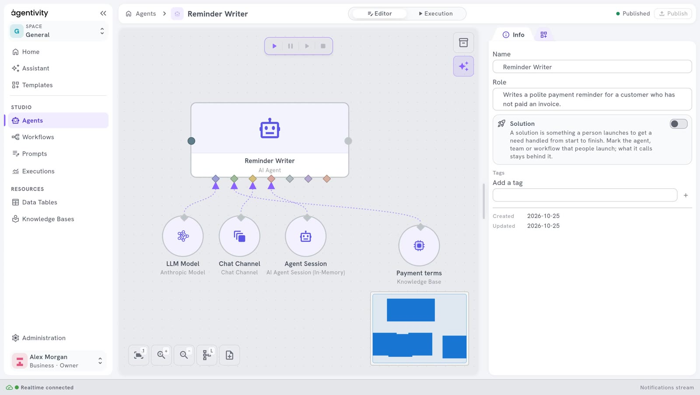
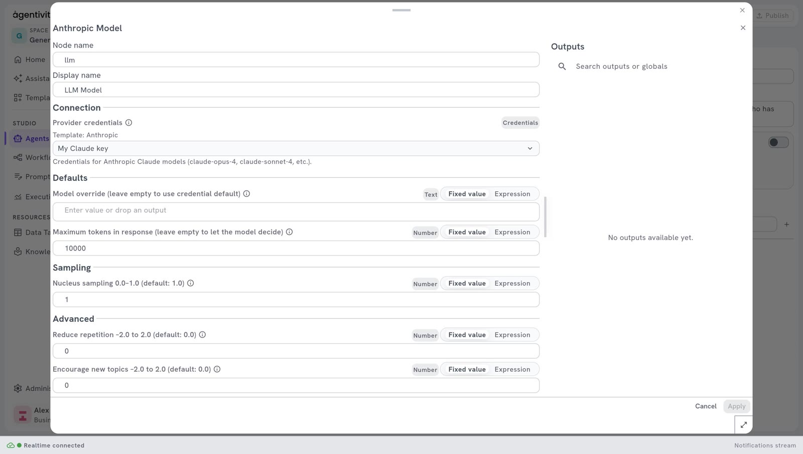
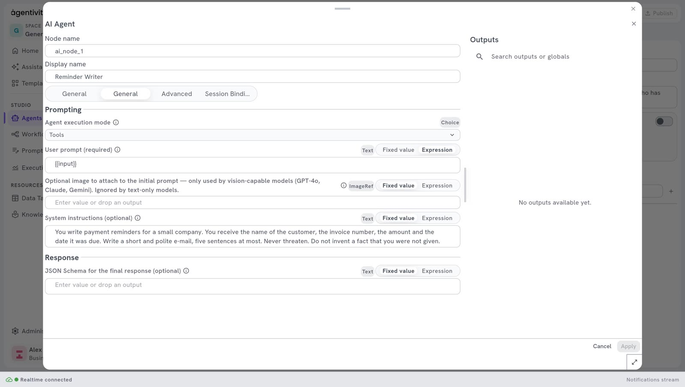

<!-- GENERATED from agentivity_docs/en/agents/create-an-agent.md. Do not edit here: edit the source and publish again. -->

An agent is one AI specialist with a role. To see what an agent is made of first, read [What an agent is made of](/docs/agents/what-an-agent-is/). This page builds an agent by hand. It takes more steps than the Assistant: to have an agent built from a description, read [Build your first team with the Assistant](/docs/getting-started/build-your-first-team-with-the-assistant/).

<video controls muted playsinline preload="metadata" src="/docs-media/en/agents/images/create-an-agent.mp4" aria-label="A recording of the Studio: in Agents, New agent is selected, the name Reminder Writer is typed, the role is written, an Anthropic Model is dragged from the Nodes catalog onto the canvas and linked to the first diamond of the agent"></video>

Recorded from the product. It stops before the agent is published and before the credentials of the model are chosen.

## What you need

- Agentivity running, with the Studio open. See [Install Agentivity with Docker](/docs/getting-started/install-community/).
- A model connection. See [Connect an AI model](/docs/guides/connect-a-model/).

## Create the agent

1. On the home page, select **New**, then **Agent**, or the card **An agent**. You can also open **Studio** > **Agents** and select **New agent**. From the list, the new agent is added to the list and its editor does not open by itself: double-click it.
2. In the window **New agent**, type the **Agent name**, for example `Reminder Writer`.
3. Select **Create**.

The editor of the agent opens. The agent is drawn as one large box, **AI Agent**, with a row of small diamonds under it. Each diamond is a place where you plug something into the agent: a model, a memory, tools.

If the canvas looks empty, select the first button at the bottom left of the canvas. It brings the whole drawing into view.

## Describe its role

In the panel **Info**, on the right:

1. Fill in **Role**: one or two sentences on what this agent is good at. When the agent is a member of a team, the team reads the role to decide when to use this agent.

## Give it a model

A new agent has no AI model. You add one and link it.

1. In the panel on the right, select the second tab. The **Nodes catalog** opens.
2. Open **AI**, then **Models**. You can also type the name of your provider in the search field and press Enter.
3. Drag the model of your provider onto the canvas, below the agent. For example **Anthropic Model**, **OpenAI Model** or **Google Gemini Model**. It appears as a circle with a diamond on top.
4. Drag from the diamond of the model to the first diamond of the agent, on the left. A dotted line links them.


5. Right-click the model and select **Edit**.
6. Under **Connection**, open the list **Provider credentials** and choose your model connection. The list shows only the connections of this provider.
7. Select **Apply**.



Leave **Model override** empty to use the default model of the connection.

## Write its instructions

1. Right-click the box **AI Agent** and select **Edit**.
2. In **System instructions**, write what the agent must do and how, in plain words. For example:

   ```text
   You write payment reminders for a small company. You receive the name of the customer, the invoice number, the amount and the date it was due. Write a short and polite e-mail, five sentences at most. Never threaten. Do not invent a fact that you were not given.
   ```

3. Select **Apply**.



## Save

1. Select **Publish**, at the top right.

**Publish** is highlighted when there are changes to save. Publish before you leave the editor.

## Try it

1. In the switch at the top, select **Execution**.
2. Type a task for the agent and send it.

## How to know it worked

- On the canvas, a dotted line goes from the model to the agent.
- In **Studio** > **Agents**, the agent is in the list, with **Agent** in the column **Type**.
- In **Execution**, the agent answers your task.

## If it does not work

- **"Agent name is required."** The name field is empty.
- **The list Provider credentials is empty.** You have no connection for this provider. Add one in **Administration** > **Credentials**, or choose the model of a provider you have a connection for.
- **Apply cannot be selected.** Nothing changed in the window yet.
- **The agent fails when it runs.** Check that the model is linked to the first diamond of the agent, and that its credentials are chosen.

## Go further

- [Write the role and the instructions of an agent](/docs/agents/write-the-instructions/)
- [Choose or change the model of an agent](/docs/agents/choose-the-model/)
- [Give tools to an agent](/docs/agents/give-tools-to-an-agent/)
- [Run an agent and read its answer](/docs/agents/run-an-agent/)

## Next step

Put the agent in a team: [Create a team of agents](/docs/teams/create-a-team/). Or use it in a [workflow](/docs/workflows/create-a-workflow/).
