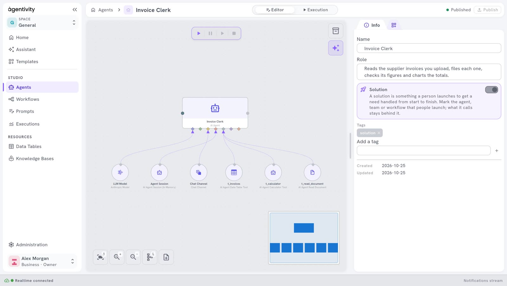

<!-- GENERATED from agentivity_docs/en/agents/give-tools-to-an-agent.md. Do not edit here: edit the source and publish again. -->

By itself, an agent can only read and write text. A tool lets it do something more: know the date, compute, read a web page, read a document, read or fill a table. The agent decides when to use a tool, from the request and from its instructions.

## What you need

- An agent with a model. See [Create an agent](/docs/agents/create-an-agent/).

## The tools that need nothing more

These tools work without an account at another service. They are in the **Node Catalog**, under **AI** > **Tools**, grouped in sub-categories such as **Data**, **Documents** and **Search**.

| Tool | What the agent can do with it |
|---|---|
| **AI Agent Date & Time Tool** | Know the current date and time. |
| **AI Agent Calculator Tool** | Compute an arithmetic expression. |
| **AI Agent Weather Tool** | Get the current weather of a place. |
| **AI Agent HTTP Request Tool** | Call a web API or read a web page. It reads by default, and may send data when you allow it on the node. |
| **AI Agent Web Scraper Tool (Direct)** | Read a web page and get its text in a clean form. |
| **AI Agent Read Document Tool** | Read a document that the person uploaded in the chat: PDF, Word or plain text. |
| **AI Agent Data Table Tool** | Read and fill a Data Table of your workspace. |
| **AI Agent Vector Store Tool** | Search texts kept in a Vector Store, by meaning, and keep texts there when you allow it. It needs a Vector Store plugged in. See [Keep texts and find them by meaning](/docs/workflows/keep-texts-and-find-them-by-meaning/). |
| **AI Agent JavaScript Tool** | Run a short JavaScript program and use its result. For a developer. |

## The tools that need a connection

| Tool | What it needs |
|---|---|
| **AI Agent Email Tool** | A mailbox: credentials to read e-mails, and credentials to send them. |
| **AI Agent Web Search Tool (SearXNG)** | The address of a SearXNG search service, as credentials. |
| **MCP Server** | The address of an MCP server. MCP is a standard way to give tools to AI agents. |

The catalogue also has tools for web search and web reading that use services you pay for separately. These pages do not cover them.

## Plug a tool into the agent

In our example, the `Reminder Writer` must know today's date, to say how many days an invoice is late.

1. In the **Node Catalog**, open **AI** > **Tools**, or type the name of the tool in the search field and press Enter.
2. Drag **AI Agent Date & Time Tool** onto the canvas, below the agent.
3. Drag from the diamond of the tool to the diamond of the agent named **AI Agent Tools**.
4. Select **Publish**.

You can plug several tools into the same diamond.



The picture shows the agent of the showcase [Invoice Clerk](/docs/showcases/invoice-clerk/), with three tools.

## Set up a tool

Some tools have settings. Right-click the tool and select **Edit**.

- **AI Agent Data Table Tool**: choose the table, then say what the agent may do with it: read rows, add rows, change rows, delete rows. Give it only what the job needs.
- **AI Agent Email Tool**: choose the mailbox, then say whether the agent may read, send, and file e-mails. You can limit who the agent may write to.

## Tell the agent when to use the tool

A tool that is plugged in is available. It is not always used. Say in the instructions when the agent must use it. For example, add this sentence to the instructions of the `Reminder Writer`:

```text
Use the date tool to know today's date, and say in the e-mail how many days the invoice is late.
```

See [Write the role and the instructions of an agent](/docs/agents/write-the-instructions/).

## Check the execution mode

Right-click **AI Agent**, select **Edit**, and look at **Agent execution mode**. With **Conversational**, the agent never uses a tool. Use **Tools**, the default, or **ReAct**.

A step can require the model to call a tool. The models Claude Opus 5.5, Claude Sonnet 5.5, Claude Fable 5.1 and Claude Mythos 5.1 no longer accept a forced choice of tool. Agentivity asks them for a required tool call in another way, and there is nothing to set.

## How to know it worked

Run the agent with a request that needs the tool. The answer must contain what only the tool could give: here, the number of days the invoice is late. In the tab **Execution**, the **Inspector** shows the steps of the run. See [Run an agent and read its answer](/docs/agents/run-an-agent/).

## Good to know

- A tool gives the agent a way to act. Before you give an agent a tool that sends or changes something, such as e-mail or a table, decide whether a person must approve first. See [Let an agent ask a person before it decides](/docs/agents/let-an-agent-ask-a-person/).
- Each use of a tool adds a call to the AI model. An agent with many tools costs more for each run.

## Next step

[Give an agent a memory and documents to rely on](/docs/agents/give-memory-and-knowledge/).
