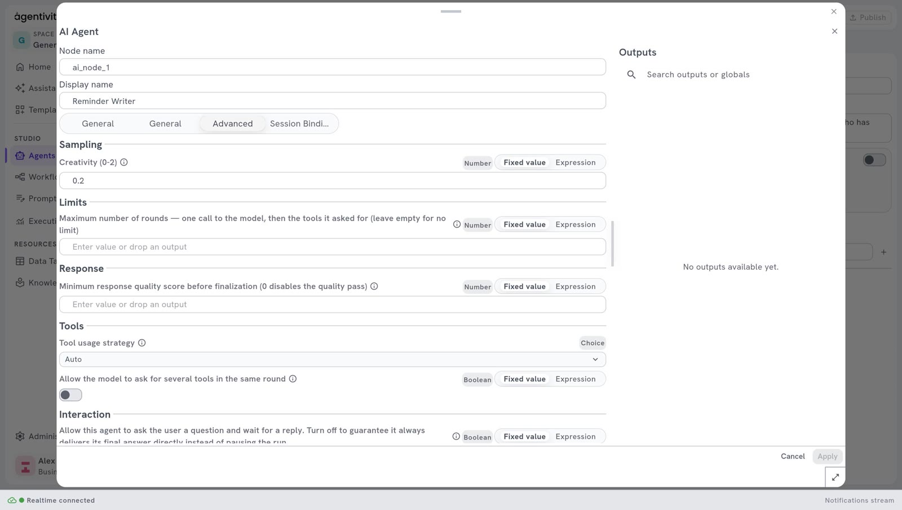

<!-- GENERATED from agentivity_docs/en/agents/let-an-agent-ask-a-person.md. Do not edit here: edit the source and publish again. -->

An agent can stop in the middle of its work and ask a person: a missing detail, a choice, or an approval. The run waits, and continues when the person has answered. For this, the agent needs a channel: the way its question reaches the person.

## What you need

- An agent with a model. See [Create an agent](/docs/agents/create-an-agent/).

## Give the agent a channel

The channels are in the **Node Catalog**, under **AI** > **Interactions**.

| Channel | Where the person answers |
|---|---|
| **Chat Channel** | In the chat of the run, inside the Studio or inside an application built on Agentivity. |
| **Forms Channel** | In a form. |
| **Email Channel** | By e-mail. |
| **Slack Channel** | In Slack. |

This page uses **Chat Channel**, which needs no account elsewhere.

1. Drag **Chat Channel** onto the canvas, below the agent.
2. Drag from its diamond to the diamond of the agent named **Human Loop Channel**.
3. Select **Publish**.

An agent has one channel only.

## Tell the agent when to ask

A channel makes the question possible. The instructions say when to ask. Be precise. For the `Reminder Writer`:

```text
Before you give your final answer, show the e-mail to the person and ask whether it can be sent. If the person asks for a change, make it and ask again.
```

See [Write the role and the instructions of an agent](/docs/agents/write-the-instructions/).

## Answer the agent

1. Run the agent. See [Run an agent and read its answer](/docs/agents/run-an-agent/).
2. When the agent asks, its question appears in the panel on the right, and the field at the bottom says **Type your response…**
3. Type the answer and send it. The agent continues.

A run that waits for a person has the label **ACTION REQUIRED** in the section **Executions**.

## Stop an agent from asking

Sometimes an agent must always give its answer at once, without stopping. For example when it is one step of a workflow that already has its own approval step.

1. Right-click **AI Agent** and select **Edit**.
2. Open the tab **Advanced**.
3. Under **Interaction**, turn off the setting "Allow this agent to ask the user a question and wait for a reply."
4. Select **Apply**, then **Publish**.

This setting is on at the start.



## How to know it worked

When you run the agent, it stops, you see its question, and it continues after your answer.

## Good to know

- An agent decides by itself when to ask, from its instructions. If an approval must happen every time, without exception, do not rely on an agent: put the agent in a workflow, with a step that waits for a person. See [Ask a person to approve or answer](/docs/workflows/ask-a-person-to-decide/).
- Agentivity has no login, so it does not check who answers.

## Next step

[Run an agent and read its answer](/docs/agents/run-an-agent/).
