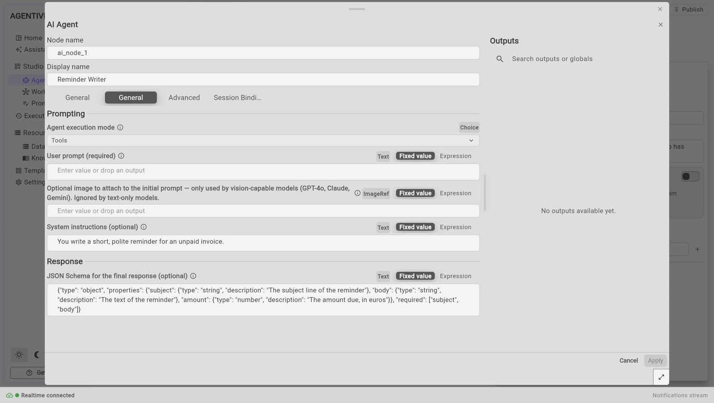

<!-- GENERATED from agentivity_docs/en/agents/write-the-instructions.md. Do not edit here: edit the source and publish again. -->

An agent does what its instructions say. Clear instructions are what makes an agent useful. This page shows where to write the role and the instructions, and how to write them well.

## What you need

- An agent open in its editor. See [Create an agent](/docs/agents/create-an-agent/).

## The role and the instructions are two things

| | Role | Instructions |
|---|---|---|
| **Who reads it** | A team, or a person who looks for the right agent. | The agent itself. |
| **What it says** | What the agent is good at, in one or two sentences. | What to do, how, and what never to do. |
| **Where** | Panel **Info**, field **Role**. | Window **AI Agent**, field **System instructions**. |

## Write the role

1. In the panel **Info**, on the right, fill in **Role**. For example:

   ```text
   Writes polite payment reminders for customers who have not paid an invoice.
   ```

Keep it short. When the agent is in a team, the team uses this text to decide who gets the work.

## Write the instructions

1. On the canvas, right-click the box **AI Agent** and select **Edit**.
2. In the tab **General**, fill in **System instructions**. For example:

   ```text
   You write payment reminders for a small company.

   You receive the name of the customer, the invoice number, the amount and the date it was due.

   Write a short e-mail, five sentences at most. Be polite and direct. Say which invoice is concerned, the amount and the date it was due. Ask the customer to pay within seven days or to answer if there is a problem.

   Never threaten. Never mention legal action. Do not invent a fact that you were not given. If a piece of information is missing, say which one, and do not write the e-mail.
   ```

3. Select **Apply**.
4. Select **Publish**.


## What good instructions contain

- **Who the agent is and for whom it works.** One sentence.
- **What it receives.** The agent then knows what to look for in the request.
- **What it must produce.** The form, the length, the tone.
- **What it must never do.** Say it plainly.
- **What to do when something is missing.** Otherwise the agent may invent it.

Write as you would for a new colleague. Short sentences work better than long ones.

## Give the answer a format

By default, an agent answers in free text. When a later step needs one piece of the answer, a subject, an amount, a city, you can give the answer a format. The agent is then asked for that format, and each field of it becomes a named output that a step can use on its own.

In our example, the `Reminder Writer` gives its reminder in two parts, a subject and a body, and the amount due.

1. Right-click the box **AI Agent** and select **Edit**.
2. In the tab **General**, in the group **Response**, find the field **JSON Schema for the final response (optional)**.
3. Describe the answer as a JSON Schema of an object, one property for each field:

   ```json
   {
     "type": "object",
     "properties": {
       "subject": { "type": "string", "description": "The subject line of the reminder" },
       "body": { "type": "string", "description": "The text of the reminder" },
       "amount": { "type": "number", "description": "The amount due, in euros" }
     },
     "required": ["subject", "body"]
   }
   ```

4. Select **Apply**, then **Publish**.



What it gives:

- The answer, `output`, stays the whole answer: here, the JSON text.
- Each field is also a named output, under its own name. A step that calls the agent reads `subject`, `body` or `amount` as it reads any output: the node name of the step, a dot, then the name of the field, between two pairs of curly braces.
- A text, a whole number, a number, a yes or no and a list of texts are given as they are. An object, or a list of objects, is given as its JSON text. To read a field of it, add a dot and the name of the field after the name of the output: for an output `hotel` that is an object, `hotel.name`.

In the window of a later step, the panel **Outputs** lists these named outputs under the step **Agent** that calls the agent, with their type and their description. Write a clear `description` for each field: the model reads it. See [Use an agent or a team as a step](/docs/workflows/use-an-agent-or-a-team/).

What we saw: an agent with a format of four fields, called by a step **Agent**. The step gave the outputs `city` as a text, `nights` as a whole number, `tips` as a list, and `hotel` as a JSON text; `hotel.name` gave the name of the hotel.

When the agent is a member of a team, its named outputs are seen by the next members and by the manager. See [Use a team or a workflow as a member](/docs/teams/put-a-team-in-a-team/).

## The other fields of the tab General

| Field | What it is for |
|---|---|
| **Agent execution mode** | How the agent works. See [What an agent is made of](/docs/agents/what-an-agent-is/). |
| **User prompt** | The request the agent receives. For an agent you run alone, leave the value that is there: it stands for what you type when you run the agent. |
| **JSON Schema for the final response (optional)** | Gives the answer a format, so that each field of it can be used on its own. See "Give the answer a format" below. Leave it empty otherwise. |

## One setting in the tab Advanced

**Creativity (0-2)** says how much the answer may vary from one run to the next. The value at the start is 0.2: the agent stays close to the same answer. Keep it low for work that must be regular, such as a reminder.

From Claude 4.7 on, the models of Anthropic no longer use the creativity setting (the temperature): the value of this setting is ignored, with no error. Agentivity adapts its requests to each generation of Claude model, and there is nothing to set.

## Ask the Assistant to improve the instructions

1. Right-click the box **AI Agent**.
2. Select **Improve its instructions…**


The Assistant reviews the instructions and makes them clearer and more precise, keeping what they are meant to do. It works on a draft: nothing changes until you save.

## How to know it worked

Run the agent with a real case and read the answer. See [Run an agent and read its answer](/docs/agents/run-an-agent/). If the answer is not what you wanted, the instructions are the first place to look.

## Next step

[Choose or change the model of an agent](/docs/agents/choose-the-model/).
