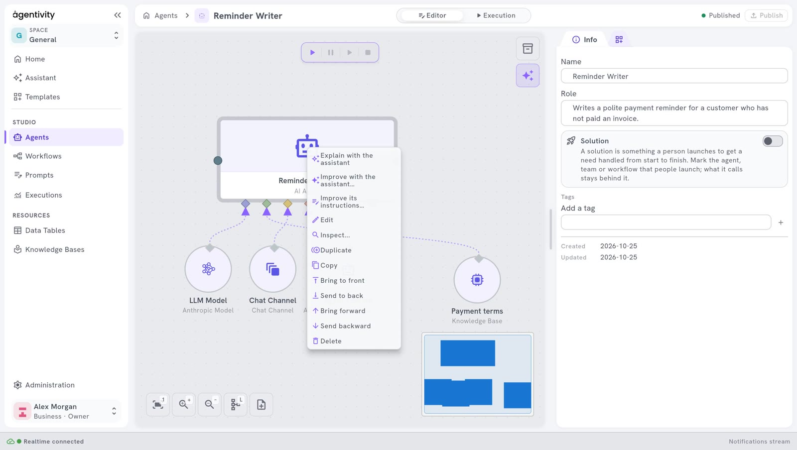

<!-- GENERATED from agentivity_docs/en/agents/write-the-instructions.md. Do not edit here: edit the source and publish again. -->

An agent does what its instructions say. Clear instructions are what makes an agent useful. This page shows where to write the role and the instructions, and how to write them well.

## What you need

- An agent open in its editor. See [Create an agent](/docs/agents/create-an-agent/).

## The role and the instructions are two things

| | Role | Instructions |
|---|---|---|
| **Who reads it** | A team, or a person who looks for the right agent. | The agent itself. |
| **What it says** | What the agent is good at, in one or two sentences. | What to do, how, and what never to do. |
| **Where** | Panel **Info**, field **Role**. | Window **AI Agent**, field **System instructions**. |

## Write the role

1. In the panel **Info**, on the right, fill in **Role**. For example:

   ```text
   Writes polite payment reminders for customers who have not paid an invoice.
   ```

Keep it short. When the agent is in a team, the team uses this text to decide who gets the work.

## Write the instructions

1. On the canvas, right-click the box **AI Agent** and select **Edit**.
2. In the tab **General**, fill in **System instructions**. For example:

   ```text
   You write payment reminders for a small company.

   You receive the name of the customer, the invoice number, the amount and the date it was due.

   Write a short e-mail, five sentences at most. Be polite and direct. Say which invoice is concerned, the amount and the date it was due. Ask the customer to pay within seven days or to answer if there is a problem.

   Never threaten. Never mention legal action. Do not invent a fact that you were not given. If a piece of information is missing, say which one, and do not write the e-mail.
   ```

3. Select **Apply**.
4. Select **Publish**.


## What good instructions contain

- **Who the agent is and for whom it works.** One sentence.
- **What it receives.** The agent then knows what to look for in the request.
- **What it must produce.** The form, the length, the tone.
- **What it must never do.** Say it plainly.
- **What to do when something is missing.** Otherwise the agent may invent it.

Write as you would for a new colleague. Short sentences work better than long ones.

## The other fields of the tab General

| Field | What it is for |
|---|---|
| **Agent execution mode** | How the agent works. See [What an agent is made of](/docs/agents/what-an-agent-is/). |
| **User prompt** | The request the agent receives. For an agent you run alone, leave the value that is there: it stands for what you type when you run the agent. |
| **JSON Schema for the final response** | For a developer: forces the answer into a fixed structure. Leave it empty otherwise. |

## One setting in the tab Advanced

**Creativity (0-2)** says how much the answer may vary from one run to the next. The value at the start is 0.2: the agent stays close to the same answer. Keep it low for work that must be regular, such as a reminder.

From Claude 4.7 on, the models of Anthropic no longer use the creativity setting (the temperature): the value of this setting is ignored, with no error. Agentivity adapts its requests to each generation of Claude model, and there is nothing to set.

## Ask the Assistant to improve the instructions

1. Right-click the box **AI Agent**.
2. Select **Improve its instructions…**



The Assistant reviews the instructions and makes them clearer and more precise, keeping what they are meant to do. It works on a draft: nothing changes until you save.

## How to know it worked

Run the agent with a real case and read the answer. See [Run an agent and read its answer](/docs/agents/run-an-agent/). If the answer is not what you wanted, the instructions are the first place to look.

## Next step

[Choose or change the model of an agent](/docs/agents/choose-the-model/).
