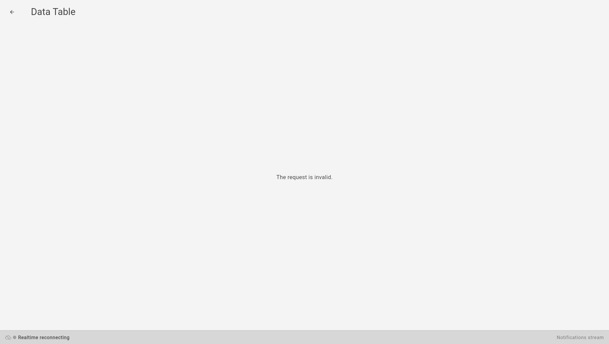

<!-- GENERATED from agentivity_docs/en/data-tables/create-a-data-table.md. Do not edit here: edit the source and publish again. -->

This page shows how a Data Table gets into your workspace. Read the section on the known problem first: in the version these pages were checked against, a table created by hand cannot be opened.

## What you need

- Agentivity running, with the Studio open.

## Create a table by hand

1. In the menu on the left, open **Resources** > **Data Tables**.
2. Select **New Data Table**.
3. In **Table name**, type a name, for example `reminders`.
4. Select **Create**.

The table appears in the list.

## A known problem with a new table

A table created this way has no column yet. When you open it, the Studio shows "The request is invalid." and nothing else. The button **Add column** is on the screen that does not open, so you cannot add the first column from the Studio.

Until this is corrected, get a table the way below.

## The way that works today

**Import a Template that carries tables.** The showcases bring their tables with them: for example, **Trip Manager Team** adds two tables. See [Try a ready-made solution](/docs/getting-started/try-a-ready-made-solution/). You can then add and remove columns in these tables: see [Look at a Data Table and change its columns](/docs/data-tables/view-and-change-a-table/).

## Name tables and columns well

- Use short names in lower case, with an underscore between words: `reminders`, `invoice_number`, `sent_on`.
- Name a table after what one row is: `reminders`, not `data`.
- Agents read these names to understand the table. A clear name is a better instruction than a long explanation.

## How to know it worked

The table is in the list of **Resources** > **Data Tables**, and it opens with its columns.

## Next step

[Look at a Data Table and change its columns](/docs/data-tables/view-and-change-a-table/).
