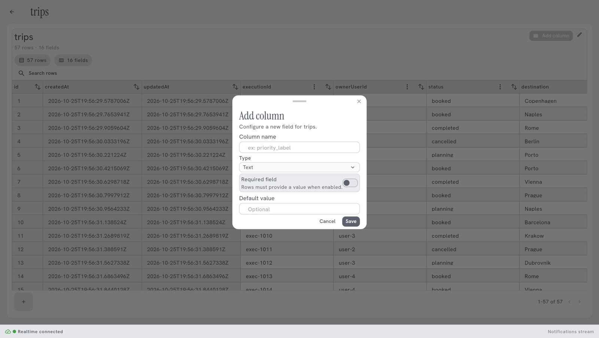

<!-- GENERATED from agentivity_docs/en/data-tables/view-and-change-a-table.md. Do not edit here: edit the source and publish again. -->

This page shows what you can do with a Data Table in the Studio.

## What you need

- A Data Table that has at least one column. See [Create a Data Table](/docs/data-tables/create-a-data-table/).

## Open a table

1. In the menu on the left, open **Resources** > **Data Tables**.
2. Double-click the table.

At the top you read the name of the table, and how many rows and fields it has. The arrow at the top left goes back to the list.

## Sort and search the rows

Each column has two small buttons next to its name: **the arrows**, which sort the rows by this column, and **the three dots**, the menu of the column.

- Select the arrows, or the name of the column, to sort the rows by this column. Select again to sort the other way, and a third time to go back to the order of the table.
- Type in **Search rows**, above the columns, to find the rows that hold a word.

Sorting and searching change only what you see. They do not change the table.

## Add a column

1. Select **Add column**, at the top right.
2. In **Column name**, type the name. Use lower case and underscores, for example `sent_on`.
3. In **Type**, choose the kind of value the column holds, for example **Text**.
4. Turn on **Required field** if every row must have a value in this column.
5. If you want, give a **Default value**: the value a row gets when none is given.
6. Select **Save**.

## Change or delete a column

1. Select the three dots next to the name of the column.
2. Select **Edit column** or **Delete column**.

Deleting a column deletes its values in every row.

The columns **id**, **CreatedAt** and **UpdatedAt** have no menu: they cannot be changed or deleted.

## Add a row

The button with a plus, at the bottom left, adds a row.

In most cases you do not fill a table by hand: a workflow or an agent does it.

## Rename or delete the table

At the top right, next to **Add column**:

- **the pencil** renames the table;
- **the bin** deletes it. The Studio warns you: "This will permanently delete the Data Table and its rows."

## When the server refuses an action

When you add a row or a column, change a cell or delete something, and the server refuses, the Studio shows the message of the server. A column that was refused is not shown as added. Read the message: it says what to correct, for example a value that does not fit the type of the column.

## Good to know

- An agent or a workflow that uses a column by its name stops working if you rename or delete that column. Check what uses a table before you change its columns.
- A table is shared by everything in your workspace. A change is seen at once by every agent and workflow that uses it.

## Next step

[Read and write a Data Table from a workflow](/docs/data-tables/use-a-table-in-a-workflow/).
