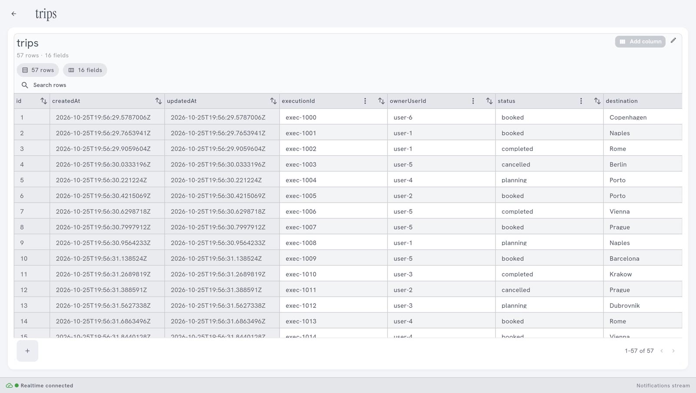
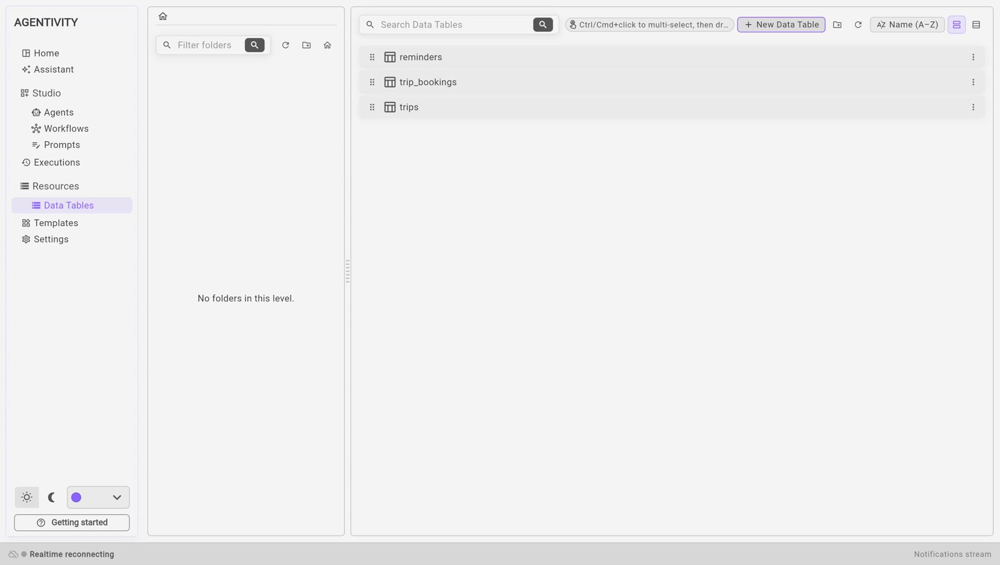

<!-- GENERATED from agentivity_docs/en/data-tables/what-a-data-table-is.md. Do not edit here: edit the source and publish again. -->

A Data Table is a table of data that lives in your Agentivity workspace. Your agents and your workflows can read it and fill it. You can look at it and change it in the Studio.

## What it is for

An agent or a workflow forgets everything when its execution ends. A Data Table is where the work is kept.

- **Keep what was done.** The reminders that were sent, the invoices that were read, the requests that were handled.
- **Give facts to work from.** A list of customers, of products, of open invoices.
- **Pass work between solutions.** One solution fills a table, another one reads it.
- **Show data in an application.** An application built with the SDK can list the rows of a table.

In our example, a table `reminders` keeps one row for each payment reminder: the customer, the invoice, the date, and whether a person approved it.

## What a table is made of

| Part | What it is |
|---|---|
| **Columns** | The fields of the table. Each column has a name and a type, for example text or number. The Studio also calls them fields. |
| **Rows** | The entries. One row is one reminder, one invoice, one trip. |
| **id**, **CreatedAt**, **UpdatedAt** | Three columns that every table has. Agentivity fills them itself. |

## Who can use a table

| Who | How |
|---|---|
| **You, in the Studio** | Open the table, sort and filter its rows, change its columns. See [Look at a Data Table and change its columns](/docs/data-tables/view-and-change-a-table/). |
| **A workflow** | A step reads, adds, changes or deletes rows. See [Read and write a Data Table from a workflow](/docs/data-tables/use-a-table-in-a-workflow/). |
| **An agent** | A tool lets the agent read and fill the table, within the limits you set. See [Let an agent read and fill a Data Table](/docs/data-tables/give-a-table-to-an-agent/). |
| **An application** | It reads and writes rows. It cannot change the columns. See [List solutions and start an execution from your app](/docs/vibeapps/run-a-solution-from-your-app/). |

## Where the tables are

In the menu on the left, open **Resources** > **Data Tables**.

- **Search Data Tables** finds a table by its name.
- Double-click a line to open the table.
- The panel on the left holds folders, as for agents and workflows.

## Good to know

- A Template can carry tables. When you import a showcase, its tables are added to your workspace.
- Agentivity has no login. Anyone who can reach your server can read and change every table. Do not keep there what must stay private from the people who can reach the server.
- Keeping earlier versions of a table is not in the Community edition.

## Not the same as a Knowledge Base

A Data Table holds rows, and an agent looks up or changes a value. A Knowledge Base holds texts, and an agent finds the passage that fits. See [Where each kind of information goes](/docs/introduction/where-does-it-go/).

## Next step

[Create a Data Table](/docs/data-tables/create-a-data-table/).
