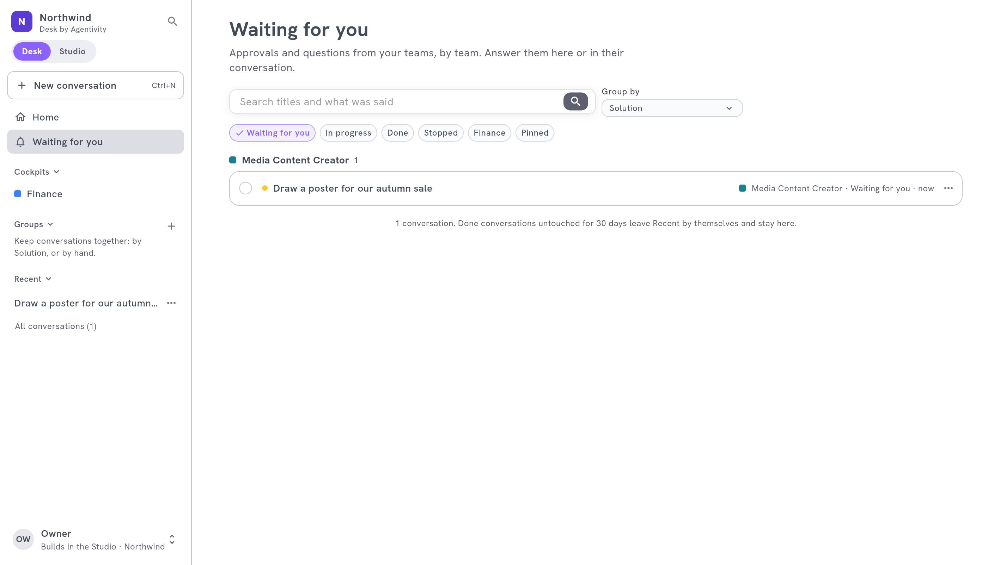

<!-- GENERATED from agentivity_docs/en/desk/answer-what-waits-for-you.md. Do not edit here: edit the source and publish again. -->

A Solution sometimes needs a person: to approve an amount, to choose between two options, to give a missing detail. The Desk puts these requests in one place, **Waiting for you**.

## Where it shows

- **On the home.** A band says how many wait, shows the first ones, and offers **Approve** on a simple approval. **See all** opens the list.
- **In the side bar.** **Waiting for you** has a number. It counts the conversations that wait for your answer, not each question. A yellow dot also shows on a cockpit when something waits there, even folded.
- **In a cockpit.** The block **Waiting for you** shows what waits in that department. See [The blocks of a cockpit](/docs/desk/cockpit-blocks/).

The list groups what waits by Solution. You answer in the list, or in the conversation.

## Answer

1. Select a request. It says **Your answer is needed**.
2. Give your answer: write, choose, or approve.
3. The work goes on, and the request leaves the list.

A request that was answered by someone else, or that is no longer yours, says "This question has been answered, or is no longer yours to answer."

## What the counter counts

| Counted | Not counted |
|---|---|
| A conversation that waits for your answer | A question whose work is over, stopped or failed |
| | A question in a closed conversation |
| | A question in an archived conversation |

The number on the side bar and the list always agree.

## Be told by e-mail

By default, what waits shows in the Desk with a yellow dot. To be e-mailed too:

1. Open your account menu at the bottom of the side bar and select **Notifications**.
2. Turn on **E-mail me when a question is asked to me**.

The e-mail is for an approval or a question that a team asks you by name. It opens the request in the Desk.

## Stop what you do not need

If a request no longer matters, **Stop** the conversation (in its menu). Nothing more is done, and nothing waits for you in it any more.

## How to know it worked

The request leaves **Waiting for you**, the number goes down, and the conversation goes on.

## If it does not work

- **The number is not what you expect.** An archived, closed or stopped conversation does not count. See above.
- **You received no e-mail.** **Notifications** is off, or the question was not asked to you by name. It still shows in the Desk.
- **You cannot answer a conversation.** It belongs to a colleague and is shared with you to read. You answer only what is asked to you.

## Next step

[Find and manage your conversations](/docs/desk/find-and-manage-conversations/).
