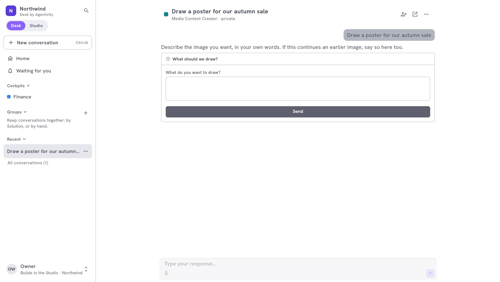

<!-- GENERATED from agentivity_docs/en/desk/ask-and-follow-in-the-desk.md. Do not edit here: edit the source and publish again. -->

This page is for the people who use the Desk. It follows one request, from the question to the result.

## What you need

- An account on the workspace, on a Desk seat or on a Studio seat.
- At least one Solution published to the Desk that you may see. If there is none, the home says so: ask the person who builds your teams.

## The home

| Part | What it is |
|---|---|
| **The field to ask** | Over it, the welcome line of your company. Describe what you need, or type **@** to choose whom to ask. You can also dictate, and add an image when you ask an agent. |
| **Suggestions** | Requests you can start in one click. |
| **Waiting for you** | The questions your Solutions ask you, and the decisions they wait for. |
| **Time saved** | The time your teams saved you this week and this year, the last 14 days, and where it came from. It stays empty until they have done some work for you. |

## Ask for work

1. In the field of the home, describe what you need. Type **@** to choose the Solution to ask. A button under the field names the Solution that will be asked: select it to open **Who do you ask?**, a window where you search the Solutions by name or by what they do.
2. Send it. A conversation opens and starts with your first message.
3. Follow the work as it goes. The Solution asks what it needs along the way: a question, a choice, an approval.
4. Reply in the box under the conversation. It says who you are talking to: the agent, the team or the workflow.

You can leave the conversation. The work goes on. When a Solution needs you, the conversation moves to **Waiting for you**.

### Start from a cockpit

A cockpit is the starting page of a department. It offers its own field to ask, its suggestions and its **Launch button**, which starts a Solution with the request already written. See [Build a cockpit](/docs/desk/build-a-cockpit/).

## The result

What the team produced stays beside the conversation, in the result panel, saved with it. Depending on the work, it shows:

- a **Summary**;
- **Figures**: numbers and charts;
- **Images**;
- **Details**, and a file to **Download**.

Select **Hide the result** to read the conversation alone, **Show the result** to bring it back.

<!-- IMAGE images/desk-result.jpg: The result panel of a conversation with a summary, figures and a chart. -->

## Start over

**New conversation** opens an empty conversation. Each request is a conversation of its own, so one subject stays in one place.

## For builders

In a conversation, **Open in the Studio** takes a builder to the execution, where they see every step. The Desk itself never shows the nodes.

## How to know it worked

The conversation opens, shows the work as it goes, and appears in **Recent**. The result shows beside it when the work is done.

## If it does not work

- **The home says no Solution is published for you.** Ask an administrator to [publish one](/docs/desk/publish-solutions-to-the-desk/), and to check that you may see it.
- **A Solution is missing.** It is not published to the Desk, or your rights do not let you see it.
- **The conversation says the Solution is not published to the Desk for you.** Its publication changed. Ask an administrator.

## Next step

[Answer what waits for you](/docs/desk/answer-what-waits-for-you/).
