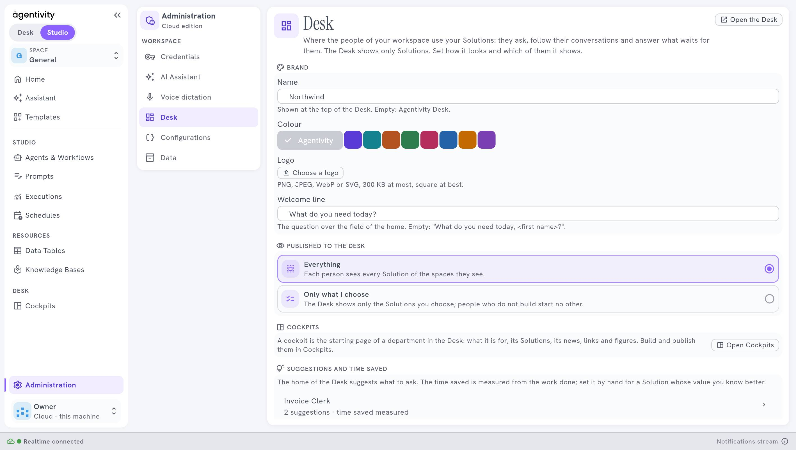

<!-- GENERATED from agentivity_docs/en/desk/brand-your-desk.md. Do not edit here: edit the source and publish again. -->

Your colleagues use the Desk every day. Make it look like your company, not like a tool.

## What you need

A role with the right to change the settings.

## Set the brand

Open **Administration** › **Desk**. At the top:

| Setting | What it does |
|---|---|
| **Name** | Shown at the top of the Desk. Empty: **Agentivity Desk**. |
| **Colour** | The colour of the Desk. Choose **Agentivity**, or one colour of the palette. |
| **Logo** | PNG, JPEG, WebP or SVG, 300 KB at most, square at best. Select **Choose a logo**, then **Change** to replace it. |
| **Welcome line** | The question over the field of the home. For example `What do you need today?`. Empty: "What do you need today, *first name*?". |

Select **Save**. The Desk shows the change at its next reading, within half a minute.

## How to know it worked

Open the Desk: the name and the logo are at the top, the colour on the buttons, and your welcome line over the field.

## If it does not work

- **The logo is refused.** It is larger than 300 KB. Make it smaller, or use an SVG.
- **The brand does not change.** Wait half a minute, then reload the Desk.

## Next step

[Seats and rights of the Desk](/docs/desk/seats-and-rights-of-the-desk/).
