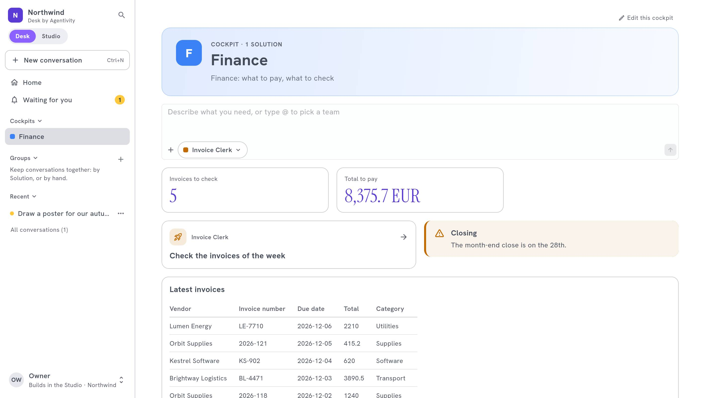
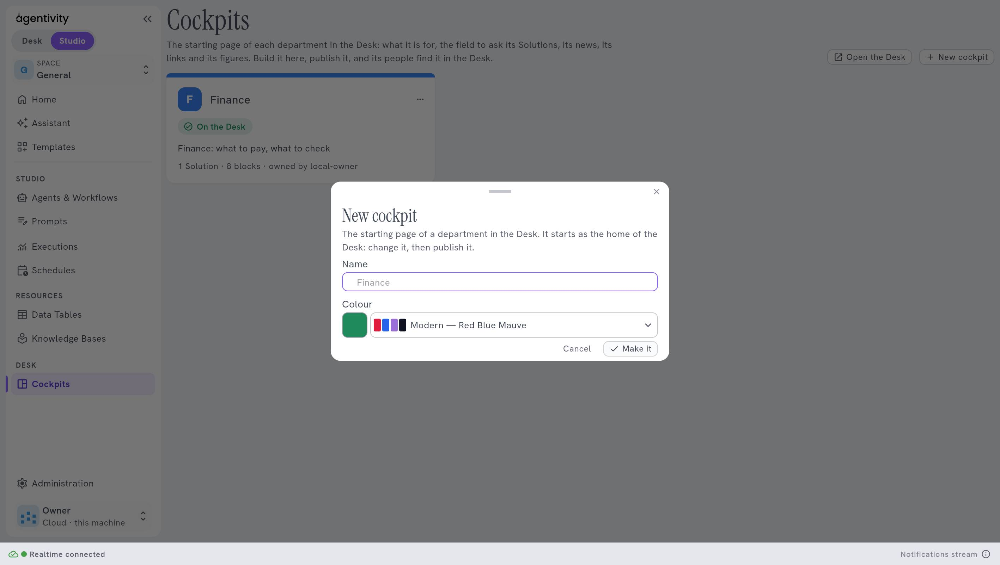
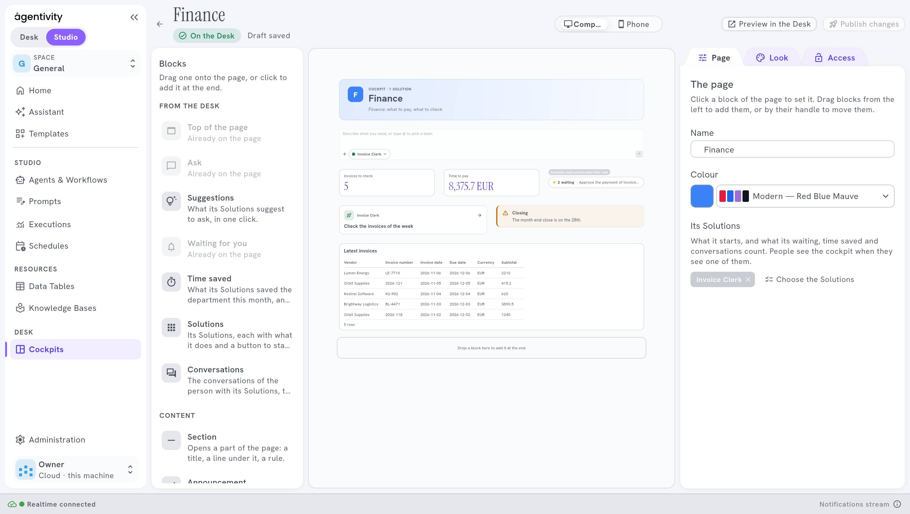

<!-- GENERATED from agentivity_docs/en/desk/build-a-cockpit.md. Do not edit here: edit the source and publish again. -->

A **cockpit** is the starting page of a department in [Desk by Agentivity](/docs/desk/agentivity-desk/): Finance, Sales, Support. It says what the department is for, lets people ask its Solutions, shows what waits for them, and can show figures from your Data Tables. You build it in the Studio, in a designer, and publish it when it is ready.

## Why a cockpit

Without a cockpit, everyone starts from the same home and must know what to ask. With one, a department starts its day on a page made for it: its Solutions, its news, its links and its figures. The Finance team does not look for the Sales agents, and the Sales team does not see the invoices.

## What you need

- A workspace with the Desk. See [Plans and their limits](/docs/hosted/plans-and-limits/).
- The Solutions of the department, [published to the Desk](/docs/desk/publish-solutions-to-the-desk/).
- One of these:
  - a role with the right "Make the cockpits of the Desk, change and publish any of them, choose their owners, order and delete them";
  - or being an **owner** of the cockpit.

## Who does what

| Who | What they can do |
|---|---|
| A person with the right to make the cockpits | Creates cockpits, puts them in order, deletes them, and chooses their owners. Changes and publishes any cockpit. |
| An **owner** of a cockpit | Changes and publishes that cockpit. |

The cockpits are built in the Studio only. **Administration** › **Desk** keeps the brand of the Desk, what is published to it and the suggestions. Its **Cockpits** part only has a button, **Open Cockpits**, that takes you here.

A workspace holds up to 30 cockpits.

## Create a cockpit

1. In the Studio, in the side bar, under **Desk**, select **Cockpits**.
2. Select **New cockpit**.
3. Give it a **Name**, for example `Finance`, and a **Colour**.
4. Select **Make it**. The designer opens on the new cockpit.

A new cockpit starts as the home of the Desk. Change it, then publish it. Until then it says **Not published**: nobody sees it in the Desk.

In the list, the menu of a cockpit offers **Open the designer** (to come back to it later), **See it in the Desk**, **Move up**, **Move down**, **Take it off the Desk** and **Delete**. **Move up** and **Move down** set the order of the cockpits in the side bar of the Desk.

## The designer

The designer has three parts:

- **On the left, Blocks.** Drag one onto the page, or click it to add it at the end. See [The blocks of a cockpit](/docs/desk/cockpit-blocks/).
- **In the middle, the page**, as the Desk draws it. Switch between **Computer** and **Phone** to see both.
- **On the right, the settings**, in tabs:
  - with no block selected, the page: **Page** (its name, its colour, its Solutions), **Look** (its style) and **Access** (its owners and its publication);
  - with a block selected, that block: **Content** and **Look**.

On a block, the buttons set its width, **Duplicate** it, or **Remove from the page**. Drag a block to move it. A cockpit holds up to 40 blocks. See [Lay out and style a cockpit](/docs/desk/lay-out-and-style-a-cockpit/).

### Choose its Solutions

In the tab **Page**, choose the Solutions of the department: up to 100. They decide who sees the cockpit, and what its blocks offer.

## Draft and publish

Your changes are a draft. The designer saves it by itself and says **Draft saved**.

| Button | What it does |
|---|---|
| **Preview in the Desk** | Shows the draft in the Desk, as people will see it. Nobody else sees it. |
| **Publish** | Puts the draft in the Desk. Once published, the button says **Publish changes** when you change something. |
| **Discard changes** | Goes back to what is published. |

To take a cockpit out of the Desk without deleting it, select **Take it off the Desk**, in the tab **Access** or in its menu in the list. **Delete the cockpit** removes its page and its blocks. Its Solutions and their conversations stay. This cannot be undone.

## Owners

1. Open the cockpit in the designer, with no block selected.
2. Open the tab **Access**.
3. Under **Add an owner**, type their e-mail and select **Add**.

An owner changes and publishes this cockpit. A cockpit has up to 20 owners. Only a person with the right to make the cockpits chooses the owners. This lets the head of a department keep its page up to date without any other right.

## The space of a cockpit

Each cockpit belongs to a space, **General** by default. In the tab **Access**, the section **Space** has a list, **Space**, to change it. Everyone in this space sees the cockpit in the Desk. People who manage cockpits in this space can change it.

## Who sees a cockpit

- A person sees a cockpit when they see at least one of its Solutions published to the Desk.
- A cockpit with no Solution is seen by everyone on the Desk.

## How to know it worked

The tab **Access** says **On the Desk**, with the date it was published. In the Desk, the cockpit shows in the side bar under **Cockpits**, and its page looks as it did in the designer.

## If it does not work

- **Someone does not see the cockpit.** They do not see any of its Solutions. Check that the Solutions are published to the Desk and that their rights let them see one.
- **Your changes do not show in the Desk.** They are still a draft. Select **Publish changes**.
- **The message says "Only people who manage cockpits can do this."** Your role does not have the right to make the cockpits, and you are not an owner of this cockpit.
- **You cannot add a block.** The cockpit already holds 40.

## Next step

[The blocks of a cockpit](/docs/desk/cockpit-blocks/).
