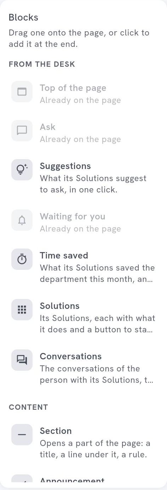

<!-- GENERATED from agentivity_docs/en/desk/cockpit-blocks.md. Do not edit here: edit the source and publish again. -->

A cockpit is a page made of blocks. This page tells what each block does and when to use it.

## What you need

A cockpit open in the designer. See [Build a cockpit](/docs/desk/build-a-cockpit/).

The list on the left has two groups: **From the Desk** (the blocks that come from the Desk itself) and **Content** (the ones you write). A block that can be on the page only once, like **Top of the page**, **Ask** or **Waiting for you**, says **Already on the page** when it is there.

## Start a request

| Block | What it shows | Use it for |
|---|---|---|
| **Ask** | The field to ask one of the Solutions of the cockpit, by writing, dictating or adding an image. | The main entrance of the department. |
| **Suggestions** | Requests to start in one click. | Teaching what to ask. |
| **Launch button** | A button that starts one Solution, with the request already written. You choose its icon, and its size: **Small**, **Normal** or **Large**. | The frequent, always-the-same request: "Start the month-end close". |
| **Quick actions** | Several buttons in one block, each starting a Solution with the request already written. A button whose Solution a person cannot see is not drawn for them. | What the department does every day. |
| **Solutions** | **All of its Solutions**, or **Some** you choose. | Showing what the department can do. |

## Follow the work

| Block | What it shows | Use it for |
|---|---|---|
| **Waiting for you** | What waits for the answer of the person in this cockpit. It shows nothing when nothing waits. | The reason to come back every morning. |
| **Conversations** | The conversations of the person with its Solutions. | Picking up where they left off. |
| **Time saved** | What its Solutions saved the department this month, and the part of the person. | Showing the value. |

## Show figures

| Block | What it shows | Use it for |
|---|---|---|
| **Indicator** | One figure from a Data Table. | "Invoices to approve: 12". |
| **Chart** | Bars, a line or the parts of a whole, from a Data Table. | "Tickets by category", "Sales by month". |
| **Table** | The rows of a Data Table, with the columns you choose. | The last orders, the last tickets. |

An **Indicator**, a **Chart** or a **Table** shows its data to everyone who sees the cockpit, even people without the right to read Data Tables. Choose what you show with care. To add a Data Table to a cockpit, you need the right to read the Data Tables. The window **Which Data Table?** says it. The database does the counting, so a table of any size is drawn quickly.

### Which rows, and which stretch of time

The three blocks have the same two ways to choose their rows:

- **Conditions**: up to six, each a column, a way of testing it and a value. All of them must be met.
- **And the rows this keeps**: for what the conditions cannot say. Write an expression such as `status = 'new' or hours > 8`. It can use **or**, **not**, brackets, the four operations, comparisons and a few functions. What you write is checked while you write it, and refused when it cannot be read.

**Over which stretch of time** keeps the rows of a period counted back from today: **Today**, **The last 7 days**, **The last 30 days**, **The last 90 days**, **The last 12 months** or **This year so far**. Choose the column of dates it counts on, a column that holds a date written `2026-11-18`. The block says the same thing every morning, with nothing to rewrite. What "today" is and where a week starts is set once for everyone, in **Settings** › **Place and time**.

### Indicator

- **The figure**: **How many rows**, the total, the average, the least or the most of a column, the median (**p50**), or **Nine in ten under (p90)** and the other percentiles. **Written as an expression** is for what none of these says, such as `sum(hours) / count()`.
- **Unit**, for example EUR.
- **What it aims at**: a target. The figure is then drawn with the share reached, in a ring.
- **Which way it went, over the dates in**: a small line under the figure, with **One point per** day, week, month, quarter or year.
- **Say how it moved**, once a stretch of time is chosen: the same figure over the stretch just before, and the share it rose or fell by. **Which way is the good way** says whether a rise is good (more sales) or bad (more tickets waiting), and the movement takes that colour.
- **How big** (**Small**, **Normal**, **Large**) and **In a card** or **Bare**. A small figure at a quarter of the width puts four of them on one row.
- **Its colour**: the colour says what the figure means before its label is read, like red for the urgent ones and green for the done ones.

### Chart

- **How it is drawn**: **Bars**, **Ranking** (bars that run sideways), **Line**, **Area** or **Parts** (the parts of a whole).
- **One bar per** a column, **Over time** (one bar per day, week, month, quarter or year, over a column of dates, drawn oldest first) or **Written** (an expression that gives one value per row).
- **Its height**: the same choices as for an indicator, including percentiles.
- **How many at most**: 4, 6, 8, 12 or 24 groups.
- **Cut into series by**: a second column, to draw one series for each of its values, **Side by side** or **Stacked**. The largest series come first, six at most, and the rest is added into **Other**. A percentile is not cut, and **Parts** has no series.
- Each bar shows its value under the pointer.

### Table

- **Table** or **List**. A list reads downwards: the first column names the row, the second says what it is. It is better on a narrow block.
- **Columns**: up to eight. If you choose none, the first six.
- **How many rows**: 5, 10, 20 or 50, **Sorted by** a column, **Latest first** or **Oldest first**. In the Desk, a person can also tap a column head to sort by it, and tap again to reverse.
- **A search box in the block**: the person looks for words in the columns shown.
- **Tabs**: the same rows read several ways, such as what is mine, what is late, what is waiting. Each tab keeps the rows its own condition allows, on top of the conditions of the block.
- **Column shown as a badge**: a status, a level or a priority is drawn as a coloured badge, urgent in red and resolved in green.

## Say things

| Block | What it shows | Use it for |
|---|---|---|
| **Top of the page** | The name of the department and what it is for, with the logo of your company. It is a **Card**, a **Bar** or **Plain** words. | The first block of a page. |
| **People** | Who to ask when no Solution can help, each with a word on what they are the one to ask about. You name them by e-mail. Only their name and e-mail are shown. | "For payroll, ask Anna". |
| **Announcement** | A message, with a colour of your choice, an icon from the catalogue, and a date when it stops showing. **Always** keeps it. | A closing date, a new tool, an incident. |
| **Text** | Paragraphs. A line that starts with `- ` is a list. | A rule of the department, a reminder. |
| **Section** | A title, a subtitle and a line, to open a part of the page. | Cutting a long page. |

## Point elsewhere

| Block | What it shows | Use it for |
|---|---|---|
| **Links** | Links to other places. An address starts with `https://`, `http://` or `mailto:`. | The intranet, the policy, the support address. |
| **Card** | An image, a title, a text and a link to another place: the intranet, a tool, a site. The image can be on top, on the left or **Behind it all**, under a veil. The whole card is then the link. | One important destination, with a picture. |

## Add, move and change a block

- **Add.** Drag a block from the left onto the page, or click it to add it at the end.
- **Move.** Drag it.
- **Width.** Use the buttons of the block. See [Lay out and style a cockpit](/docs/desk/lay-out-and-style-a-cockpit/).
- **Duplicate** copies it, with its settings. **Remove from the page** removes it.
- **Content** is what it says. **Look** is how it looks: its width, its card, its colour.
- **Icons.** Wherever you choose an icon, a button opens the whole catalogue, with a search. A button that chooses none keeps the mark of its Solution.

## How to know it worked

In **Preview in the Desk**, the block shows with its content. Blocks that depend on the person (**Waiting for you**, **Conversations**, **Time saved**) show their own data.

## If it does not work

- **A block shows nothing.** **Waiting for you** shows nothing when nothing waits.

## Next step

[Lay out and style a cockpit](/docs/desk/lay-out-and-style-a-cockpit/).
