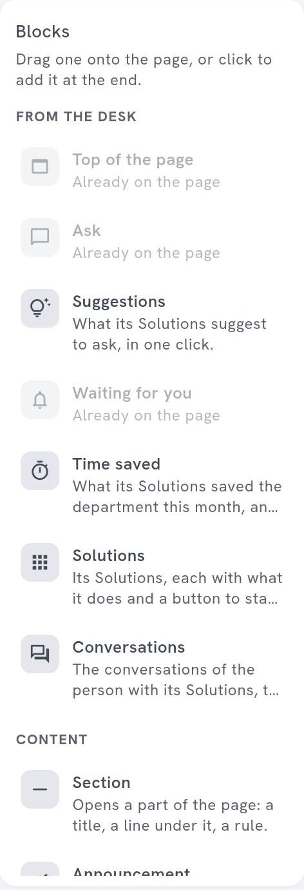

<!-- GENERATED from agentivity_docs/en/desk/cockpit-blocks.md. Do not edit here: edit the source and publish again. -->

A cockpit is a page made of blocks. This page tells what each block does and when to use it.

## What you need

A cockpit open in the designer. See [Build a cockpit](/docs/desk/build-a-cockpit/).

The list on the left has two groups: **From the Desk** (the blocks that come from the Desk itself) and **Content** (the ones you write). A block that can be on the page only once, like **Top of the page**, **Ask** or **Waiting for you**, says **Already on the page** when it is there.

## Start a request

| Block | What it shows | Use it for |
|---|---|---|
| **Ask** | The field to ask one of the Solutions of the cockpit, by writing, dictating or adding an image. | The main entrance of the department. |
| **Suggestions** | Requests to start in one click. | Teaching what to ask. |
| **Launch button** | A button that starts one Solution, with the request already written. | The frequent, always-the-same request: "Start the month-end close". |
| **Solutions** | **All of its Solutions**, or **Some** you choose. | Showing what the department can do. |

## Follow the work

| Block | What it shows | Use it for |
|---|---|---|
| **Waiting for you** | What waits for the answer of the person in this cockpit. It shows nothing when nothing waits. | The reason to come back every morning. |
| **Conversations** | The conversations of the person with its Solutions. | Picking up where they left off. |
| **Time saved** | What its Solutions saved the department this month, and the part of the person. | Showing the value. |

## Show figures

| Block | What it shows | Use it for |
|---|---|---|
| **Indicator** | One figure from a Data Table: how many rows, or the total, the average, the least or the most of a column. **Only the rows where** filters the rows. | "Invoices to approve: 12". |
| **Table** | The last rows of a Data Table, **Latest first** or **Oldest first**. | The last orders, the last tickets. |

An **Indicator** or a **Table** shows its data to everyone who sees the cockpit, even people without the right to read Data Tables. Choose what you show with care. To add a Data Table to a cockpit, you need the right to read the Data Tables. The window **Which Data Table?** says it.

## Say things

| Block | What it shows | Use it for |
|---|---|---|
| **Top of the page** | The name of the department and what it is for, in its colour. | The first block of a page. |
| **Announcement** | A message, with a tone (**News**, **Good news**, **Warning**) and a date when it stops showing. **Always** keeps it. | A closing date, a new tool, an incident. |
| **Text** | Paragraphs. A line that starts with `- ` is a list. | A rule of the department, a reminder. |
| **Section** | A title, a subtitle and a line, to open a part of the page. | Cutting a long page. |

## Point elsewhere

| Block | What it shows | Use it for |
|---|---|---|
| **Links** | Links to other places. An address starts with `https://`, `http://` or `mailto:`. | The intranet, the policy, the support address. |
| **Card** | An image, a title, a text and a link to another place: the intranet, a tool, a site. | One important destination, with a picture. |

## Add, move and change a block

- **Add.** Drag a block from the left onto the page, or click it to add it at the end.
- **Move.** Drag it.
- **Width.** Use the buttons of the block. See [Lay out and style a cockpit](/docs/desk/lay-out-and-style-a-cockpit/).
- **Duplicate** copies it, with its settings. **Remove from the page** removes it.
- **Content** is what it says. **Look** is how it looks.

## How to know it worked

In **Preview in the Desk**, the block shows with its content. Blocks that depend on the person (**Waiting for you**, **Conversations**, **Time saved**) show their own data.

## If it does not work

- **A block shows nothing.** **Waiting for you** shows nothing when nothing waits.

## Next step

[Lay out and style a cockpit](/docs/desk/lay-out-and-style-a-cockpit/).
