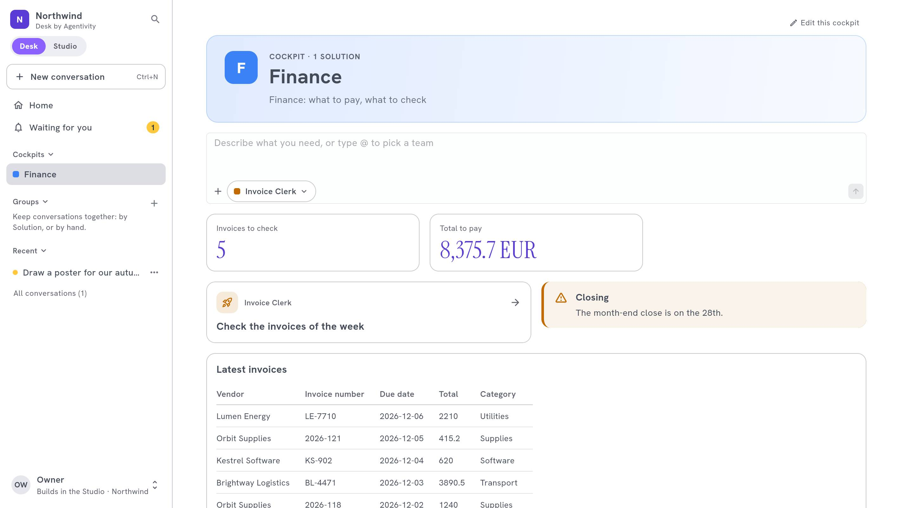

<!-- GENERATED from agentivity_docs/en/desk/cockpit-examples.md. Do not edit here: edit the source and publish again. -->

A cockpit is not a dashboard to look at. It is a page to start from. Here are three, built with the [blocks](/docs/desk/cockpit-blocks/) of the designer. Change the names to yours.

## What you need

- The Solutions of the department, [published to the Desk](/docs/desk/publish-solutions-to-the-desk/).
- For figures, a Data Table filled by your workflows, and the right to read the Data Tables.

## Finance: the invoices

**Solutions:** the agent that reads invoices, the workflow that checks them against orders, the approval of payments.

| Block | Width | Setting |
|---|---|---|
| **Top of the page** | Full width | "Finance: what to pay, what to check" |
| **Ask** | Full width | |
| **Indicator** | A third | Invoices to approve: rows of the table `Invoices` **Only the rows where** status is `to approve` |
| **Indicator** | A third | Total of the column `Amount` of those rows |
| **Waiting for you** | A third | |
| **Launch button** | Half | "Check today's invoices" |
| **Announcement** | Half | **Warning**: "Closing on the 28th" with a date when it stops |
| **Table** | Full width | The last rows of `Invoices`, **Latest first** |

Why it works: the person sees what waits, starts the daily work in one click, and sees the figures that matter.

## Sales: the follow-up

**Solutions:** the agent that writes follow-up e-mails, the team that prepares a visit.

| Block | Width | Setting |
|---|---|---|
| **Top of the page** | Full width | "Sales: today's follow-ups" |
| **Ask** | Two thirds | |
| **Suggestions** | A third | "Write a follow-up to the client of yesterday" |
| **Indicator** | A third | Open opportunities |
| **Time saved** | A third | |
| **Card** | Half | The CRM, with its link |
| **Links** | Half | The price policy, the contract model |

## Support: the queue

**Solutions:** the agent that drafts replies, the workflow that sorts tickets.

| Block | Width | Setting |
|---|---|---|
| **Top of the page** | Full width | "Support: answer faster" |
| **Waiting for you** | Half | Replies to approve |
| **Conversations** | Half | The conversations in progress |
| **Indicator** | A third | Tickets of the day |
| **Announcement** | Two thirds | **News**: the incident of the morning |
| **Text** | Full width | The tone of a reply: three short rules |

## How to build yours

1. List what the department does every day: those are its Solutions.
2. Put first what people do first: the **Ask** and the **Launch button**.
3. Add what waits, then the figures, then the news.
4. Preview on a phone, remove what is not needed, and [publish](/docs/desk/build-a-cockpit/).

## How to know it worked

A person of the department opens the Desk and starts their day from the cockpit, without asking you where things are.

## Next step

[Desk by Agentivity](/docs/desk/agentivity-desk/): the map of the section.
