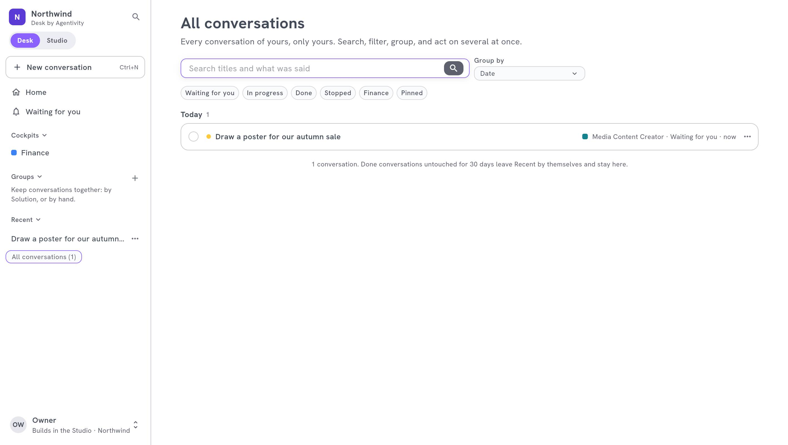
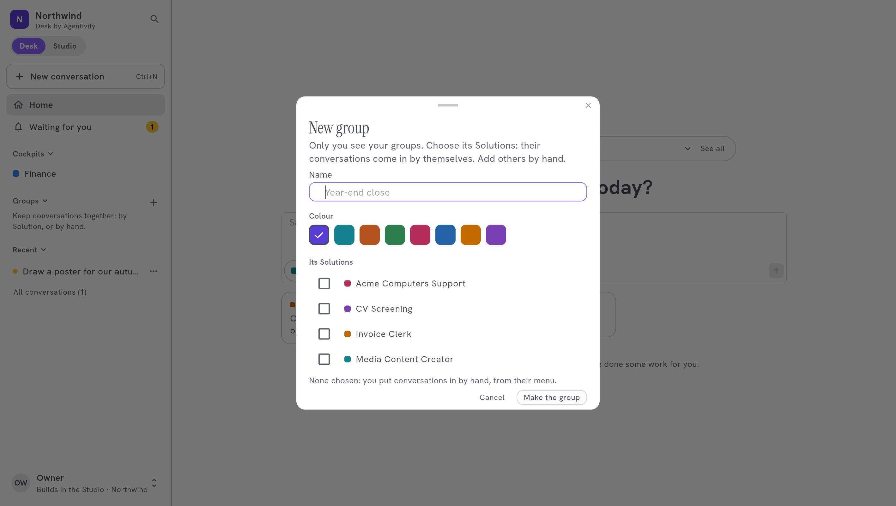

<!-- GENERATED from agentivity_docs/en/desk/find-and-manage-conversations.md. Do not edit here: edit the source and publish again. -->

Every request you make is a conversation. After a few weeks you have many. The Desk helps you find them, and put them in order.

## The side bar

| Item | What it shows |
|---|---|
| **Home** | The field to ask, and what is above. |
| **Waiting for you** | Every conversation that waits for your answer. See [Answer what waits for you](/docs/desk/answer-what-waits-for-you/). |
| **Cockpits** | The starting page of each department. |
| **Groups** | Your own groups of conversations. |
| **Recent** | Your latest conversations. |
| **All conversations** | Every conversation of yours, with its search. |
| **Archived (n)** | The conversations you put away. It shows as soon as you archived one. |

Select the title **Cockpits**, **Groups** or **Recent** to fold it, and again to open it. Your browser remembers how you left them. A done conversation untouched for 30 days leaves **Recent** by itself and stays in **All conversations**.

## All conversations

**All conversations** lists every conversation of yours, and only yours.

- **Search.** It looks in the titles and in what was said.
- **Filters.** **Waiting for you**, **In progress**, **Done**, **Stopped**, one for each cockpit, and **Pinned**.
- **Group by.** Sorts them by **Solution**, **Cockpit**, **Group**, **Status** or **Date**.
- **Several at once.** Tick several conversations to act on all of them.

## Work with a conversation

Open the menu of a conversation (**More**):

| Action | What it does |
|---|---|
| **Rename** | Gives it a title of your own, 200 characters at most. Empty gives it back its first words. |
| **Pin** | Keeps it at the top. **Unpin** puts it back. |
| **Put in a group** | Puts it in one of your groups. |
| **Archive** | Moves it to **Archived**. |
| **Stop** | The conversation is still working, or waits for you. Nothing more is done, and nothing waits for you in it any more. |
| **Close** | The work is over. You can still read it, but you cannot write in it any more. |
| **Delete** | Deletes the conversation, what was said and what it produced, after you confirm. This cannot be undone. |

Only the person who started a conversation can delete it. To keep one out of sight without losing it, **Archive** it.

## Archive and restore

**Archived (n)** lists the conversations you put away. **Restore** puts one back in your lists.

An archived conversation no longer counts in **Waiting for you**, in the groups, in the cockpits or in **All conversations**. Opened, it still shows its question if it waits for one.

## Groups

A group is a folder of your own. Nobody else sees it.

1. In the side bar, select **+** beside **Groups**. The window **New group** opens.
2. Give it a name, for example `Year-end close`, and a colour.
3. Choose **Its Solutions**: the conversations of those Solutions come in by themselves. Or choose none, and put conversations in by hand with **Put in a group**.
4. Select **Make the group**.

To change it, open **Edit the group**. **Delete the group** keeps its conversations, in no group.

## Share a conversation

1. In the conversation, select **Share**.
2. Type the e-mail of a colleague of your workspace.
3. Leave **They may reply in it too** off to let them read only. Turn it on to let them reply.
4. Select **Share**.

Under **Shared with**, each colleague shows with **Reads** or **Reads and replies**. **Stop sharing** beside a name ends it. A colleague leaves a shared conversation with **Leave this conversation**.

The titles, pins, archives and groups of a shared conversation are yours: each person keeps their own.

## When a conversation leaves the Desk

A conversation leaves the Desk when its agent, team or workflow is deleted, or is no longer marked as a Solution. It stays in **Executions** in the Studio. Only **Delete** erases it.

## How to know it worked

The conversation shows where you put it: in its group, at the top once pinned, or in **Archived (n)**.

## If it does not work

- **A conversation is missing.** Check **Archived (n)**. If it is not there, its agent, team or workflow was deleted or is no longer a published Solution: find it in **Executions** in the Studio.
- **You cannot delete a conversation.** Someone else started it. Only they can.
- **You cannot write in a conversation.** It is closed, or it was shared with you to read.

## Next step

[Build a cockpit](/docs/desk/build-a-cockpit/) for a department.
