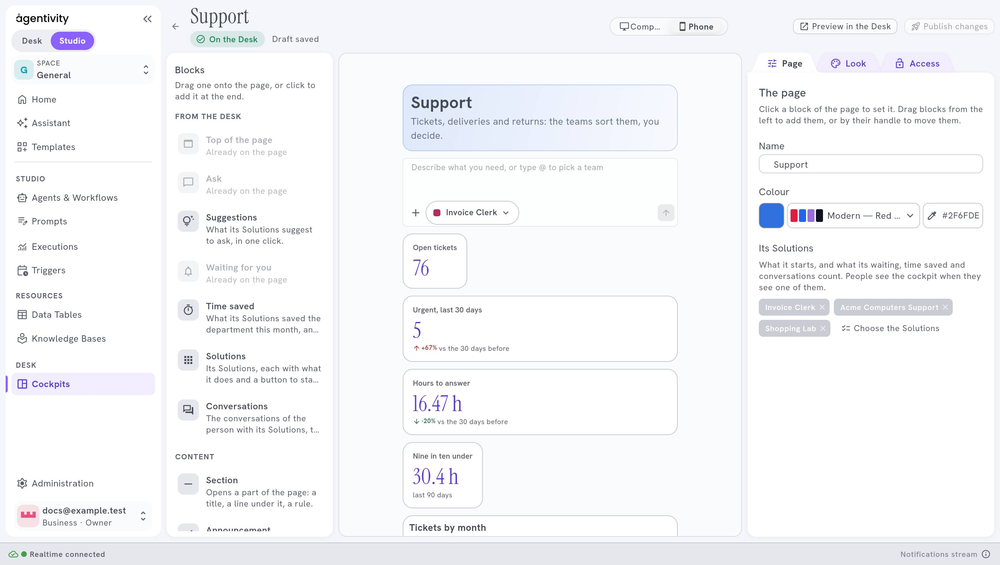
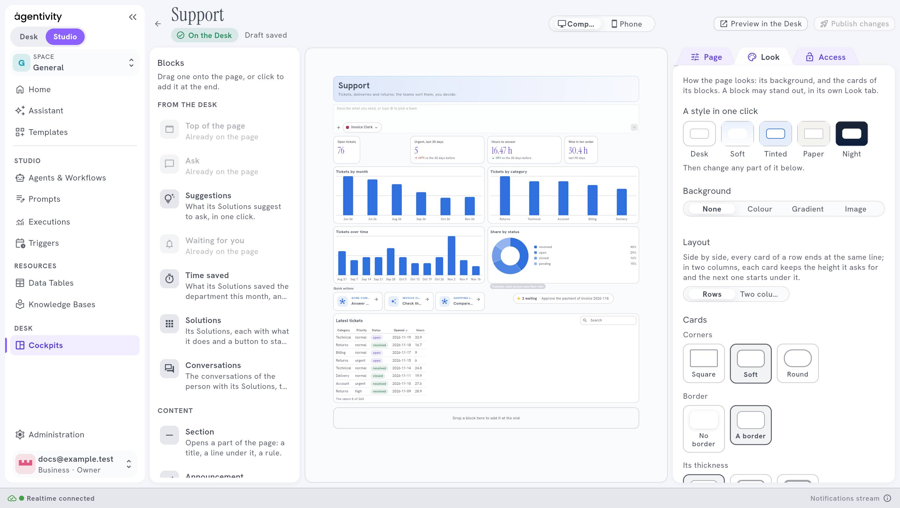

<!-- GENERATED from agentivity_docs/en/desk/lay-out-and-style-a-cockpit.md. Do not edit here: edit the source and publish again. -->

A good cockpit reads in one glance: what to do first, what waits, what is new. The layout and the look do most of that.

## What you need

A cockpit open in the designer. See [Build a cockpit](/docs/desk/build-a-cockpit/).

## The width of a block

The page is cut in forty-eight parts, so a block can be as narrow as a sixteenth of it. In the tab **Look** of a block, **Width** offers the usual ones:

| Width | Of the page |
|---|---|
| **1/16** and **1/8** | Very narrow: a small figure |
| **1/6**, **3/16** and **1/4** | Four figures side by side take a quarter each |
| **1/3** | Three blocks side by side |
| **3/8** and **1/2** | Two blocks side by side |
| **2/3** and **3/4** | A large block and a small one beside it |
| **Full** | All of it |

Or drag the right edge of a block: any width in between is kept. Blocks that fit on a line sit side by side, and the blocks of one row end at the same line. On a phone, every block goes into one column, in the order of the page. A **Section** always takes the whole width.

Switch between **Computer** and **Phone** above the page to see both.

## A layout that works

1. **Top of the page** in full width: who it is for.
2. **Ask** in full width, so people start from it.
3. Below, a line of three or four **Indicator** blocks, a third or a quarter each: the figures to watch.
4. Then **Waiting for you** in half, and **Announcement** in half.
5. At the foot, **Links** or **Card** blocks.

Keep the important blocks high: on a phone they come first. A page with many blocks is a page nobody reads. Cut it with a **Section**.

For examples by department, see [Cockpit ideas by department](/docs/desk/cockpit-examples/).

## The look

In the tab **Look** of the page:

- **A style in one click**: **Desk**, **Soft**, **Tinted**, **Paper** or **Night**. Start with one, then change what you want.
- **The background**: **None**, **Colour**, **Gradient** (**Down**, **Diagonal** or **Across**) or **Image**, with a veil over it so that the page stays readable. **What is written on it** is **Dark** or **Light**.
- **Layout**: **Rows**, or **Two columns** that fill on their own, so that a table beside two small figures does not stretch them to its height.
- **The cards**: their **Corners** (**Square**, **Soft** or **Round**), their **Border** (**No border** or **A border**), its thickness and its colour, their **Fill** (**White**, **Tinted** or **Clear**) and their **Shadow** (**None** or **Soft**).
- **Spacing and size**: **How close together the blocks stand** (**Compact**, **Cosy** or **Roomy**), **How big the page reads** (**Small**, **Normal** or **Large**) and **How wide it runs on a large screen** (**Column**, **Wide** or **Full width**). Compact and small fit far more on one screen. **Its figures** are set in a **Serif** or in the **Same as the text**.

A block can have a look of its own, in its tab **Look**: its colour is chosen like any colour of the Studio, in the palettes, with the picker or with a code. What is written on a card takes the ink of its fill, light on a dark colour and dark on a light one. **What is written on it** lets you force **Dark** or **Light**. Use a look of its own for one block that must stand out, like a warning.

The top of the page takes the logo of your company, in the size and the place you choose: **Left**, **Above** or **Right** of the name.

## Images

Choose an image on your computer, 1 MB at most and 12 per cockpit, in PNG, JPEG, WebP or GIF. Or give its address, starting with `https://`.

## Keep it readable

- One style for the whole page. A block with a look of its own is an exception.
- Check the page in **Preview in the Desk**, on a computer and on a phone.

## How to know it worked

**Preview in the Desk** shows the page as people see it, on a computer and on a phone, before you publish.

## If it does not work

- **An image is refused.** It is larger than 1 MB, or the cockpit already holds 12 images. Make it smaller, or give its address.
- **The phone page looks long.** Every block goes into one column there: remove what is not needed.

## Next step

[Cockpit ideas by department](/docs/desk/cockpit-examples/).
