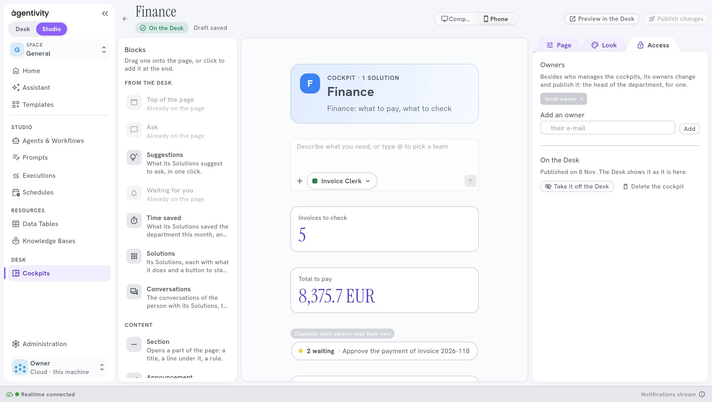
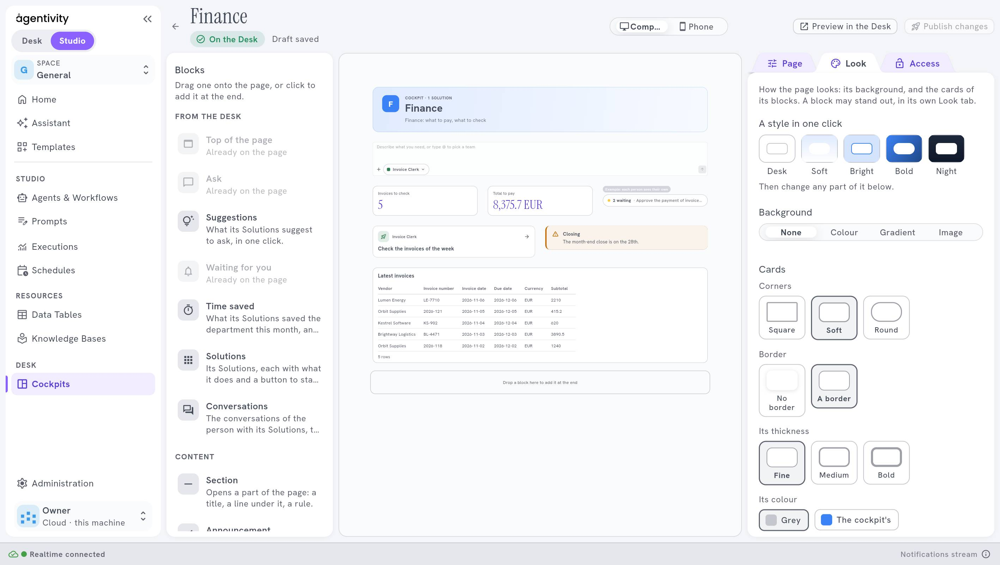

<!-- GENERATED from agentivity_docs/en/desk/lay-out-and-style-a-cockpit.md. Do not edit here: edit the source and publish again. -->

A good cockpit reads in one glance: what to do first, what waits, what is new. The layout and the look do most of that.

## What you need

A cockpit open in the designer. See [Build a cockpit](/docs/desk/build-a-cockpit/).

## The width of a block

The page is cut in twelve. A block takes:

| Width | Of the page |
|---|---|
| **A third** | 4 parts: three blocks side by side |
| **Half** | 6 parts: two blocks side by side |
| **Two thirds** | 8 parts: a large block and a third beside it |
| **Full width** | All of it |

Blocks that fit on a line sit side by side; the next one goes to the next line. On a phone, every block goes into one column, in the order of the page.

Switch between **Computer** and **Phone** above the page to see both.

## A layout that works

1. **Top of the page** in full width: who it is for.
2. **Ask** in full width, so people start from it.
3. Below, a line of three **Indicator** blocks, a third each: the figures to watch.
4. Then **Waiting for you** in half, and **Announcement** in half.
5. At the foot, **Links** or **Card** blocks.

Keep the important blocks high: on a phone they come first. A page with many blocks is a page nobody reads. Cut it with a **Section**.

For examples by department, see [Cockpit ideas by department](/docs/desk/cockpit-examples/).

## The look

In the tab **Look** of the page:

- **A style in one click**: **Desk**, **Soft**, **Bright**, **Bold** or **Night**. Start with one, then change what you want.
- **The background**: **None**, **Colour**, **Gradient** or **Image**.
- **The cards**: their **Corners** (**Square**, **Soft** or **Round**), their **Border** (**No border** or **A border**), its thickness (**Fine**, **Medium** or **Bold**) and its colour (**Grey** or **The cockpit's**).

A block can have a look of its own, in its tab **Look**. Choose a colour in the palettes, or any colour with the picker. Use it for one block that must stand out, like a **Warning**.

## Images

Choose an image on your computer, 1 MB at most and 12 per cockpit, in PNG, JPEG, WebP or GIF. Or give its address, starting with `https://`.

## Keep it readable

- One style for the whole page. A block with a look of its own is an exception.
- Check the page in **Preview in the Desk**, on a computer and on a phone.

## How to know it worked

**Preview in the Desk** shows the page as people see it, on a computer and on a phone, before you publish.

## If it does not work

- **An image is refused.** It is larger than 1 MB, or the cockpit already holds 12 images. Make it smaller, or give its address.
- **The phone page looks long.** Every block goes into one column there: remove what is not needed.

## Next step

[Cockpit ideas by department](/docs/desk/cockpit-examples/).
