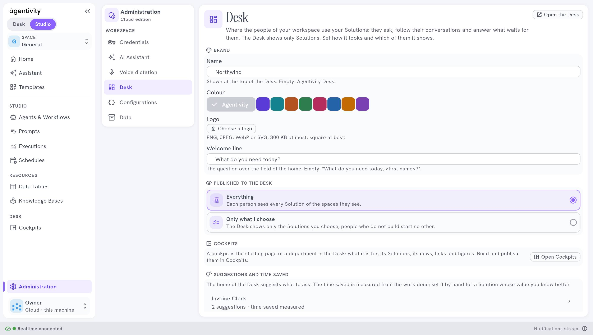

<!-- GENERATED from agentivity_docs/en/desk/publish-solutions-to-the-desk.md. Do not edit here: edit the source and publish again. -->

A Solution shows in the Desk only if you publish it there. You decide in **Administration** › **Desk**, under **Published to the Desk**.

## What you need

- A role with the right to change the settings.
- Solutions: agents, teams or workflows marked as Solutions. See [What a Solution is, and how to mark one](/docs/introduction/what-a-solution-is/).

## Choose what is published

Open **Administration** › **Desk**. Under **Published to the Desk**, choose:

| Choice | What the Desk shows |
|---|---|
| **Everything** | Each person sees every Solution of the spaces they see. |
| **Only what I choose** | Only the Solutions you choose. People who do not build start no other. |

With **Only what I choose**, select **Choose the Solutions**, tick them, then **Save**. Until you choose one, the Desk shows nothing and says so.

The Desk reads the change within half a minute.

A person sees a published Solution only if their rights let them see it. Publishing is not a way to give a right.

## Write the suggestions of the home

The home of the Desk suggests requests to start in one click. Under **Suggestions and time saved**:

1. Select **Suggest for a Solution** and choose the Solution.
2. Write one to several suggestions, each as the person would ask. For example: `Check invoice 2026-118 against its order`.
3. Select **Save**.

A good suggestion is a real request, short, with the kind of detail a person gives. It teaches people what to ask.

## Set the time saved

The Desk shows each person the time your Solutions saved them. It is measured from the work done. For a Solution whose value you know better, set **Minutes saved each time**, between 0 and 1440. Empty means measured.

## Open a Solution in the Desk

From the Studio, the menu of a Solution in **Agents & Workflows** offers **Open in Desk**. It opens the Desk on that Solution, so you try it as your colleagues will.

## How to know it worked

Open the Desk with **Open the Desk** at the top of the pane. The Solutions you chose are in the field to ask, and the suggestions are on the home.

## If it does not work

- **A Solution is missing in the Desk.** It is not published, it is not marked as a Solution, or the person's rights do not let them see it.
- **The Desk says no Solution is published for you.** Nothing is chosen under **Only what I choose**, or none of the chosen Solutions is visible to that person.
- **A Solution you removed still shows.** Wait half a minute and reload.

## Next step

[Give the Desk your brand](/docs/desk/brand-your-desk/).
