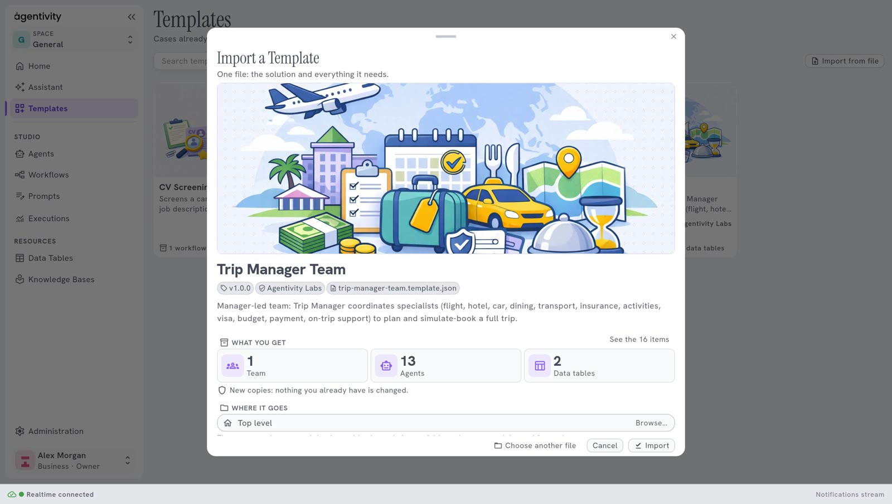
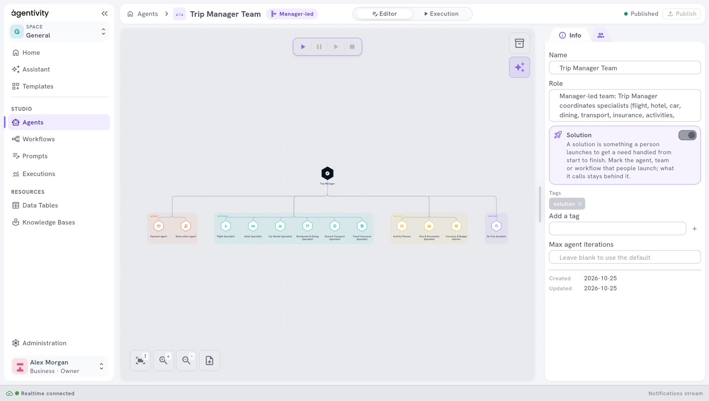

<!-- GENERATED from agentivity_docs/en/getting-started/try-a-ready-made-solution.md. Do not edit here: edit the source and publish again. -->

The fastest way to understand Agentivity is to open a solution that is already built. Agentivity offers showcase solutions as Templates. A Template is one file that holds a solution and everything it needs: its agents, its team or its workflow, and its data tables.

<video controls muted playsinline preload="metadata" src="/docs-media/en/getting-started/images/import-a-showcase.mp4" aria-label="A recording of the Studio: in Templates, the card Trip Manager Team is selected, Import is selected, Import is confirmed in the window, and Open shows the team in its editor"></video>

Recorded from the product, played faster.

## What you need

- Agentivity running, with the Studio open. See [Install Agentivity with Docker](/docs/getting-started/install-community/).
- An internet connection on the machine where Agentivity runs. The Templates are downloaded from the Agentivity catalogue.
- To run the solution, not only to look at it: a model connection. See [Connect an AI model](/docs/guides/connect-a-model/).

## The showcase solutions

| Solution | What it contains | What it does |
|---|---|---|
| **Trip Manager Team** | 1 team, 13 agents, 2 data tables | A manager and its specialists plan a full trip: flight, hotel, car, dining, transport. The bookings are simulated. |
| **Shopping Lab** | 1 team, 9 agents, 5 data tables | Compares a product across stores and writes a recommendation. |
| **Invoice Clerk** | 1 agent, 1 data table | Reads the supplier invoices you upload, files each one and checks its figures. |
| **CV Screening** | 1 workflow | Compares a CV with a job description and proposes what to do with it. |

## Import a solution

From the welcome guide:

1. Open the [welcome guide](/docs/getting-started/welcome-guide/) and go to the step **First team**.
2. On the card of the solution, select **Add it**. The window **Import a Template** opens. It shows the name of the Template, its version and author, what you get, and where it goes.

3. Select **Import**.
4. Wait for the message **Template imported**. It says "is in your library" and counts what was created, for example "16 new items, ready to use": 1 team, 13 agents and 2 data tables.
5. Select **Open Trip Manager Team**, the button of the message, to open it in its editor. In the guide there is only **Close**: the guide goes on.

The import always creates new copies. Nothing you already have is changed.

You can also start from the Studio: in the menu on the left, select **Templates**, or on the home page select the card **From a template**. The **Templates** section opens. Select a Template to see what it contains and how it is built, then select **Import**.

## The model of the imported agents

The agents of a Template were set up with the model connection of their author. That connection does not exist on your server. So the import replaces it:

- **If you have a model connection**, the imported agents use yours. The message **Template imported** says which one, for example "13 model credentials now use" followed by the name of your connection.
- **If you have no model connection yet**, the import still works, but the agents fail at their first execution. Add a connection in **Administration** > **Credentials**. Then go to **Studio** > **Agents**, open the menu of the imported item and select **Use my default model**.

## How to know it worked

The solution opens in its editor and you see it drawn on the canvas.

For **Trip Manager Team**, you see the manager, a larger dark hexagon, at the top and its specialists below, gathered in groups. The imported agents and the team are also in **Studio** > **Agents**.

## If it does not work

- **"The marketplace could not be reached."** The machine where Agentivity runs cannot reach the catalogue of Templates. Check its internet connection.
- **You received a Template as a file.** In the Studio, open **Templates**, select **Import from file** and choose the file.
- **"This file is not a JSON document."** The file you chose is not a Template.

## Read more about each showcase

[The four showcases and what each one teaches](/docs/showcases/the-four-showcases/) says how each one is built and what to look at.

## Next step

[Run a team and read its work](/docs/teams/run-a-team/), with the team you just imported. Or [build your own team with the Assistant](/docs/getting-started/build-your-first-team-with-the-assistant/).
