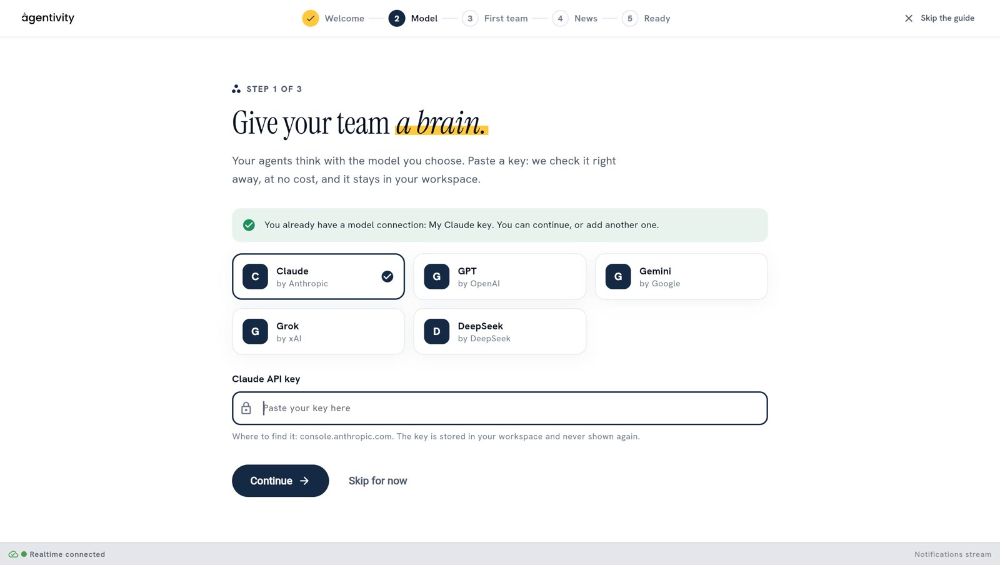
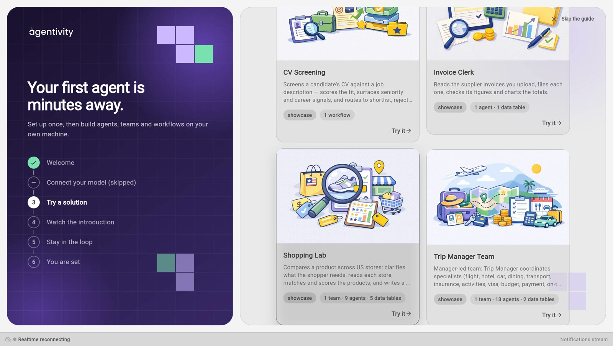

<!-- GENERATED from agentivity_docs/en/getting-started/welcome-guide.md. Do not edit here: edit the source and publish again. -->

The first time you open the Studio, a welcome guide appears. It has four short steps. The list on the left also shows the welcome screen and the last screen, which are not counted as steps. You can skip any step and come back to it later.

## What you need

- Agentivity running, with the Studio open in your browser. If it is not, start with [Install Agentivity with Docker](/docs/getting-started/install-community/).
- For step 1, an API key from an AI model provider. An API key is a secret code that lets Agentivity use your account with that provider.
- For step 2, an internet connection on the machine where Agentivity runs.

## Start the guide

The welcome screen shows what the guide covers: **Connect your model**, **Try a ready-made solution** and **Take the two-minute tour**.

1. Select **Get started**.

If you prefer to look around first, select **Not now** or **Skip the guide**. See [Open the guide again](#open-the-guide-again).

## Step 1: connect your AI model

Your agents need an AI model to think with.

1. Choose your provider: **Claude**, **GPT**, **Gemini**, **Grok** or **DeepSeek**.
2. Paste your API key in the field, then select **Check the key**. Agentivity asks the provider whether the key works. Nothing is saved yet. A key that the provider refuses shows the message of the provider.
3. Choose the model. It is required. The list holds the models that your key can use. If the list is not available, type the ID of the model.
4. Select **Save**. The connection is saved with its key and its model. You can change the model later, in **Credentials**.

The key is stored on your server and is never shown again.

To do this later, select **Skip for now**. The page [Connect an AI model](/docs/guides/connect-a-model/) explains this step in detail.

## Step 2: try a first solution

A solution is something you launch to get a need handled from start to finish. This step offers ready-made solutions, so you can see one work before you build anything. Each card says what the solution contains, for example "1 team · 13 agents · 2 data tables".

1. On the card of the solution you want, select **Try it**. The window **Import a Template** opens. A Template is one file that holds a solution and everything it needs.
2. Select **Import**.
3. When you see **Template imported**, select **Open it** to open the solution in its editor, or **Close** to stay in the guide.

The import creates new copies in your workspace. Nothing you already have is changed.

The ready-made solutions are downloaded from the Agentivity catalogue of Templates, over the internet. If the catalogue cannot be reached, the guide tells you so and lets you continue. You can import Templates later, in the **Templates** section.

For more detail, read [Try a ready-made solution](/docs/getting-started/try-a-ready-made-solution/).

## Step 3: watch the introduction

A short video shows what you can build and where to start. You can skip it.

## Step 4: stay in the loop

You can give your e-mail address to receive news from Agentivity: new Templates and new releases. This step is optional. To subscribe, tick the box to agree, then select **Subscribe**. You receive one confirmation e-mail, and you can unsubscribe at any time.

## How to know it worked

The guide ends on the screen **You are set**. Select **Open my workspace** to go to the Studio.

## Open the guide again

What you skipped is not lost. In the Studio, select **Getting started**, at the bottom of the menu on the left. The guide opens again.

## If it does not work

- **"Paste your API key first."** The key field is empty.
- **The key is refused.** The Studio shows the message of your provider.
- **"The marketplace could not be reached."** The machine where Agentivity runs has no access to the catalogue of Templates. Check its internet connection, or skip the step and import a Template later from a file.

## Next step

[Find your way around the Studio](/docs/studio/find-your-way-in-the-studio/), then [build your first team with the Assistant](/docs/getting-started/build-your-first-team-with-the-assistant/).
