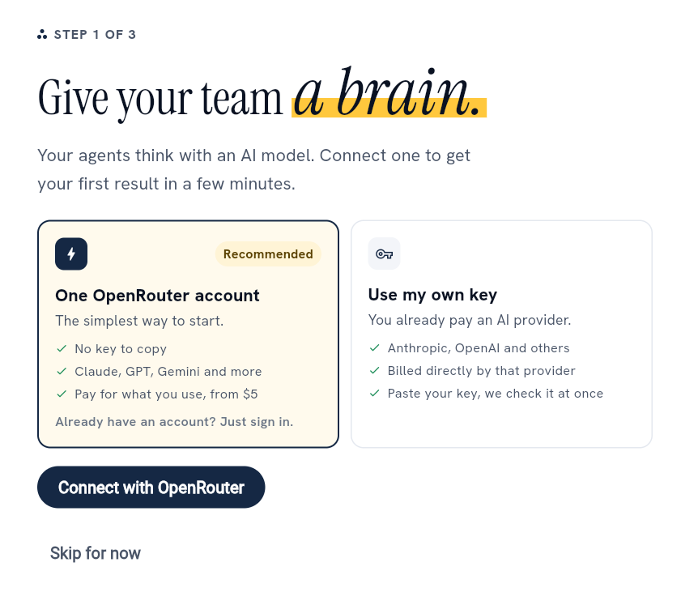
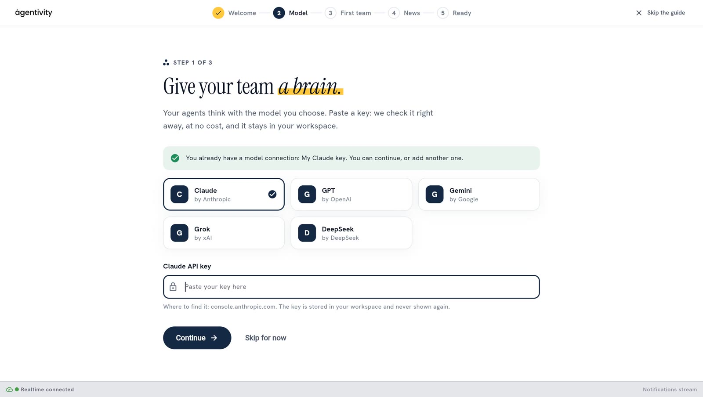

<!-- GENERATED from agentivity_docs/en/getting-started/welcome-guide.md. Do not edit here: edit the source and publish again. -->

The first time you open the Studio, a welcome guide appears. At the top, three stops show where you are: **Welcome**, **Model** and **Ready**. You can skip the guide and come back to it later.

## What you need

- Agentivity running, with the Studio open in your browser. If it is not, start with [Install Agentivity with Docker](/docs/getting-started/install-community/).
- For the step **Model**, an OpenRouter account, which you can create on the way, or an API key from an AI model provider if you prefer to use your own. An API key is a secret code that lets Agentivity use your account with that provider. On a hosted workspace, you may also have an AI credit code.

## Start the guide

<!-- IMAGE images/welcome-guide.jpg: The first screen of the welcome guide, with the three stops at the top, the title "Start with one workflow. Grow to a whole AI company.", the buttons Let's start and Not now, and a navy card that lists the two steps to start. -->

The first screen says "Start with one workflow. Grow to a whole AI company." Pick one job you do by hand, and add agents and teams as the work grows: you stay in charge. A card called **Two steps to start** lists what comes next: **Connect a model**, then **Tell Winston what you want to automate**.

1. Select **Let's start**.

If you prefer to look around first, select **Not now**, or **Skip the guide** at the top right. See [Open the guide again](#open-the-guide-again).

## Step 1: connect a model

Winston and your agents need an AI model to think with. The step is called **One step before you start**, and offers two ways, in two boxes:

- **One OpenRouter account**, marked **Recommended**: no key to copy, models from several providers, and you pay for what you use. If you already have an account, you just sign in.
- **Use my own key**: for someone who already pays an AI provider, such as Anthropic or OpenAI. You paste a key, and Agentivity checks it at once.

### With an OpenRouter account

1. Keep the first box and select **Connect with OpenRouter**. A window opens at OpenRouter: sign up or sign in, then select **Authorize**.
2. A new account has no credit, so the guide then says "One step left: add credit". Select **Add credit**, pay at OpenRouter, and come back. The guide notices the credit by itself, or you can select **I've added credit**.
3. When the guide says "Connected to OpenRouter. You are ready.", select **Continue**.

You can change the model later, in **Administration** > **Credentials**. Everything about this way, including what happens when credit runs out, is in [Connect with OpenRouter](/docs/guides/connect-with-openrouter/).

### With your own key

1. Select **Use my own key**, then choose your provider: **Claude**, **GPT**, **Gemini**, **Grok** or **DeepSeek**. **Back to the choices** goes back to the two boxes.
2. Paste your API key in the field **API key**, then select **Check the key**. Agentivity asks the provider whether the key works, at no cost. Nothing is saved yet. A key that the provider refuses shows the message of the provider.
3. Choose the **Model**. It is required. The list holds the models that your key can use. If the list is not available, type the ID of the model.
4. Select **Save**. The connection is saved with its key and its model, and the guide says "Connected to" your provider. Select **Continue**. You can change the model later, in **Administration** > **Credentials**.

The key is stored in your workspace and is never shown again.

If a model connection already exists, a green line says so ("You already have a model connection") and you can select **Continue**, or add another one.

On a hosted workspace, a third way may be offered: **I have an AI credit code**. Paste the code you were given and select **Use the code**: Agentivity pays for the model calls, up to the credit of the code, and the connection is made at once. The key behind the code stays at Agentivity.

To do this later, select **Skip for now**. If you start a chat or a run with no model connected, the Studio offers the same two choices in a window, so nothing is lost. The page [Connect an AI model](/docs/guides/connect-a-model/) explains the own-key step in detail.

## How to know it worked

The guide ends on the screen **Your workspace is ready.** It asks "Where would you like to start?" and offers two cards: **Tell Winston what you want to automate** (he builds the trigger, the steps, the agents and teams, and who approves) and **Start from a Template** (workflows, agents and teams ready to adapt). Select **Open my workspace** to go to the Studio. If you skipped the model, the screen says to connect one first: Winston and your agents need one to work.

The first time, a short tour of the Studio follows. It shows, one screen at a time, what the Studio is, then workflows, agents, teams, connections, Winston and the Desk with its cockpits. The tour opens again from **Getting started**, in the menu on the left, just above your name.

## Open the guide again

What you skipped is not lost. The tour of the Studio opens again with **Getting started**, in the menu on the left, just above your name. The setup guide itself stays in your account menu, under your name.

## If it does not work

- **The window of OpenRouter did not open.** Your browser blocked the pop-up. Allow pop-ups for this page and select **Try again**.
- **"Paste your API key first."** The key field is empty.
- **"This key was refused by" your provider.** The Studio shows the message of your provider.
- **"Choose the model your agents will use."** Choose a model in the list before you select **Save**.
## Next step

[Find your way around the Studio](/docs/studio/find-your-way-in-the-studio/), then [build your first team with Winston](/docs/getting-started/build-your-first-team-with-the-assistant/).
