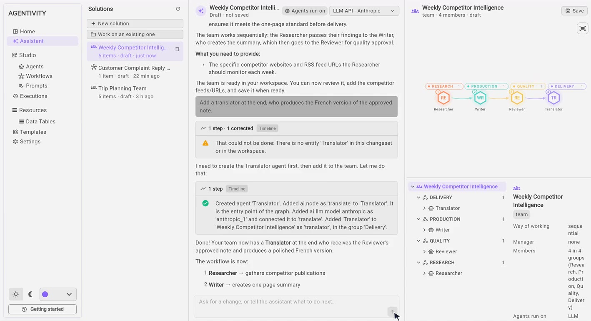

<!-- GENERATED from agentivity_docs/en/guides/formatting-test.md. Do not edit here: edit the source and publish again. -->

This page exists to test the documentation site. It stays a draft, so it is never published. It uses the elements a real page can use.

## Text and lists

A paragraph with **bold**, *italic* and `inline code`. A link to another page of the documentation: [Install Agentivity with Docker](/docs/getting-started/install-community/). A link to a page of the website: [how it works](/how-it-works). A link to another site: [Docker](https://docs.docker.com/get-started/get-docker/).

1. A numbered step.
2. A second step.
3. A third step.

- A bullet.
- Another bullet.

> **Note:** a quote is used for a remark the reader should not miss.

## A table

| Item | What it is |
|---|---|
| Agent | One AI specialist with a role. |
| Team | Several agents working together. |
| Workflow | Steps drawn in advance. |

## Code

```bash
docker run -d --name agentivity -p 5005:5005 -v agentivity-data:/app/_data agentivitylabs/agentivity
```

## An image



## A video

<video controls muted playsinline preload="metadata" src="/docs-media/en/guides/images/assistant-create.mp4" aria-label="A recording of the Assistant building a team of three from one sentence"></video>

## Where to go next

Back to the [documentation home](/docs/).
