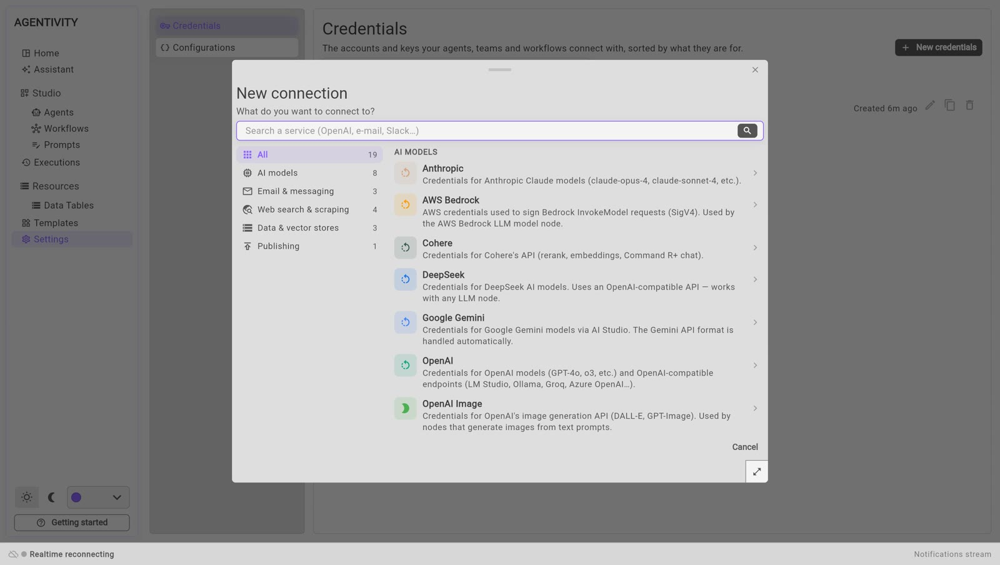
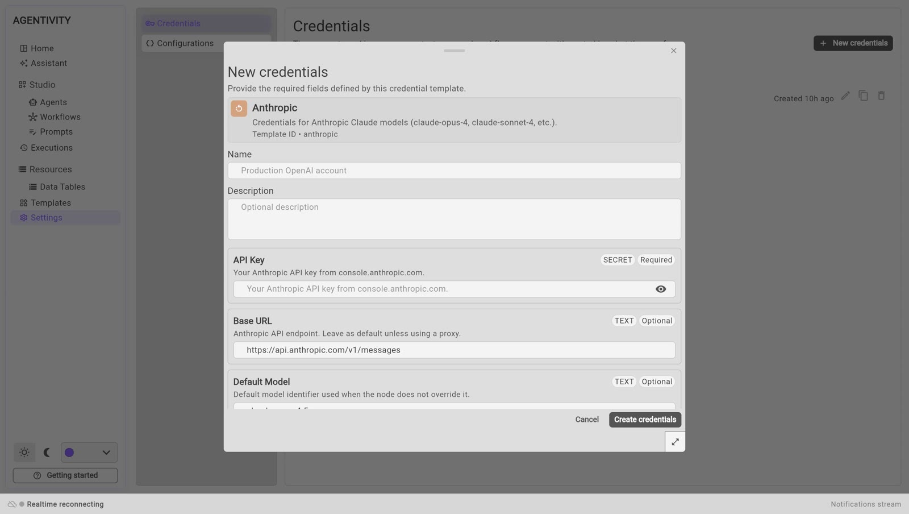

<!-- GENERATED from agentivity_docs/en/guides/manage-credentials.md. Do not edit here: edit the source and publish again. -->

Credentials are the keys and the accounts that your agents, teams and workflows connect with. Agentivity also calls one of them a connection. This page shows how to manage them.

For the first connection to an AI model, the shorter page is [Connect an AI model](/docs/guides/connect-a-model/).

## What you need

- Agentivity running, with the Studio open.
- The key or the account of the service you want to connect.

## Open the screen

In the menu on the left, open **Settings**, then **Credentials**.

The connections are sorted by what they are for. Each line shows the name, the service, the values that are not secret, and when it was created. A secret value is shown as dots.

## Add a connection

1. Select **New credentials**. The window **New connection** asks "What do you want to connect to?"

   

2. Choose a kind on the left, or type the name of the service in the search field.

   | Kind | For example |
   |---|---|
   | **AI models** | Anthropic, OpenAI, Google Gemini, DeepSeek, AWS Bedrock |
   | **Email & messaging** | A mailbox, Slack |
   | **Web search & scraping** | A web search service |
   | **Data & vector stores** | A database for documents |
   | **Publishing** | A website to publish to |

3. Select the service. The window **New credentials** opens.

   

4. Give the connection a **Name** that you will recognise, for example `Claude for reminders`.
5. Fill in the fields. Each one says whether it is **Required** or **Optional**, and whether it is a **SECRET**. The button with an eye shows what you typed in a secret field.
6. Select **Create credentials**.

Leave the optional fields as they are unless you know you need another value.

## Change a connection or replace a key

1. On the line of the connection, select the pencil. The window **Edit credentials** opens.
2. Change what you need. To replace a secret, type the new value in its field. To keep the secret, leave its field as it is.
3. Select **Save changes**.

Everything that uses this connection uses the new values at its next run. You do not have to change your agents.

## Copy a connection

On the line of the connection, select the button with two sheets. Use a copy to keep two settings of the same service, for example two default models.

## Delete a connection

1. On the line of the connection, select the bin.
2. Read the warning: the connection "will be permanently removed and nodes using it may fail."
3. Select **Delete**, or **Cancel** to keep it.

Before you delete a connection, give another one to the agents and steps that use it. See [Choose or change the model of an agent](/docs/agents/choose-the-model/).

## Good to know

- A saved secret is never shown again, in the Studio or elsewhere. If you lost a key, create a new one at your provider and replace it here.
- Agentivity has no login. Anyone who can open the Studio can add, change and delete connections. See [Keep your Agentivity server private](/docs/guides/keep-your-server-private/).
- The credentials are in your backup file. Keep that file safe. See [Update Agentivity and back up your data](/docs/guides/update-and-back-up/).

## Next step

[Share your work as a Template](/docs/guides/share-a-template/).
