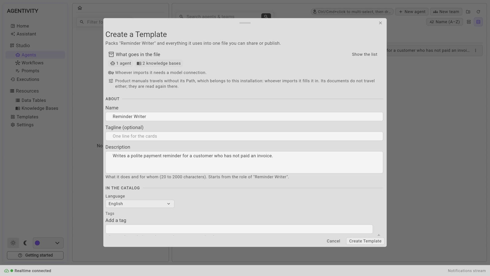
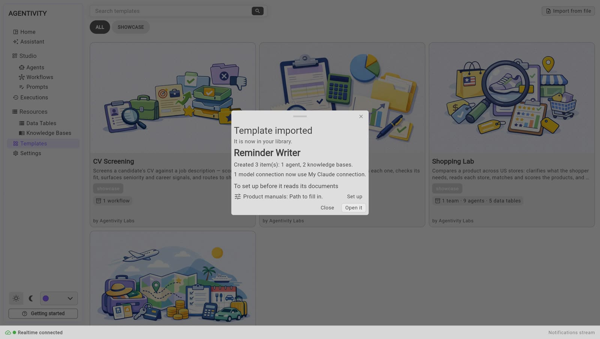

<!-- GENERATED from agentivity_docs/en/guides/share-a-template.md. Do not edit here: edit the source and publish again. -->

A Template is one file that holds a solution and everything it needs: the agent, the team or the workflow, the agents it uses, and its data tables. This page shows how to make a Template of your own work, and how another person imports it. What a solution is, and how it is marked, is in [What a Solution is, and how to mark one](/docs/introduction/what-a-solution-is/).

## What you need

- An agent, a team or a workflow that works, published.

## Create the Template

1. Open **Studio** > **Agents** or **Studio** > **Workflows**.
2. On the line of what you want to share, select the three dots, then **Create Template...** You can also select the box button in its editor.
3. The window **Create a Template** opens.

4. Check **What goes in the file**. **Show the list** shows every element that is packed.
5. Fill in the form.

   | Field | What to write |
   |---|---|
   | **Name** | The name people will see. |
   | **Tagline** | One line for the card. It is optional. |
   | **Description** | What it does and for whom. Between 20 and 2000 characters. |
   | **Language** | The language of the solution. |
   | **Tags** | Words that say who it is for and what it does. |
   | **Author** | Your name, and your website if you want. |
   | **Cover** | A picture for the card. It is optional. |

6. If the solution has data tables, decide whether to **Include the rows of the data tables**. Leave them out if they hold data that should not be shared.
7. Select **Create Template**.

Your browser saves a file whose name ends with `.template.json`.

## The Knowledge Bases in a Template

If the agents of your solution search Knowledge Bases, the Template carries those bases with the rest: the agents, the teams, the workflows and the data tables.

**What travels** is the definition of each base: its kind of source, its settings, its name, what it holds, and how it is kept up to date. The window counts them in **What goes in the file**.

**What never travels:**

- **Its documents.** They are read again, on the machine where the Template is imported.
- **The settings that belong to your server.** The path of a **Files** base, the file of a **SQLite** base, the connection string of a **PostgreSQL** base. The window names each base that travels without a setting, for example "Product manuals travels without its Path, which belongs to this installation: whoever imports it fills it in. Its documents do not travel either; they are read again there."

The other kinds (**Text**, **Web pages**, **Sitemap**, **RSS/Atom feed**, **API**) travel as they are. For **Text**, that means the texts themselves.

## What the file does not contain

- **The documents of your Knowledge Bases**, and the settings that belong to your server. See above.
- **Your credentials.** A Template never carries a key. The window tells you what the person who imports it will need, for example a model connection.
- **The history of your executions.**

Before you share the file, read the instructions of your agents again: anything you wrote there is in the file.

## Give it to someone

Send the file as you would send any document. The other person needs their own Agentivity and their own model connection.

## Import a Template from a file

On the other side:

1. In the Studio, open **Templates**.
2. Select **Import from file**, at the top right, and choose the file.
3. The window **Import a Template** shows what the Template is and what it will create.
4. Select **Import**.

The window counts what it will create, for example "Will create: 1 agent · 2 knowledge bases". The Knowledge Bases go in the folder you chose for the import, like the rest.

A base that has nothing to fill in is read at once. A base that arrived without a setting waits: after the import, the window lists it under **To set up before it reads its documents**, with the settings to fill in and a button **Set up**. **Set up** opens the base on that setting. When you save, the base is read. An installation that cannot read a kind of source refuses the import and names the base.

The import creates new copies: nothing they already have is changed. When you already have a model connection, the window of the end of the import says which one the imported agents now use. If you have none, they need one: see "The model of the imported agents" in [Try a ready-made solution](/docs/getting-started/try-a-ready-made-solution/).

## How to know it worked

- The file is in the downloads folder of your browser.
- After the import, the message **Template imported** lists what was created, and the solution opens in its editor.

## If it does not work

- **"This file is not a JSON document."** The file chosen is not a Template, or it was changed.
- **The imported agents fail at their first execution.** They have no model connection yet.

## Next step

[Organise your work in folders](/docs/guides/organise-with-folders/).
