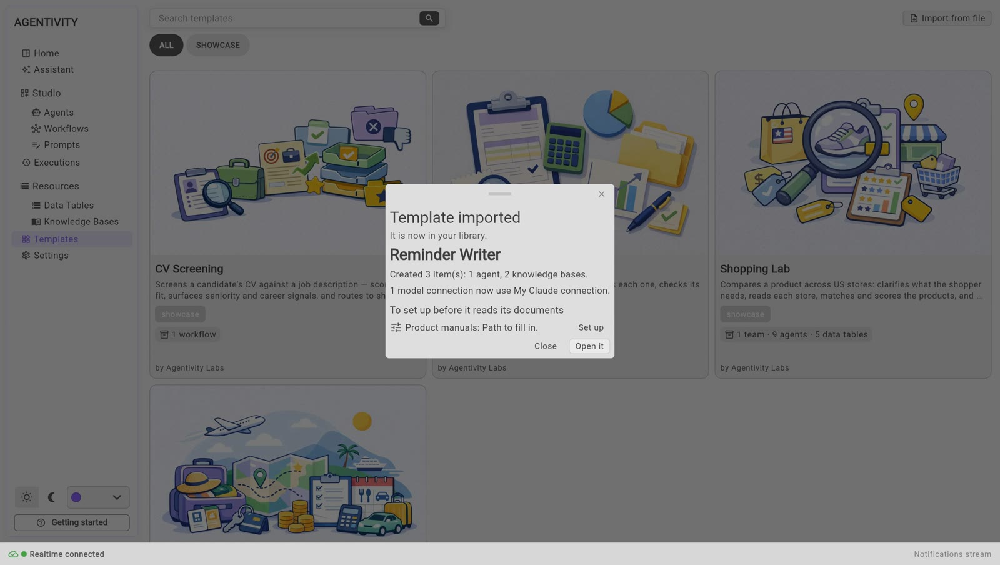

<!-- GENERATED from agentivity_docs/en/guides/share-a-template.md. Do not edit here: edit the source and publish again. -->

A Template is one file that holds a solution and everything it needs: the agent, the team or the workflow, the agents it uses, and its data tables. This page shows how to make a Template of your own work, and how another person imports it. What a solution is, and how it is marked, is in [What a Solution is, and how to mark one](/docs/introduction/what-a-solution-is/).

## What you need

- An agent, a team or a workflow that works, published.

## Create the Template

1. Open **Studio** > **Agents & Workflows**.
2. On the line of what you want to share, select the three dots, then **Create Template...** You can also select the box button in its editor.
3. The window **Create a Template** opens.

4. Check **What goes in the file**. **Show the list** shows every element that is packed.
5. Fill in the form.

   | Field | What to write |
   |---|---|
   | **Name** | The name people will see. |
   | **Tagline** | One line for the card. It is optional. |
   | **Description** | What it does and for whom. Between 20 and 2000 characters. |
   | **Language** | The language of the solution. |
   | **Tags** | Words that say who it is for and what it does. |
   | **Author** | Your name, and your website if you want. |
   | **Cover** | A picture for the card. It is optional. |

6. If the solution has data tables, decide whether to **Include the rows of the data tables**. Leave them out if they hold data that should not be shared.
7. Select **Create Template**.

Your browser saves a file whose name ends with `.template.json`.

## A Template of several Solutions

Some solutions are made of several Solutions that work together on the same data: for example a front desk and a resolution team that share their tickets. Put them in one Template, so that every agent of the imported Template uses the same tables and the same Knowledge Bases.

1. In **Agents & Workflows**, open the menu of the folder that holds the Solutions, in the list or in the folder tree, and select **Create a Template from this folder**.
2. The window says how many Solutions it packs: the Solutions of the folder and of the folders inside it.
3. Fill in the form as above and select **Create Template**.

What the Solutions share is carried once. Every Solution keeps its Solution mark. When you import such a Template, the window counts the Solutions first, and a card of the catalogue says, for example, "2 Solutions". A Template made of one Solution imports as before.

## Publish a Template on the marketplace

On a hosted workspace, you can publish your Templates in the catalogue of the marketplace, under a name of your own.

1. Open **Templates**. At the top, a switch has two views: **Catalogue**, and **Mine**.
2. In **Mine**, the first time, choose **the name you publish under**: your name, or your company's, and your website if you want. People see it on your Templates. It is yours alone: nobody else can publish under it. **Change name** lets you change it.
3. Select **Publish a file…**, or select **Publish** in the window **Create a Template**.
4. The header says "You publish as" followed by your name. It says either that what you publish is in the catalogue at once, or that it is reviewed before it goes online.

Each Template of yours shows its state: **Online**, **Out of the catalogue**, **In review**, or **Refused**, with the reason. To publish a new version, give it a higher version than the one online, for example 1.0.1.

- **Take out** removes a Template from the catalogue: people can no longer import it, and those who imported it keep their copy. You can publish it again later with a new version.
- **Delete** removes a Template of yours for good, also one already out of the catalogue.

You need to be signed in, with an e-mail address on your account. Publishing is open to the hosted workspaces of Agentivity.

## The Knowledge Bases in a Template

If the agents of your solution search Knowledge Bases, the Template carries those bases with the rest: the agents, the teams, the workflows and the data tables.

**What travels** is the definition of each base: its kind of source, its settings, its name, what it holds, and how it is kept up to date. The window counts them in **What goes in the file**.

**What never travels:**

- **Its documents.** They are read again, on the machine where the Template is imported.
- **The settings that belong to your server.** The path of a **Files** base, the file of a **SQLite** base, the connection string of a **PostgreSQL** base. The window names each base that travels without a setting, for example "Product manuals travels without its Path, which belongs to this installation: whoever imports it fills it in. Its documents do not travel either; they are read again there."

The other kinds (**Text**, **Web pages**, **Sitemap**, **RSS/Atom feed**, **API**) travel as they are. For **Text**, that means the texts themselves.

## What the file does not contain

- **The documents of your Knowledge Bases**, and the settings that belong to your server. See above.
- **Your credentials.** A Template never carries a key. The window tells you what the person who imports it will need, for example a model connection.
- **The history of your executions.**

Before you share the file, read the instructions of your agents again: anything you wrote there is in the file.

## Give it to someone

Send the file as you would send any document. The other person needs their own Agentivity and their own model connection.

## Import a Template from a file

On the other side:

1. In the Studio, open **Templates**.
2. Select **Import from file**, at the top right, and choose the file.
3. The window **Import a Template** shows what the Template is and what it will create.
4. Select **Import**.

The window counts what you get, one tile per kind of thing, for example "1 Team", "13 Agents" and "2 Data tables". The Knowledge Bases go in the folder you chose under **Where it goes**, like the rest.

A base that has nothing to fill in is read at once. A base that arrived without a setting waits: after the import, the window lists it under **To set up before it reads its documents**, with the settings to fill in and a button **Set up**. **Set up** opens the base on that setting. When you save, the base is read. An installation that cannot read a kind of source refuses the import and names the base.

The import creates new copies: nothing they already have is changed. When you already have a model connection, the window of the end of the import says which one the imported agents now use. If you have none, they need one: see "The model of the imported agents" in [Try a ready-made solution](/docs/getting-started/try-a-ready-made-solution/).

## How to know it worked

- The file is in the downloads folder of your browser.
- After the import, the message **Template imported** says what was created. Select the button **Open** with the name of the solution to open it in its editor.

## If it does not work

- **"This file is not a JSON document."** The file chosen is not a Template, or it was changed.
- **The imported agents fail at their first execution.** They have no model connection yet.

## Next step

[Organise your work in folders](/docs/guides/organise-with-folders/).
