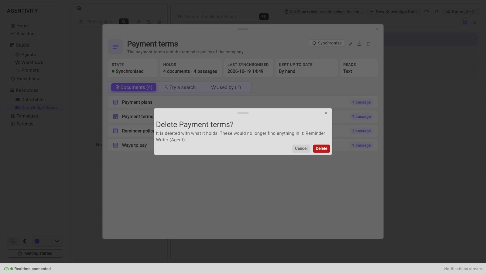

<!-- GENERATED from agentivity_docs/en/knowledge-bases/change-empty-or-delete-a-knowledge-base.md. Do not edit here: edit the source and publish again. -->

You can change a Knowledge Base at any time. Agents that use it keep working: they search the base under its new settings.

## What you need

- A Knowledge Base. See [Create a Knowledge Base](/docs/knowledge-bases/create-a-knowledge-base/).

## Change its settings

1. In **Resources** > **Knowledge Bases**, double-click the base.
2. Select the pencil, **Edit**.
3. The window opens on the step **Where it reads from**. Change a setting. Select **Continue** to go to **About it**, where you can change the name, **What it holds** and how the base stays up to date.
4. Select **Save**.

The kind of source cannot be changed. To read another kind of source, create another base.

**Saving does not read the source again.** What the base holds stays as it was until its next synchronisation. Select **Synchronise** in the window of the base to read it now. See [Keep a Knowledge Base up to date](/docs/knowledge-bases/keep-a-knowledge-base-up-to-date/).

## Rename it

In the list, open the menu of the line and select **Rename**. Type the name, then select **Rename**. A base needs a name.

Agents find a base by its identifier, not by its name, so renaming it breaks nothing. The tool that an agent has for the base is named after the base: it takes the new name the next time the agent runs.

## Put it in a folder

The explorer of **Knowledge Bases** has folders, as **Data Tables** has (see [Organise your work in folders](/docs/guides/organise-with-folders/)): **Create folder**, **Rename folder**, **Delete folder**, and **Move to root**. A folder you delete is deleted with everything in it, bases included.

## Empty it

Emptying removes what the base holds: its documents and its passages. The base, its source and its settings stay.

1. Double-click the base, then select the button **Empty** (its name shows when you point at it).
2. Read the question "Empty <name>?": "Its documents and passages go; its data source and settings stay. It fills again at its next synchronisation."
3. Select **Empty**.

Use it when the source changed a lot and you want a clean start, or to remove what an old reading left. The base is read again at its next search, or when you select **Synchronise**. Whatever way the base is kept up to date, the next search reads the source first, because the base holds nothing.

## Delete it

1. Double-click the base, then select the bin, **Delete**. In the list, the menu of the line has **Delete** too.
2. Read the warning. It says: "It is deleted with what it holds." If agents or workflows use the base, it names them: "These would no longer find anything in it", with the name and the kind of each.
3. Select **Delete**.

This cannot be undone. The agents and workflows that used the base are not deleted, but their step **Knowledge Base** now points to nothing, and they find nothing. Give them another base: see [Give a Knowledge Base to an agent or a prompt](/docs/knowledge-bases/give-a-knowledge-base-to-an-agent/).

## How to know it worked

- After an edit and a synchronisation, a search finds the new text.
- After **Empty**, **Holds** says no document, and **State** goes back to **Never synchronised**.
- After **Delete**, the base is not in the list.

## Good to know

- **Earlier versions of a base are not kept in the Community edition.** A change or a deletion cannot be taken back.
- A base that a Template brought can wait for a setting before it reads anything. See [Share your work as a Template](/docs/guides/share-a-template/).

## Next step

[Give a Knowledge Base to an agent or a prompt](/docs/knowledge-bases/give-a-knowledge-base-to-an-agent/).
