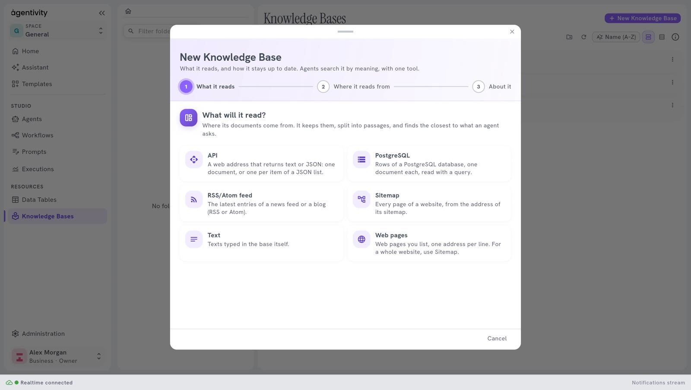
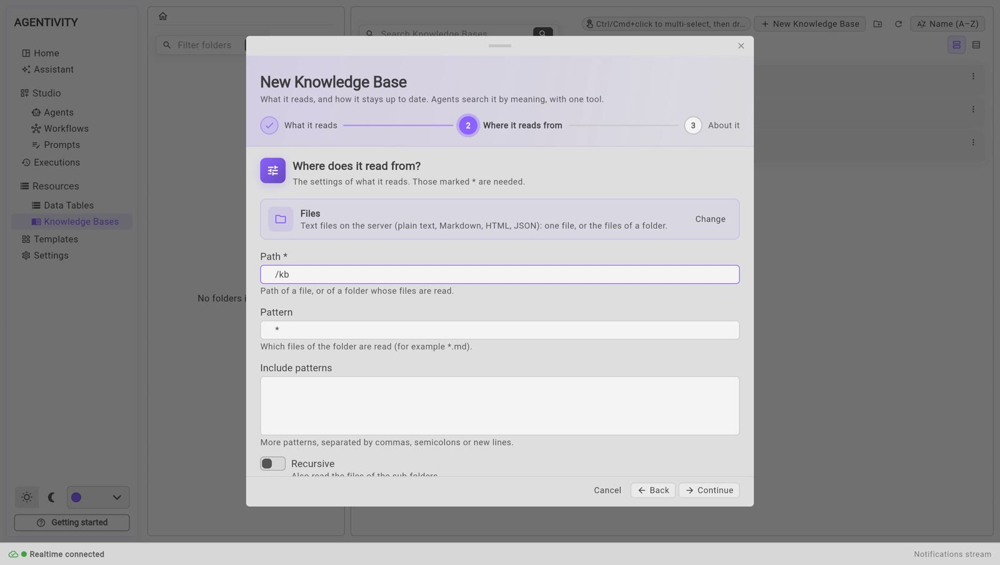
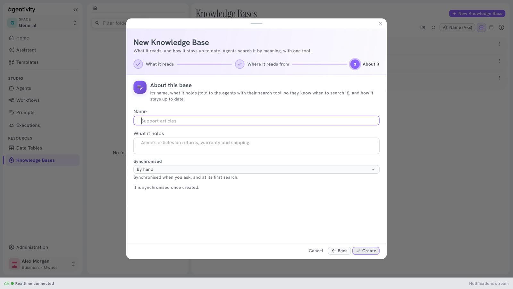

<!-- GENERATED from agentivity_docs/en/knowledge-bases/create-a-knowledge-base.md. Do not edit here: edit the source and publish again. -->

You create a Knowledge Base in a window with three steps. The base reads its source as soon as it is created.

<video controls muted playsinline preload="metadata" src="/docs-media/en/knowledge-bases/images/create-a-knowledge-base.mp4" aria-label="A recording of the Studio: in Resources > Knowledge Bases, New Knowledge Base is selected, the kind Files is chosen, the path /kb is typed, then the name Support FAQ and what it holds, and Create adds the base to the list"></video>

## What you need

- Agentivity running, with the Studio open.
- A source: your texts, a folder of files on the server, or a web address.

## Open the window

1. In the menu on the left, open **Resources** > **Knowledge Bases**.
2. Select **New Knowledge Base**. If you want the base in a folder, open the folder first.

The window **New Knowledge Base** opens. A line under the title says: "What it reads, and how it stays up to date. Agents search it by meaning, with one tool."

## Step 1: what it reads

Choose the kind of source: **Text**, **Files**, **Web pages**, **Sitemap**, **RSS/Atom feed**, **API**, **PostgreSQL** or **SQLite**. Each choice says in a line what it reads. See [What a Knowledge Base is for](/docs/knowledge-bases/what-a-knowledge-base-is/) for the list.



Select a card: the window goes to the next step. You can come back with **Back**, or with **Change** on the next step.

A hosted workspace does not offer **Files** and **SQLite**, because they read the server itself: its window shows six cards. The Community edition shows all eight.

## Step 2: where it reads from

The window shows the settings of the kind you chose. A setting marked with a star is needed. The others have a value already.



The settings that matter least, such as delays and options for reading pages, wait under **More settings**. Select it to open them.

| Kind | Needed | Good to know |
|---|---|---|
| **Text** | none | **Documents** holds your texts as a list in JSON. See "Type your texts" below. |
| **Files** | **Path** | The path of a file, or of a folder, on the machine where Agentivity runs. **Pattern** says which files of a folder are read, for example `*.md` (at the start, `*` reads all of them). **Recursive** also reads the sub-folders. |
| **Web pages** | **URLs** | One address per line. For a whole site, use **Sitemap**. Under **More settings**: how pages are read (**Direct**, which is free and the default, **Jina Reader**, or **Firecrawl**, which needs a key), and the longest content kept from each page. |
| **Sitemap** | **Sitemap URL** | Often `https://your-site/sitemap.xml`. **Max URLs** limits the pages read (50 at the start). |
| **RSS/Atom feed** | **Feed URL** | **Max items** limits the entries read (20 at the start). |
| **API** | **URL** | An address that returns text or JSON. For a JSON list, **Selector** gives the path to it, and **Item text field** the field that holds the text of each item. |
| **PostgreSQL** | **Connection string**, **Query** | The database is your own, an outside connection. The query returns one row per document. **Content column** names the column that holds the text. |
| **SQLite** | **Database path**, **Query** | A SQLite file on the server. Same query rule. |

A setting with a drop-down list of credentials, such as the Firecrawl key, says "No credentials of this kind yet" if you have none. Create one in **Administration** > **Credentials**.

### Type your texts (kind Text)

**Documents** is a list in JSON. Each text is a block with `text`, and, if you want a title, a `metadata` with `title`.

```json
[
  { "text": "Invoices are due 30 days after the invoice date.", "metadata": { "title": "Payment terms" } },
  { "text": "A reminder is sent 7 days after the due date.", "metadata": { "title": "Reminders" } }
]
```

Each block becomes one document. The title is what the Studio shows in the list of documents.

### Read files (kind Files)

The path is a path on the machine where Agentivity runs, inside its container, not a path on your own computer. To give the container a folder of yours, add a mount to the start command. Mount it outside `/app`, for example at `/kb`:

```bash
docker run -d --name agentivity -p 5005:5005 -v agentivity-data:/app/_data -v C:\guides:/kb:ro agentivitylabs/agentivity
```

Then give `/kb` as the **Path**. The end `:ro` makes the folder read-only for the container.

A path inside `/app` is refused: it is the installation of Agentivity, with its data, its connections and its settings. The base then fails with a message that says so.

## Step 3: about it

| Field | What to enter |
|---|---|
| **Name** | A name that you will recognise, for example `Payment terms`. It is required. |
| **What it holds** | A sentence on what is in the base, for example "The payment terms of the company." It is told to the agents with their search tool, so that they know when to search the base. |
| **Synchronised** | How the base stays up to date: **By hand**, **After a delay** or **When the source changes**. See [Keep a Knowledge Base up to date](/docs/knowledge-bases/keep-a-knowledge-base-up-to-date/). |
| **Delay (hours)** | Only with **After a delay**: a number of hours, at least 1. |



A line says: "It is synchronised once created."

Select **Create**.

## How to know it worked

The base is in the list, and its column **Synchronisation** goes from **Synchronising…** to **Synchronised**. Open it: **Holds** says how many documents and passages it read. See [Look inside a Knowledge Base](/docs/knowledge-bases/look-inside-a-knowledge-base/).

## If it does not work

- **"A knowledge base needs a name."** The field **Name** is empty.
- **"<Setting> is required."** A setting marked with a star is empty.
- **"<Setting> must be a number."** A numeric setting has other characters in it.
- **"The delay is a number of hours, at least 1."** Fix **Delay (hours)**.
- **"Choose what it reads."** Go back to step 1 and choose a kind.
- **The base shows Failed.** Open it and read **What could not be read**: it says which address or file failed and why.
- **The list of kinds does not load.** The Studio says that the types of data source could not be read. Reload the page.

## Next step

[Keep a Knowledge Base up to date](/docs/knowledge-bases/keep-a-knowledge-base-up-to-date/), then [give it to an agent](/docs/knowledge-bases/give-a-knowledge-base-to-an-agent/).
