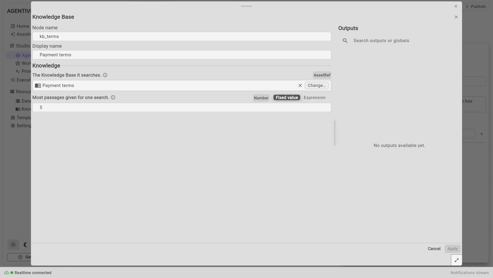
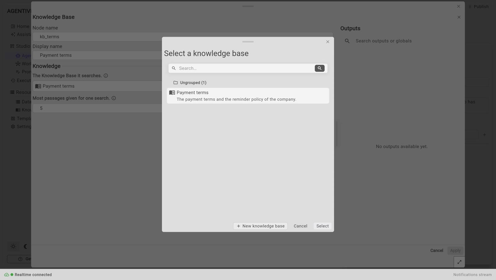

<!-- GENERATED from agentivity_docs/en/knowledge-bases/give-a-knowledge-base-to-an-agent.md. Do not edit here: edit the source and publish again. -->

An agent does not know your documents unless you give it a Knowledge Base. You give it with a step named **Knowledge Base**, which you plug into the agent. The agent then searches the base itself, when it needs to.

## What you need

- An agent with a model. See [Create an agent](/docs/agents/create-an-agent/).
- A Knowledge Base that holds something. See [Create a Knowledge Base](/docs/knowledge-bases/create-a-knowledge-base/).

## Give a base to an AI Agent

In our example, the `Reminder Writer` must follow the payment terms of the company, kept in the base `Payment terms`.

1. Open the agent in its editor.
2. In the **Node Catalog**, search for `Knowledge Base`. It is under **AI** > **Knowledge**.
3. Drag **Knowledge Base** onto the canvas, below the agent.
4. Drag from its diamond to the diamond of the agent named **Knowledge Bases**. It is the second one from the left.
5. Right-click the step and select **Edit**.
6. Next to **The Knowledge Base it searches.**, select **Change…**. The chooser **Select a knowledge base** opens. Pick `Payment terms` and select **Select**. If you have none yet, **New knowledge base** creates one there, and it is read at once.
7. Select **Apply**, then **Publish**.






You can plug several bases into the same diamond, one step for each. The agent then has one search for each base.

### What the step has

| Setting | What it is |
|---|---|
| **The Knowledge Base it searches.** | The base that the step searches. |
| **Most passages given for one search.** | The number of passages given back for one search (`results` in the API and in a Template). It is 5 at the start. You can choose from 1 to 20. |

### How the agent searches

The agent receives one search tool for each base. The tool is named after the base: for `Payment terms`, it is `retrieve_payment_terms`. The agent decides when to use it. It gives a question, in its own words, and gets back the closest passages, each with its title, its source and a score.

The sentence that you wrote in **What it holds** is told to the agent with the tool. That is how it knows what the base is for. Write it well. See [Create a Knowledge Base](/docs/knowledge-bases/create-a-knowledge-base/).

The agent must be in the execution mode **Tools**, which is the default. In the mode **Conversational**, an agent never uses a tool. See [What an agent is](/docs/agents/what-an-agent-is/).

### Say what to do with it

Add a sentence to the instructions of the agent, for example:

```text
Follow the payment terms of your knowledge base. If they do not cover the case, say so.
```

## Give a base to an LLM Prompt

An **LLM Prompt** step also has a diamond named **Knowledge Bases**. Plug the same **Knowledge Base** step into it.

The base is not searched by the model here. It is searched once, with the text of the prompt, and the passages found are added to the prompt before the model answers. The output `knowledge_used` of the step gives what was found.

## How to know it worked

1. In the window of the base, tab **Used by**: the agent is listed. See [Look inside a Knowledge Base](/docs/knowledge-bases/look-inside-a-knowledge-base/).
2. Run the agent with a request whose answer is only in the base. The e-mail must give your payment terms, as written. See [Run an agent and read its answer](/docs/agents/run-an-agent/).
3. In the tab **Execution**, the **Inspector** shows the steps of the execution.

## If it does not work

- **The agent does not search the base.** Check that the step is plugged into the diamond **Knowledge Bases**, and not into **AI Agent Tools**. Check the execution mode. Say in the instructions to use its knowledge.
- **The agent answers with something else than your documents.** Try the same question in the tab **Try a search** of the base. If the right passage does not come first, change the source.
- **The search says that the base holds nothing yet.** The first reading failed. Open the base and read **What could not be read**.

## Good to know

- What the agent finds in a base is sent to the AI model, like the rest of the conversation. Do not put in a base what must not leave your server.
- A Template that carries the agent carries the base too, without its documents. See [Share your work as a Template](/docs/guides/share-a-template/).

## Next step

[Where each kind of information goes](/docs/introduction/where-does-it-go/), to choose between a Knowledge Base, a Data Table and a session.
