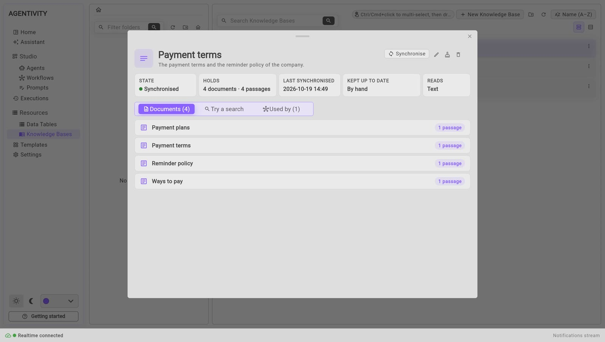
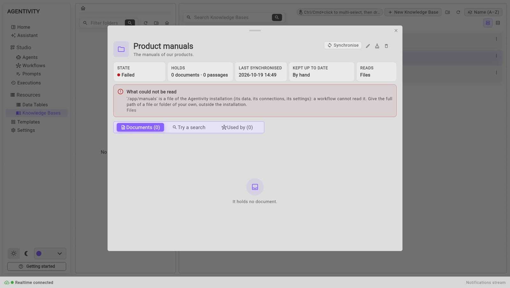
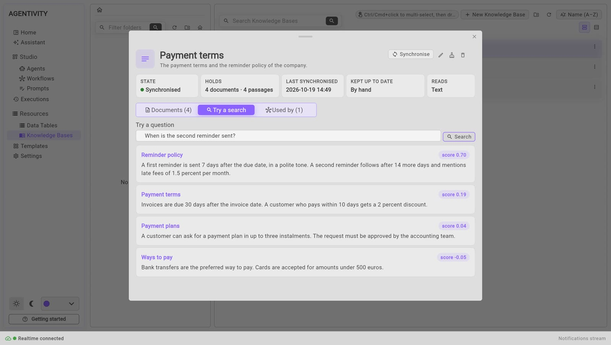
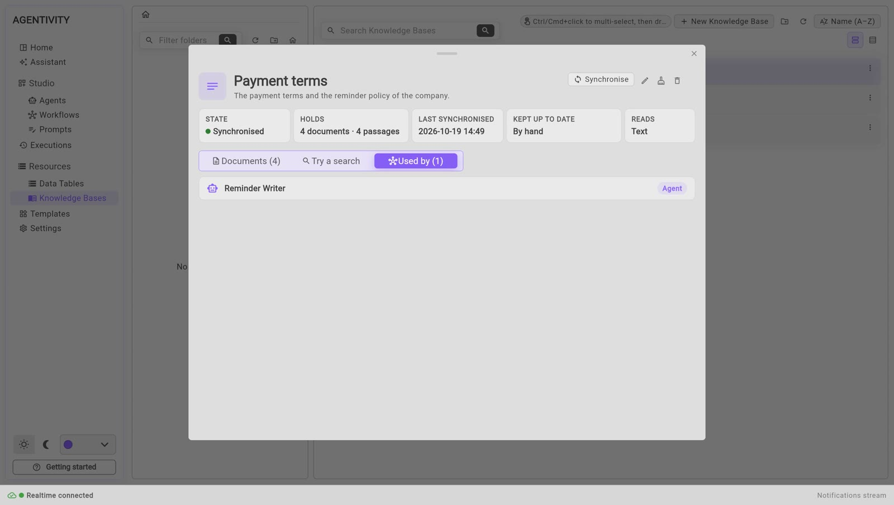

<!-- GENERATED from agentivity_docs/en/knowledge-bases/look-inside-a-knowledge-base.md. Do not edit here: edit the source and publish again. -->

The window of a Knowledge Base shows what it read, whether it went well, and what an agent would find in it. You do not need it to use a base. It is how you check that the base holds what you think.

## What you need

- A Knowledge Base. See [Create a Knowledge Base](/docs/knowledge-bases/create-a-knowledge-base/).

## Open the window

In **Resources** > **Knowledge Bases**, double-click the base. A window opens over the list.

## The figures at the top

| Figure | What it says |
|---|---|
| **State** | **Synchronised**, **Synchronising…**, **Failed** or **Never synchronised**. |
| **Holds** | The number of documents and of passages, for example "3 documents · 3 passages". A passage is a piece of a document. |
| **Last synchronised** | The date and the time of the last reading. |
| **Kept up to date** | **By hand**, **When the source changes**, or "Every 24 h" with a delay. |
| **Reads** | The kind of source. |

At the top right, **Synchronise** reads the source now. Three small buttons follow: **Edit**, **Empty** and **Delete**. See [Change, empty or delete a Knowledge Base](/docs/knowledge-bases/change-empty-or-delete-a-knowledge-base/).

## What could not be read

If the last reading failed, or if part of it failed, a red frame titled **What could not be read** lists each problem, in the words of the server, with the kind of source it concerns. For example, a path that Agentivity refuses to read, or a web address that does not answer.

## The three tabs

### Documents

The tab **Documents** lists what the base holds. Each line shows the title of the document, where it comes from (a file path or an address), and how many passages it gave. A long text gives several passages.

Before the first reading, the tab says: "Nothing read yet: synchronise it, or it is read at its first search." If the source gave nothing: "It holds no document."

### Try a search

The tab **Try a search** lets you ask what an agent would ask.

1. Type a question in **Try a question**, for example "Can I return my laptop?".
2. Select **Search**.

The passages that the agent would receive come out, the closest first. Each shows its title, its text and a score. The higher the score, the closer the passage is to your question.

If the base finds nothing, the tab says "Nothing found."

This is the best way to improve a base. If the passage you expected does not come first, the document is badly cut, or it does not say what you think. Change the text of the source, synchronise, and try again.

### Used by

The tab **Used by** lists the agents and workflows that use the base, each with its kind. If there is none: "No agent or workflow uses it yet." See [Give a Knowledge Base to an agent or a prompt](/docs/knowledge-bases/give-a-knowledge-base-to-an-agent/).

## How to know it worked

After a synchronisation, **State** says **Synchronised** and **Holds** is not zero. A search on a word that your documents contain brings back the right passage first.

## If it does not work

- **The state is Failed, and a red frame shows.** Read **What could not be read**. For example, a Files base fails when its path is inside the installation of Agentivity (use a folder mounted outside `/app`), and a base on the web fails when an address does not answer.
- **"Nothing found."** The base holds nothing that is close to the question, or it is empty. Check **Holds**.
- **The search takes long the first time.** The base was due, and the search synchronised it first. See [Keep a Knowledge Base up to date](/docs/knowledge-bases/keep-a-knowledge-base-up-to-date/).

## Next step

[Change, empty or delete a Knowledge Base](/docs/knowledge-bases/change-empty-or-delete-a-knowledge-base/).
