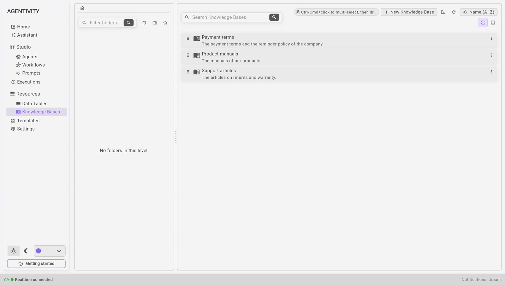
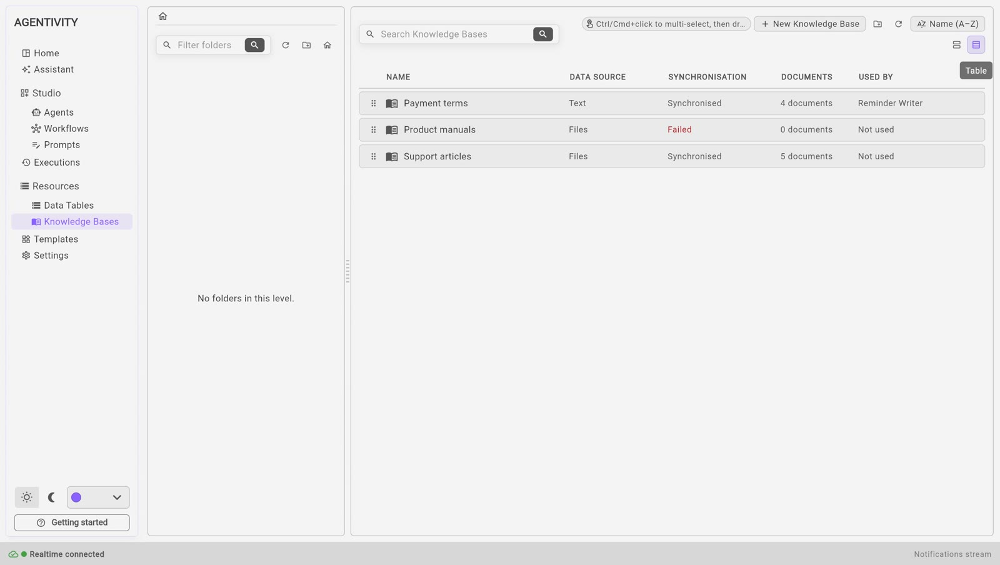

<!-- GENERATED from agentivity_docs/en/knowledge-bases/what-a-knowledge-base-is.md. Do not edit here: edit the source and publish again. -->

A Knowledge Base is a set of your own texts that your agents can search. It reads a source, for example a folder of guides or a website. It keeps what it read, cut into short passages. When an agent asks a question, the base gives back the passages whose meaning is the closest.

## What it is for

An AI model does not know your company. A Knowledge Base is how you give it what it must know: your policies, your guides, your articles, the pages of your site.

- **The agent does not read everything.** It asks, and it receives only the few passages that fit.
- **It finds by meaning, not by exact words.** A question about "sending a laptop back" finds the passage titled "Returns".
- **It stays up to date.** The base reads its source again, as often as you choose. See [Keep a Knowledge Base up to date](/docs/knowledge-bases/keep-a-knowledge-base-up-to-date/).
- **It needs no account.** The search runs on your server, with a small local model. Agentivity downloads that model the first time it starts, so the machine needs an internet connection for that.

In our example, a base named `Payment terms` holds the terms of payment of the company. The agent `Reminder Writer` searches it each time it writes a reminder.

## What a base reads

Each base reads one kind of source. A Community installation offers eight.

| Kind | What it reads |
|---|---|
| **Text** | Texts that you type in the base itself. |
| **Files** | Text files on the server: plain text, Markdown, HTML, JSON. One file, or the files of a folder. |
| **Web pages** | Web pages that you list, one address per line. |
| **Sitemap** | Every page of a website, from the address of its sitemap. |
| **RSS/Atom feed** | The latest entries of a news feed or a blog. |
| **API** | A web address that returns text or JSON: one document, or one per item of a JSON list. |
| **PostgreSQL** | The rows of a PostgreSQL database, one document each, read with a query. |
| **SQLite** | The rows of a SQLite file on the server, one document each, read with a query. |

To create one, see [Create a Knowledge Base](/docs/knowledge-bases/create-a-knowledge-base/).

## Who can use a base

| Who | How |
|---|---|
| **An AI Agent** | The agent searches the base when it wants, with a tool named after the base. See [Give a Knowledge Base to an agent or a prompt](/docs/knowledge-bases/give-a-knowledge-base-to-an-agent/). |
| **An LLM Prompt** | The base is searched once with the prompt, and the passages are added to the prompt. |
| **You, in the Studio** | Open the base, look at what it holds, and try a search. See [Look inside a Knowledge Base](/docs/knowledge-bases/look-inside-a-knowledge-base/). |

## Where the bases are

In the menu on the left, open **Resources** > **Knowledge Bases**. It is the same kind of screen as **Data Tables**: folders on the left, a list of bases, a button **New Knowledge Base**.

The list shows the bases as cards. The button at the top right switches to the **Table** view, which has four columns:

| Column | What it says |
|---|---|
| **Data source** | The kind of source of the base. |
| **Synchronisation** | **Synchronised**, **Synchronising…**, **Failed** or **Never synchronised**. |
| **Documents** | How many documents the base holds. |
| **Used by** | The agents and workflows that use it, or **Not used**. |

Double-click a base to open it.

## Not the same as a Data Table, a Session or a Vector Store

| If the agent must… | Use |
|---|---|
| Know your texts | A Knowledge Base |
| Look up facts kept in rows | A Data Table |
| Remember the earlier messages of a conversation | An Agent Session |
| Keep notes while it works | A Vector Store |

See [Where each kind of information goes](/docs/introduction/where-does-it-go/), which compares them.

## Good to know

- **The passages an agent receives are sent to your AI model provider**, like the rest of what an agent works with. Do not put in a base what must not leave your server.
- **A Template carries the bases that its agents search**, but never their documents. See [Share your work as a Template](/docs/guides/share-a-template/).
- **Earlier versions of a base are not kept in the Community edition.**
- **Files and SQLite read the server.** They are for an installation that you run yourself. The cloud edition does not offer them.
- Agentivity has no login. Anyone who can reach your server can read and change every base.

## Next step

[Create a Knowledge Base](/docs/knowledge-bases/create-a-knowledge-base/).
