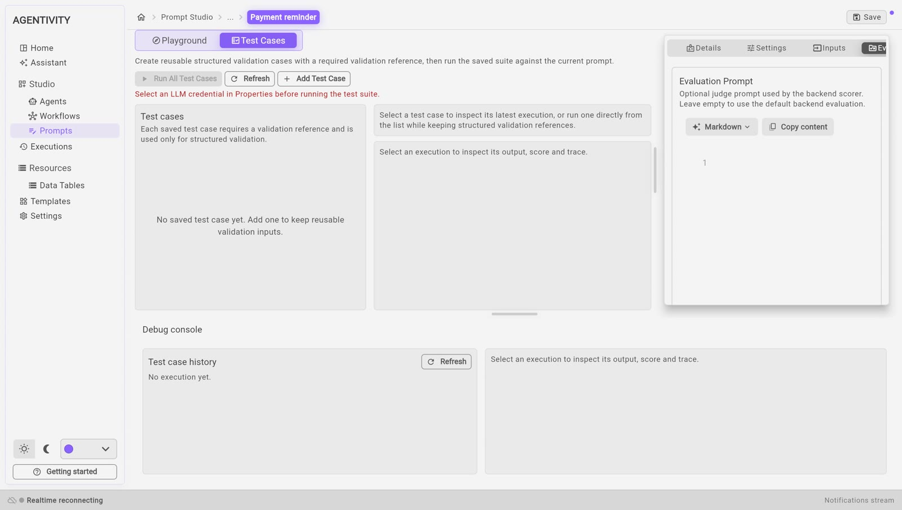

<!-- GENERATED from agentivity_docs/en/prompts/test-and-improve-a-prompt.md. Do not edit here: edit the source and publish again. -->

Prompt Studio has four ways to work on a prompt: try it, test it, analyse it and optimise it. All four send the prompt to an AI model.

## Before you start

All of this needs a model connection chosen in the tab **Settings** of the panel on the right. In the version these pages were checked against, that list stays empty: see the known problem in [What Prompt Studio is for](/docs/prompts/what-prompt-studio-is/). This page describes what the screens offer once a connection can be chosen. It was not run.

Each run uses the AI model, and your provider bills you for it.

## Try the prompt

1. In the tab **Playground**, give a value to each input.
2. Select **Run Prompt**.
3. Read the answer in the **Debug console**, at the bottom.

**Playground history** keeps the list of your tries. Select one to see its output again.

## Keep test cases

A test case is one example that you keep: values for the inputs, and the answer you expect. It lets you check the prompt again after each change.

1. Select the tab **Test Cases**.
2. Select **Add Test Case**.
3. Give it a **Name**.
4. Fill in the inputs.
5. Fill in the expected result. It is required: it is the reference used to check the answer.
6. Select **Save**.

## Run the test cases

- **Run All Test Cases** runs every saved case against the current prompt.
- Select one case to see its last run: the expected answer, the actual answer, and a score.

A case that passes is marked **Success**; one that does not is marked **Failed**, with an analysis of the failure.

Use test cases for what must not break: after each change of the prompt, run them all again.

## Analyse the prompt

1. In the tab **Playground**, select **Analyze**.
2. Read the **Analysis Result**.

| Part | What it tells you |
|---|---|
| **Strengths** | What the prompt does well. |
| **Issues** | What is wrong, each with a level: **HIGH**, **MED** or **LOW**. |
| **Recommendations** | What to change. |
| **Improved Prompt** | A rewritten version of your prompt. |

To take the improved version, select **Apply**. It replaces the text of your draft. It is saved only when you select **Save**.

## Optimise the prompt

Optimisation tries several versions of the prompt in a row and keeps the one with the best score.

1. Open **Optimization**.
2. Set **Max Iterations**: how many versions it may try.
3. Select **Start Optimization**.
4. When it is finished, read **Score per Iteration** and the **Best Candidate**.
5. Select **Apply Best Candidate** to take it, then **Save**.

Optimisation makes many calls to the AI model. Start with a small number of iterations.

## The evaluation prompt

The scores are given by the AI model too, following an evaluation prompt. The last tab of the panel on the right lets you write your own. Leave it empty to use the default evaluation.

## Good to know

- A score is an opinion of an AI model. Read the answers yourself before you trust a number.
- Nothing is changed without you: an improved prompt is applied only when you select **Apply**, and saved only when you select **Save**.

## Next step

Back to [What Prompt Studio is for](/docs/prompts/what-prompt-studio-is/).
