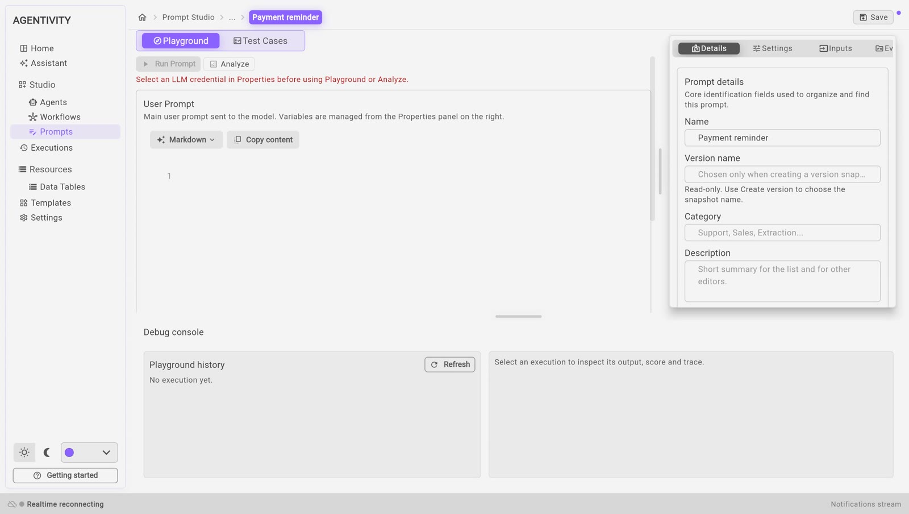

<!-- GENERATED from agentivity_docs/en/prompts/what-prompt-studio-is.md. Do not edit here: edit the source and publish again. -->

A prompt is the text of a request that is sent to an AI model. Prompt Studio is the part of the Studio where you write prompts and work on them, apart from any agent.

## What it is for

The instructions of an agent decide how well it works. Prompt Studio lets you work on such a text by itself:

- **Write** the prompt, with places for the values that change from one request to the next.
- **Try** it on an example and read the answer.
- **Check** it against cases you saved, each with the answer you expect.
- **Improve** it: ask for an analysis of its strong and weak points, and for a better version.

When the prompt is good, you copy it into the instructions of an agent or into an AI step of a workflow.

## Where it is

In the menu on the left, open **Studio** > **Prompts**. The list shows your prompts, with their name and their category.

- **New prompt** creates a prompt.
- **Search prompts** finds one by its name.
- Double-click a line to open a prompt in Prompt Studio.

## The screen

| Part | What it is for |
|---|---|
| The tab **Playground** | Write the prompt and try it freely. |
| The tab **Test Cases** | Keep cases with the expected answer, and run them all. |
| **Run Prompt** | Sends the prompt to the AI model. |
| **Analyze** | Asks for an analysis of the prompt. |
| The panel on the right | **Details** (name, category, description), **Settings** (model connection and generation settings), **Inputs** (the values that change), and the evaluation prompt. |
| **Debug console** | The history of what you ran, with the output of each run. |
| **Save**, at the top right | Saves the prompt. |

## What is not in the Community edition

Keeping named versions of a prompt, and going back to one, is not in the Community edition.

## Next step

[Write a prompt and its inputs](/docs/prompts/write-a-prompt/).
