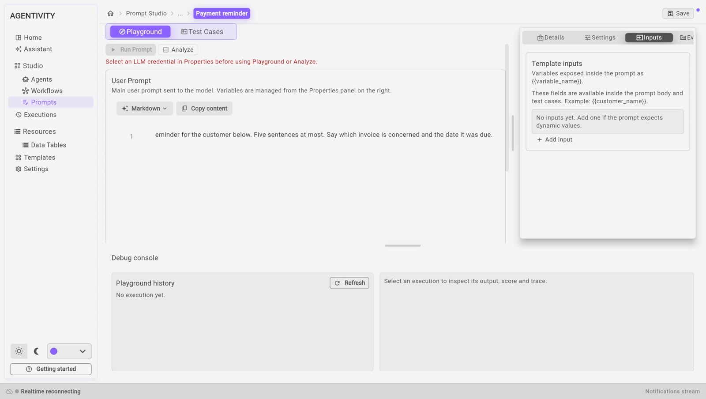

<!-- GENERATED from agentivity_docs/en/prompts/write-a-prompt.md. Do not edit here: edit the source and publish again. -->

This page creates a prompt and gives it inputs. An input is a named place in the prompt, which receives a different value at each request: the name of a customer, an invoice number.

## What you need

- Agentivity running, with the Studio open.

## Create the prompt

1. In the menu on the left, open **Studio** > **Prompts**.
2. Select **New prompt**.
3. Type the **Prompt name**, for example `Payment reminder`.
4. Select **Create**.

Prompt Studio opens on the tab **Playground**.

## Describe it

In the panel on the right, the tab **Details** has:

| Field | What to write |
|---|---|
| **Name** | The name of the prompt. |
| **Category** | A word to sort your prompts, for example Support or Sales. |
| **Description** | A short summary, for the list and for other people. |

## Write the text

1. Select the area under **User Prompt**.
2. Type the prompt. For example:

   ```text
   Write a polite payment reminder for the customer below. Five sentences at most. Say which invoice is concerned and the date it was due.
   ```

**User Prompt** is the main text sent to the model. The editor also has a system prompt, which is optional: it is applied before the user prompt, and it is the place for the general rules, such as the tone to use.

**Copy content** copies the text, to paste it elsewhere.

## Add inputs

1. In the panel on the right, select the tab **Inputs**.
2. Select **Add input**.
3. Type the **Input name**, for example `customer_name`.
4. Fill in **Description**: what this input should contain.
5. If you want, give a **Default value**, used when no value is given.
6. Say whether the input is required or optional.



Then place the input in the text of the prompt: write its name between two pairs of curly braces, where the value must go. The tab **Inputs** shows an example of this writing.

For the reminder, three inputs are enough: `customer_name`, `invoice_number` and `due_date`.

## The generation settings

The tab **Settings** has the settings used when the prompt runs.

| Setting | What it is |
|---|---|
| **Provider credential** | The model connection to use. |
| **Model** | It comes from the connection you chose. |
| **Temperature** | Lower gives more regular answers, higher gives more varied answers. |
| **Top P** | Another setting for how varied the answers are. It is optional. |
| **Max tokens** | The longest answer allowed. |

From Claude 4.7 on, the models of Anthropic no longer use the temperature or Top P: the value of the step is ignored, with no error. Agentivity adapts its requests to each generation of Claude model, and there is nothing to set.

See the known problem with **Provider credential** in [What Prompt Studio is for](/docs/prompts/what-prompt-studio-is/).

## Save

Select **Save**, at the top right.

If you leave with changes that are not saved, the Studio asks what to do: **Keep editing**, **Discard** or **Save**.

## How to know it worked

The prompt is in the list of **Studio** > **Prompts**, and it opens with its text and its inputs.

## Use the prompt in an agent or a workflow

When the prompt is ready, select **Copy content** and paste the text:

- into **System instructions** of an agent: see [Write the role and the instructions of an agent](/docs/agents/write-the-instructions/);
- or into an AI step of a workflow: see [Add an AI step to a workflow](/docs/workflows/add-an-ai-step/).

## Next step

[Try, test and improve a prompt](/docs/prompts/test-and-improve-a-prompt/).
