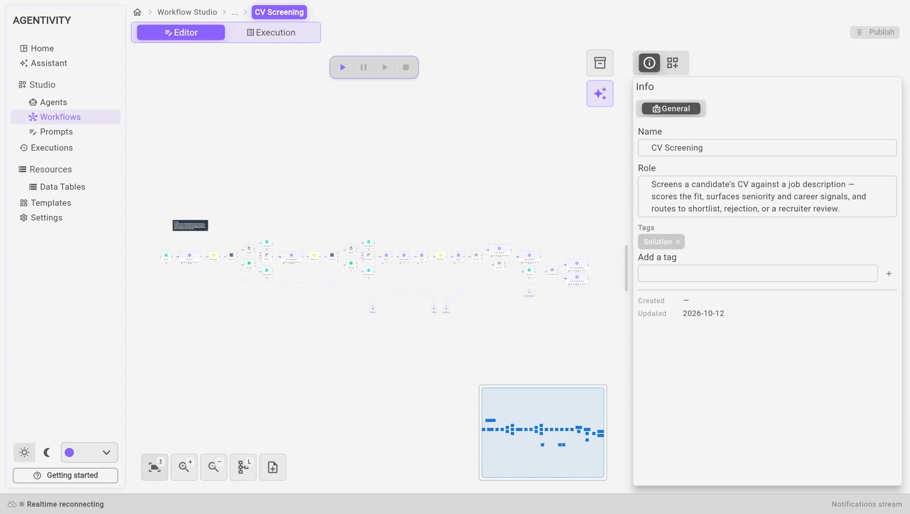

<!-- GENERATED from agentivity_docs/en/showcases/cv-screening.md. Do not edit here: edit the source and publish again. -->

CV Screening compares the CV of a candidate with a job description. It reads both, scores the fit, and writes a report for the recruiter with a recommended next step. It is a workflow: the path is drawn in advance, and AI works only in some steps.

## Read this first

This showcase shows how to build a workflow. It is not a recruitment tool to use as it is.

- **As delivered, a person reviews only the cases in the middle.** A high score leads to a "shortlisted" report and a low score to a "rejected" report, with no review step. Only the scores in between go to a recruiter.
- **The report is a recommendation.** It is written for a recruiter, who decides. Do not send anything to a candidate from it without a person reading the case.
- **Check your obligations.** In many countries, rules apply to the automatic evaluation of job candidates and to the personal data in a CV. Ask your legal adviser before you use anything like this on real candidates.
- **A CV is personal data.** What the workflow reads is sent to your AI model provider.

## What it contains

One workflow, **CV Screening**, with thirty-four elements.

## What happens, in order

1. **It asks for the CV.** An **AI Agent** step shows a box in the chat. You upload a file, give a link, or paste the text.
2. **It reads the CV.** A **Switch** step chooses the path: one step reads the file, another reads the web page. A **First Of** step keeps whichever text arrived.
3. **It does the same for the job description.**
4. **It puts both in a regular structure.** Two **LLM Prompt** steps: one for the CV, one for the job description. Both are told to keep only what is written, and to invent nothing.
5. **It scores the fit on six axes.** One **LLM Prompt** step gives a score from 0 to 100 on each axis. Another notes career facts, such as the seniority.
6. **It computes one score.** A **JavaScript** step makes a weighted average of the six axes. The weights come from what the job description says matters.
7. **It chooses the path with two fixed thresholds.** Two **If** steps: 75 or more is a shortlist, less than 50 is a rejection, and between the two the case goes to a recruiter.
8. **A recruiter reviews the cases in between.** A **Form Interaction** step shows the score, the reasons, the skills found and missing, and waits for the decision.
9. **It writes the report.** One **AI Agent** step per outcome writes the report in the chat.

## What to look at

- **Three ways in, one path.** File, link or text: a **Switch** separates them, a **First Of** joins them. Reuse this each time an input can come in several forms.
- **AI to read, a program to compute.** AI steps read and judge each axis. The final score is computed by a program, so the same six scores always give the same result, and the report can show the formula.
- **Fixed rules for the outcome.** The thresholds are in **If** steps, where you can read and change them. An AI model does not choose the path.
- **A form for the review.** The recruiter sees everything needed to decide in one form. See [Ask a person with a form](/docs/workflows/ask-with-a-form/).
- **Messages when something fails.** If a file cannot be read or a link cannot be opened, a **Human Interaction** step says so in the chat and asks to start again. See [Ask a person to approve or answer](/docs/workflows/ask-a-person-to-decide/).
- **One model for all the AI steps.** One model element is plugged into every AI step. To change the model, change it in one place.

## Try it

1. Open **Studio** > **Workflows** and open **CV Screening**.
2. Select the tab **Execution**, then **Run**.
3. Give a CV, then a job description, when the workflow asks. Use fictitious ones.

See [Run a workflow and follow each step](/docs/workflows/run-a-workflow/).

## Make it yours

- **Send every case to a person.** Link the two automatic outcomes to the review step, or change the two thresholds. This is the first change to make before any real use.
- **Reuse the shape.** It fits any work where a document is compared with criteria: an offer against a call for tenders, an invoice against an order, a request against a policy. Keep the four parts: AI to read, a program to compute, fixed rules to route, and a person to decide.

## Next step

Back to [The four showcases and what each one teaches](/docs/showcases/the-four-showcases/).
