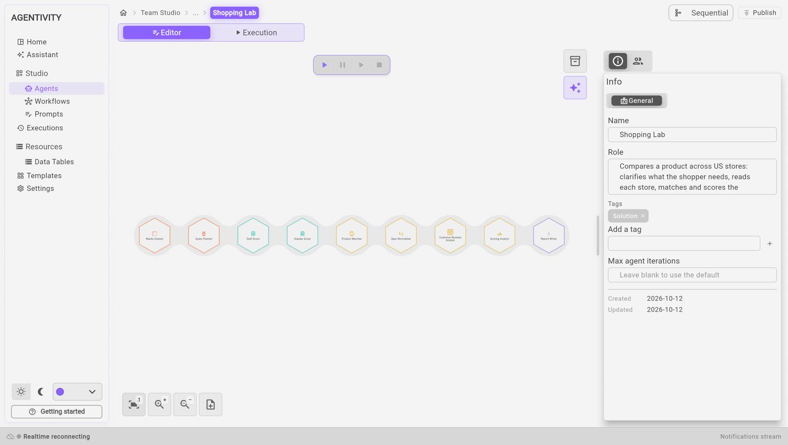

<!-- GENERATED from agentivity_docs/en/showcases/shopping-lab.md. Do not edit here: edit the source and publish again. -->

Shopping Lab helps a shopper choose a product. It clarifies the need, reads the pages of two online stores, compares the offers, scores them and writes a report with the best picks. It is a **Sequential** team: nine agents work one after another.

## What it contains

| Element | What it is |
|---|---|
| The team **Shopping Lab** | A Sequential team of nine members. |
| Nine agents | One per step of the work. |
| Five data tables | Where the agents keep and pass their results. |

## The nine members, in order

| # | Member | What it does |
|---|---|---|
| 1 | **Needs Analyst** | Turns a vague wish into a precise brief: product, budget, must-haves. It is the only member that asks the shopper questions. |
| 2 | **Query Planner** | Prepares the search for each store from the brief. |
| 3 | **Quill Scout** | Reads the pages of the first store and reports prices, ratings, reviews and specifications. |
| 4 | **Staples Scout** | Does the same for the second store. |
| 5 | **Product Matcher** | Merges the same product found in both stores, and checks the must-haves. |
| 6 | **Spec Normalizer** | Builds a side-by-side comparison in the same units. It never fills a gap with a guess. |
| 7 | **Customer Reviews Analyst** | Says what customers think, from the reviews collected. |
| 8 | **Scoring Analyst** | Scores every product with a script, never by estimation. |
| 9 | **Report Writer** | Writes the final report: verdict, top picks, charts, comparison, sources. It sends the report without asking anything. |

## What to look at

- **One job per agent.** Each role is one sentence. Read the roles in the team, then open two or three agents and read their instructions.
- **Only one member asks questions.** The **Needs Analyst** asks the shopper at the start. The **Report Writer** shows the report at the end, without asking anything. The seven others work only from what is in the tables.
- **The tables carry the work.** In a Sequential team, each member receives what the previous one produced. Here the agents also write their results in tables, and the next ones read them. Open **Resources** > **Data Tables** to see the five tables.
- **A script for the scores.** The **Scoring Analyst** has a tool that runs a small program. The same inputs always give the same score. This is how to get a result that does not vary from an AI team.
- **Groups.** The members are sorted in four groups: Intake, Stores, Analysis and Report. See [Name, group and give an icon to team members](/docs/teams/set-up-a-member/).
- **Reading web pages.** The two scouts have the tool **AI Tool - Web Scraper - Direct**, which reads a page without a paid service.

## Try it

1. Open **Studio** > **Agents** and open the team **Shopping Lab**.
2. Select the tab **Execution**.
3. Ask for a product, with a budget. The **Needs Analyst** asks you questions first.

See [Run a team and read its work](/docs/teams/run-a-team/).

A run uses the AI model many times: nine agents work, and several of them make several calls.

## Make it yours

- To compare other stores, copy a scout and change its instructions. Check first that the terms of use of the store allow its pages to be read this way.
- To compare something other than products, keep the shape: clarify, collect, match, compare, score, report.

## Good to know

- The stores are real websites. Their pages can change, and a scout can then find nothing.
- The showcase is written for stores in the United States, and it works in English.

## Next step

[Trip Manager Team](/docs/showcases/trip-manager-team/).
