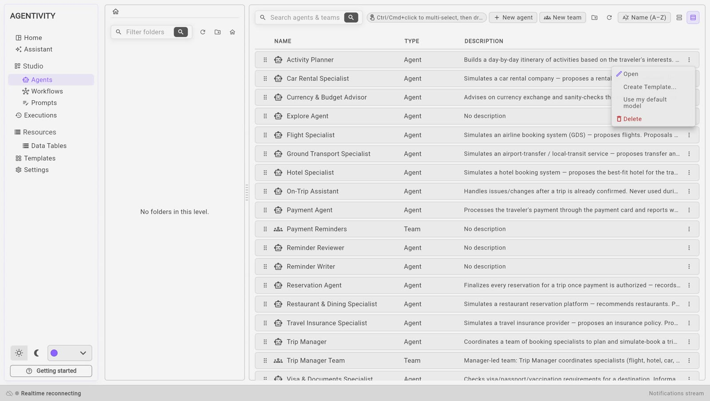

<!-- GENERATED from agentivity_docs/en/studio/agents-list.md. Do not edit here: edit the source and publish again. -->

**Studio** > **Agents** lists your agents and your teams together. This is where you open one to change it or to run it.

## The list

Each line is an agent or a team. The columns are **Name**, **Type** (Agent, Team or Folder) and **Description**. The description is the role you gave to the agent or the team.

Double-click a line to open it in its editor.

## The bar above the list

| Control | What it does |
|---|---|
| **Search agents & teams** | Finds an agent or a team by its name. |
| **New agent** | Creates an agent. |
| **New team** | Creates a team. |
| The folder button | Creates a folder. |
| The refresh button | Loads the list again. |
| **Name (A–Z)** | Changes the order of the list: by name, in either direction, or folders first. |

## The menu of a line

Select the three dots at the end of a line.

| Entry | What it does |
|---|---|
| **Open** | Opens the agent or the team in its editor. |
| **Create Template...** | Packs it, with everything it uses, into one file that you can share. |
| **Use my default model** | Makes it use your own model connection. Use it after you import a Template. See [Choose or change the model of an agent](/docs/agents/choose-the-model/). |
| **Delete** | Removes it from your workspace. |

## The folders

The panel on the left holds your folders.

- To create a folder, select the folder button at the top of the panel, type a name and select **Create**.
- To put an agent or a team in a folder, drag its line onto the folder.
- To move several at once, hold Ctrl (or Cmd on a Mac), select the lines, then drag them.
- Select a folder to see only what it contains. The house button goes back to the top level.

A folder also appears in the list, with **Folder** in the column **Type**.

## Next step

[The list of workflows](/docs/studio/workflows-list/).
