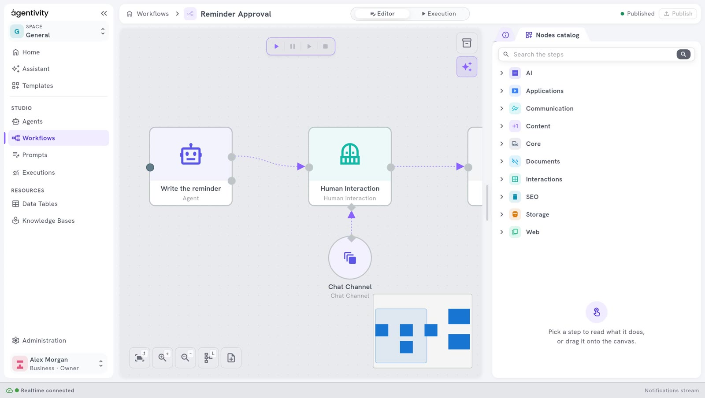

<!-- GENERATED from agentivity_docs/en/studio/editor.md. Do not edit here: edit the source and publish again. -->

Agents, teams and workflows each open in an editor. The three editors are built the same way. This page names their parts.

## At the top

- **The path**, on the left. It shows where you are: the house, then the section (**Agents** or **Workflows**), then the name of what you edit. The house and the section name take you back to the list.
- **The switch Editor | Execution**, in the middle. **Editor** is where you build. **Execution** is where you run and see what happened.
- **The state and Publish**, on the right. A dot says **Published** when everything is saved, and **Changed** when there are changes that are not saved. **Publish** saves your changes: it is light when there is nothing to save and highlighted when there is.
- In a team, the way the team works (**Manager-led**, **Sequential**, and so on) is shown as a small pill beside the name.

## The canvas

The canvas is the large white box in the middle, where the agent, the team or the workflow is drawn.

- **Drag** an element to move it.
- **Right-click** an element to open its menu. **Edit** opens its settings.
- **Drag from one dot to another** to link two steps. **Drag from one diamond to another** to plug something into a step.

## The buttons at the bottom left

| Button | What it does |
|---|---|
| The first one | Brings the whole drawing into view. |
| The magnifier with a plus | Zooms in. |
| The magnifier with a minus | Zooms out. |

In the agent and workflow editors, a small map at the bottom right shows the whole drawing and the part you are looking at.

## The bar of execution buttons

Above the canvas, a small bar has four buttons: **Run**, **Pause**, **Resume** and **Stop**. **Pause** shows while the execution runs, and **Resume** only once you paused it: it undoes your pause. An execution that waits for a person is not paused: you answer it, there is no **Resume** to select.

## The two buttons next to the panel

| Button | What it does |
|---|---|
| The box | Opens **Create a Template**, to pack what you are editing into one file. |
| The sparkle | Opens the Assistant on what you are editing. |

## The panel on the right

The panel has two tabs, each with an icon. The tab that is open also shows its name.

| Tab | Agent and workflow | Team |
|---|---|---|
| The first tab, **Info** | The name, the role, the box **Solution** and the tags. | The same, and **Max agent iterations**. |
| The second tab | The **Nodes catalog**: everything you can add to the canvas. | **Members**: the agents, teams and workflows you can add to the team. |

In the Nodes catalog, the field **Search the steps** finds a node by its name. Select a category to open it. Select a category or a node and a box at the bottom of the panel says what it is for, and **Where it sits**: its place in the catalog. Drag a node onto the canvas to add it.

## The menu of an element

Right-click an element of the canvas. The menu has, depending on the element:

| Entry | What it does |
|---|---|
| **Explain with the assistant** | Asks the Assistant what this element does. |
| **Improve with the assistant…** | Asks the Assistant to change it. |
| **Improve its instructions…** | For an agent: asks the Assistant to make its instructions clearer. |
| **Edit** | Opens the settings of the element. |
| **Inspect...** | Opens the inspection of the element. |
| **Duplicate**, **Copy** | Make a copy. |
| **Bring to front**, **Send to back**, **Bring forward**, **Send backward** | Change which element is drawn above the others. |
| **Delete** | Removes the element. |

## The window of settings

**Edit** opens a window with the settings of the element.

- Each field can hold a **Fixed value**, which you type, or an **Expression**, which is computed when it runs.
- The panel **Outputs**, on the right, lists what the earlier steps produce, with their exact names.
- **Apply** keeps your changes and closes the window. **Cancel** closes it without keeping them.

Changes are saved in your workspace only when you select **Publish**. A message, "Workflow published" for example, confirms it.

## When you leave an editor

- **A workflow with changes that are not saved**: the Studio asks what to do. **Keep editing** stays in the editor, **Discard** loses the changes, **Publish** saves them.
- **A team**: the Studio does not ask. Publish before you leave.

## In the tab Execution

Below the canvas, three tabs show an execution: **Inspector**, **Errors** and **Logs**. See [Run a workflow and follow each step](/docs/workflows/run-a-workflow/).

## Next step

[The Executions screen](/docs/studio/executions/).
