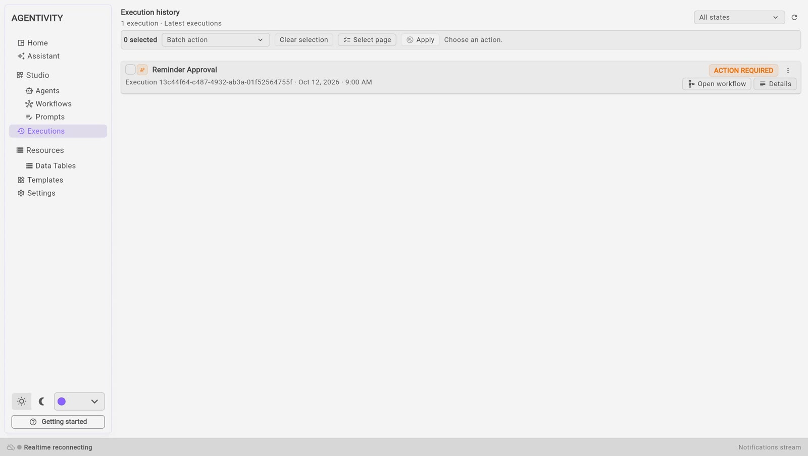
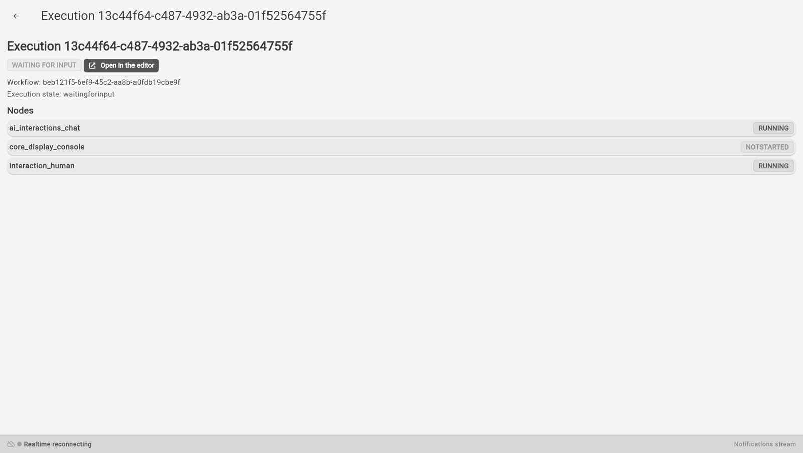

<!-- GENERATED from agentivity_docs/en/studio/executions.md. Do not edit here: edit the source and publish again. -->

**Executions** lists the runs of your whole workspace: each time a workflow, an agent or a team worked on a request. The page is titled **Execution history**.

## The list

Under the title, a line says how many runs are listed. Each line of the list is one run:

- the name of what ran;
- the identifier of the run, its date and its time;
- a label when the run needs you: **ACTION REQUIRED** means the run waits for the answer of a person.

## Filter and refresh

- The list **All states**, at the top right, keeps only the runs in one state.
- The button next to it loads the list again.

## The buttons of a line

| Button | What it does |
|---|---|
| **Open workflow** | Opens what ran in its editor. |
| **Details** | Opens the details of the run. |
| The three dots | Opens the actions on this run: stop it, or delete it from the history. |

## The details of a run

The details show:

- the state of the run, for example **WAITING FOR INPUT**;
- **Open in the editor**, to go to the workflow, the agent or the team;
- the list **Nodes**: each step of the run with its state, for example running or not started.

The arrow at the top left goes back to the list.

### A run that waits for a person

A workflow, an agent or a team that asks a person a question stops and waits. What we saw through the API on 2026-10-19, with a workflow that asks a question: the execution is **active** when it starts, **paused** while it waits, then **completed** once the question is answered. The run itself is in the state **waitingforinput**, which the details show as **WAITING FOR INPUT**.

Between the answer and the end, the execution is active again while the work goes on. With a short workflow, this lasts too little to see.

To answer, open the run in its editor and use the panel **Chat** of the tab **Execution**.

## Act on several runs at once

1. Tick the box of each run. **Select page** ticks all the runs of the page, **Clear selection** unticks them.
2. Choose an action in the list **Batch action**: stop the runs, or delete them.
3. Select **Apply**.

## Good to know

- To answer a run that waits for a person, open it in its editor and use the panel **Chat** of the tab **Execution**. See [Ask a person to approve or answer](/docs/workflows/ask-a-person-to-decide/).
- Deleting a run removes it from the history. It does not change the workflow, the agent or the team.

## Next step

[The Templates screen](/docs/studio/templates/).
