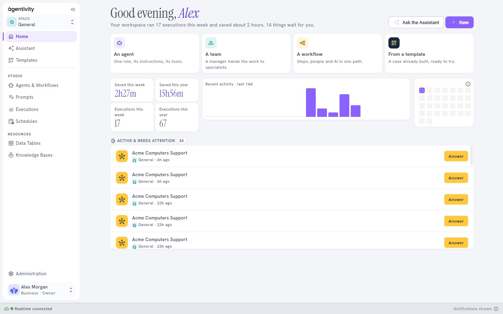
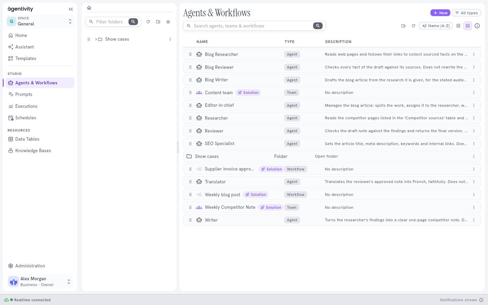

<!-- GENERATED from agentivity_docs/en/studio/find-your-way-in-the-studio.md. Do not edit here: edit the source and publish again. -->

The Studio is the visual editor of Agentivity. It runs in your browser. This page shows where things are, so that the other pages are easier to follow.

## What you need

- Agentivity running, with the Studio open in your browser. See [Install Agentivity with Docker](/docs/getting-started/install-community/).

## The menu on the left

At the top of the menu, the logo and two small arrows (**«**) fold the menu into a column of icons. Select **»**, or the logo of the folded menu, to open it again. **Ctrl+B** (**Cmd+B** on a Mac) does the same. The Studio remembers your choice.

Under the logo, the **Space** switcher says which space you work in: see [People, groups, roles and spaces](/docs/administration/people-groups-roles-spaces/). It is there in every edition: the Community edition has one space, **General**.

| Entry | What you do there |
|---|---|
| **Home** | See what is running and what is waiting for you, and start something new. |
| **Winston** | Describe what you need in your own words. Winston, your AI builder, builds an agent, a team or a workflow as a draft. See [Build your first team with Winston](/docs/getting-started/build-your-first-team-with-the-assistant/). |
| **Templates** | Ready-made solutions to import, and **Import from file** for a Template you received. |
| **Studio** > **Agents & Workflows** | The list of your agents, your teams and your workflows. Open one to change it or to run it. |
| **Studio** > **Prompts** | The prompts you write and test. A prompt is the text of instructions that is sent to an AI model. |
| **Studio** > **Executions** | The executions: each time an agent, a team or a workflow worked on a request. |
| **Resources** > **Data Tables** | Tables of data that your agents and workflows can read and fill. |
| **Resources** > **Knowledge Bases** | Your documents, pages and feeds, kept so that agents can search them by meaning. See [What a Knowledge Base is for](/docs/knowledge-bases/what-a-knowledge-base-is/). |
| **Administration** | **Credentials**, where you keep the keys and accounts your agents connect with, **Configurations**, and, when the workspace asks for a sign-in, the people, the roles and more. See [Administration, who sees what](/docs/administration/what-administration-is/). |

If you do not know the difference between an agent, a team and a workflow, read [Choose between an agent, a team and a workflow](/docs/introduction/agent-team-or-workflow/).

Just above that card, **Getting started** opens a short tour of the Studio again: what it is, then workflows, agents, teams, connections, Winston and the Desk.

At the bottom of the menu, a card shows your name and your edition (for example **Business · Owner**). Select it to open your account menu:

- **Your account**: see [Your account](/docs/administration/your-account-and-api-keys/);
- **Appearance**: the sun and the moon switch between a light and a dark screen, and a list changes the accent colour;
- **Setup guide** opens the [welcome guide](/docs/getting-started/welcome-guide/) again;
- **Sign out**, on a workspace that asks for a sign-in.

## The home page

The home page is the first screen of the Studio. It greets you by your first name ("Good morning, Alex") and asks first what you want to do.

### What do you want to automate?

When Winston is available, a field asks "Describe the job… we'll build the team, agent or workflow". Write the job in your own words and select the arrow: a conversation with Winston begins, and he chooses what it becomes. See [Build your first team with Winston](/docs/getting-started/build-your-first-team-with-the-assistant/).

### The buttons

- **Ask Winston**, at the top right, opens Winston, to build from a description.
- **New** opens a menu: **Agent**, **Team** or **Workflow**. Each one asks for a name.
- On a line, the ways to make something by hand: **Agent**, **Team**, **Workflow** (see [Create a workflow](/docs/workflows/create-a-workflow/), [Create an agent](/docs/agents/create-an-agent/) and [Create a team of agents](/docs/teams/create-a-team/)), and **From a template**, which opens the [Templates screen](/docs/studio/templates/).

### The counters

| Counter | What it counts |
|---|---|
| **Plan used** | On a hosted workspace, how much of the executions of the plan the month used, and when it starts again. It shows to the people who manage the plan. |
| **Saved this week**, **Saved this year** | An estimate of the time these executions saved, in minutes. |
| **Waiting for you** | What waits for your answer, with a way to the questions. |
| **Executions this week**, **Executions this year** | The number of executions of your agents, teams and workflows. |

### The recent activity

- **Recent activity · last 14d** is a chart with one bar per day, for the last fourteen days.
- The grid next to it shows the activity over a longer period, one square per day. Move the pointer over a square to read the date and the time saved. The small **i** at its corner explains the grid.

### Active & needs attention

This block lists the executions that are in progress and the executions that need you. The executions of one same agent, team or workflow make one row, with how many wait for you, failed or are running. A row says what it is about, taken from what started it, the question it waits on and how many, or why it failed. Its button **Answer** opens that execution so that you can answer. A switch shows all of them, the **Questions**, the **Failed** ones or the **Running** ones.

Of what failed, the home keeps the last seven days. Older failures are found in **Executions**.

## The list of agents and teams

**Studio** > **Agents & Workflows** shows agents, teams and workflows in the same list. The column **Type** says which one each line is.

- **New** creates one, at the top right. It asks which: agent, team or workflow.
- The type filter beside it shows one type only.
- The search field, on the second row, finds an item by its name.
- The panel on the left holds folders, to keep your work in order.

## An editor

When you open an agent or a team, its editor takes the place of the list. Every editor has the same parts:

- a bar at the top: on the left, the path (for example **Agents & Workflows** > the name), in the middle a switch **Editor** | **Execution** (**Editor** to build, **Execution** to run and to see what happened, and in a team or a workflow **Observation** to read a whole period), and on the right the state of the work and **Publish**, which saves your changes;
- a canvas in the middle, a white box where the agent, the team or the workflow is drawn;
- a panel on the right, with icon tabs: **Info** has the name and the role.

## Each screen in detail

- [The lists of agents, teams and workflows](/docs/studio/lists-of-agents-teams-and-workflows/)
- [An editor, its canvas, panels and buttons](/docs/studio/editor/)
- [The Executions screen](/docs/studio/executions/)
- [The Templates screen](/docs/studio/templates/)
- [Settings, theme and the small controls of the Studio](/docs/studio/settings-theme-and-controls/)

## How to know it worked

You can open **Home**, **Winston**, **Studio** > **Agents & Workflows** and **Administration** from the menu, and each one shows the screen described above.

## Next step

[Build your first team with Winston](/docs/getting-started/build-your-first-team-with-the-assistant/), or [try a ready-made solution](/docs/getting-started/try-a-ready-made-solution/) first.
