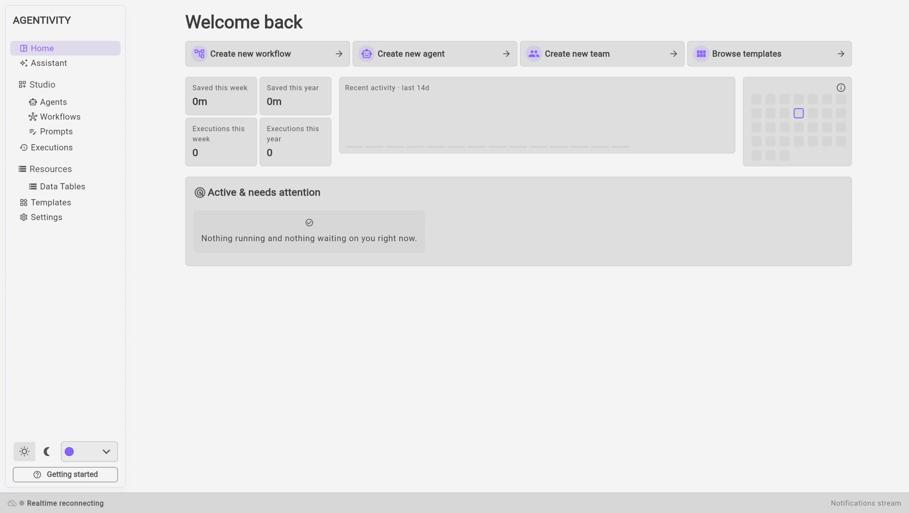
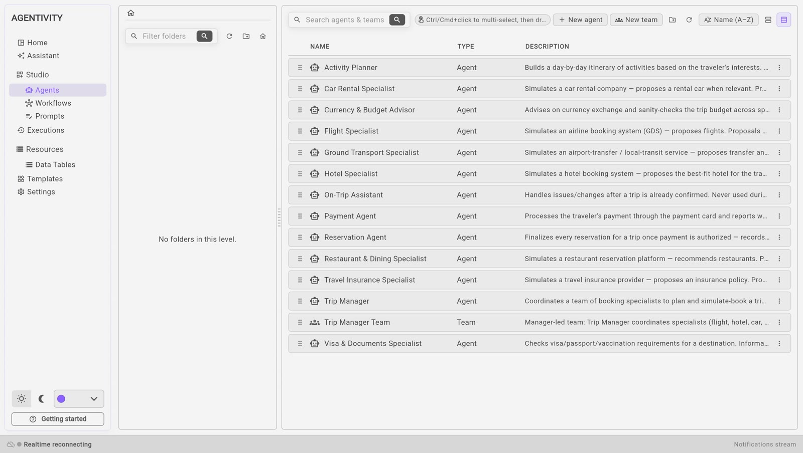

<!-- GENERATED from agentivity_docs/en/studio/find-your-way-in-the-studio.md. Do not edit here: edit the source and publish again. -->

The Studio is the visual editor of Agentivity. It runs in your browser. This page shows where things are, so that the other pages are easier to follow.

## What you need

- Agentivity running, with the Studio open in your browser. See [Install Agentivity with Docker](/docs/getting-started/install-community/).

## The menu on the left

| Entry | What you do there |
|---|---|
| **Home** | See what is running and what is waiting for you, and start something new. |
| **Assistant** | Describe what you need in your own words. The Assistant builds an agent, a team or a workflow as a draft. See [Build your first team with the Assistant](/docs/getting-started/build-your-first-team-with-the-assistant/). |
| **Studio** > **Agents** | The list of your agents and your teams. Open one to change it or to run it. |
| **Studio** > **Workflows** | The list of your workflows. |
| **Studio** > **Prompts** | The prompts you write and test. A prompt is the text of instructions that is sent to an AI model. |
| **Executions** | The runs: each time an agent, a team or a workflow worked on a request. |
| **Resources** > **Data Tables** | Tables of data that your agents and workflows can read and fill. |
| **Templates** | Ready-made solutions to import, and **Import from file** for a Template you received. |
| **Settings** | **Credentials**, where you keep the keys and accounts your agents connect with, and **Configurations**. |

If you do not know the difference between an agent, a team and a workflow, read [Choose between an agent, a team and a workflow](/docs/introduction/agent-team-or-workflow/).

At the bottom of the menu:

- two buttons switch between a light and a dark screen;
- a list changes the accent colour;
- **Getting started** opens the [welcome guide](/docs/getting-started/welcome-guide/) again.

## The home page

The home page is titled **Welcome back**. It has three parts.

**Four shortcuts**, at the top:

- **Create new workflow**
- **Create new agent**
- **Create new team**
- **Browse templates**

**Counters**: **Executions this week** and **Executions this year** count the runs. **Saved this week** and **Saved this year** show an estimate of the time saved by these runs.

**Active & needs attention**: the runs that are in progress, the runs that failed, and the runs that wait for an answer from a person. When there is nothing, you read "Nothing running and nothing waiting on you right now."

## The list of agents and teams

**Studio** > **Agents** shows agents and teams in the same list. The column **Type** says which one each line is.

- **New agent** and **New team** create one.
- The search field finds an agent or a team by its name.
- The panel on the left holds folders, to keep your work in order.

## An editor

When you open an agent or a team, its editor takes the place of the list. Every editor has the same parts:

- two tabs at the top: **Editor**, to build, and **Execution**, to run and to see what happened;
- a canvas in the middle, where the agent or the team is drawn;
- a panel on the right, with the name and the role;
- **Publish**, at the top right, which saves your changes.

## Each screen in detail

- [The Home page of the Studio](/docs/studio/home/)
- [The list of agents and teams](/docs/studio/agents-list/)
- [The list of workflows](/docs/studio/workflows-list/)
- [An editor, its canvas, panels and buttons](/docs/studio/editor/)
- [The Executions screen](/docs/studio/executions/)
- [The Templates screen](/docs/studio/templates/)
- [The Settings screen](/docs/studio/settings/)
- [The status bar, the theme and the guide button](/docs/studio/status-bar-and-theme/)

## How to know it worked

You can open **Home**, **Assistant**, **Studio** > **Agents** and **Settings** from the menu, and each one shows the screen described above.

## Next step

[Build your first team with the Assistant](/docs/getting-started/build-your-first-team-with-the-assistant/), or [try a ready-made solution](/docs/getting-started/try-a-ready-made-solution/) first.
