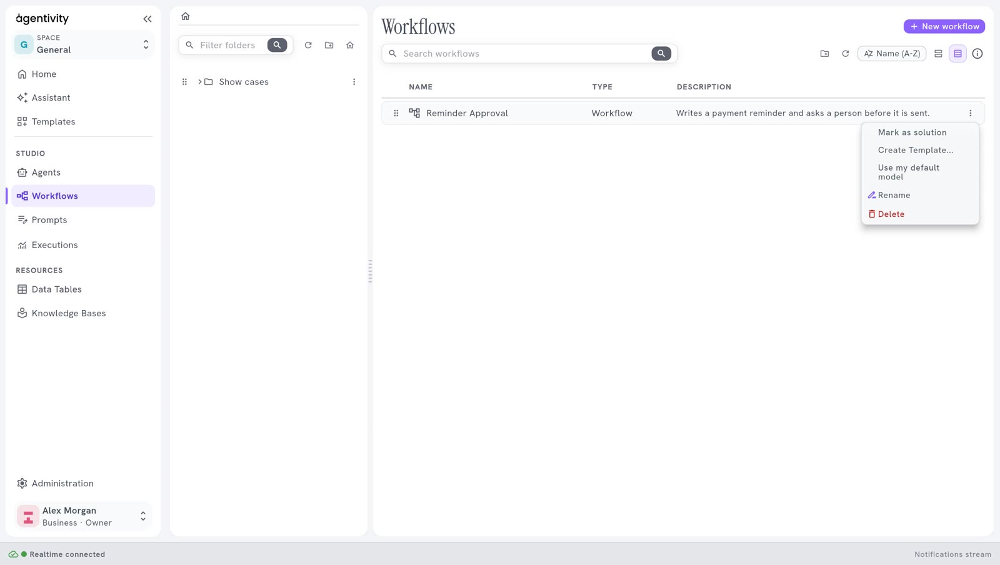

<!-- GENERATED from agentivity_docs/en/studio/lists-of-agents-teams-and-workflows.md. Do not edit here: edit the source and publish again. -->

**Studio** > **Agents** lists your agents and your teams together. **Studio** > **Workflows** lists your workflows. The two screens work the same way, and this page describes both. This is where you open a solution to change it or to run it.

## The list of agents and teams

Each line is an agent or a team. The columns are **Name**, **Type** (Agent, Team or Folder) and **Description**. The description is the role you gave to the agent or the team.

Double-click a line to open it in its editor.

### Above the list

The header has two rows. The first holds the title and the buttons **New agent** and **New team**. The second holds the search field and the tools.

| Control | What it does |
|---|---|
| **New agent** | Creates an agent. |
| **New team** | Creates a team. |
| **Search agents & teams** | Finds an agent or a team by its name. |
| The folder button | Creates a folder. |
| The refresh button | Loads the list again. |
| **Name (A–Z)** | Changes the order of the list: by name, in either direction, or folders first. |
| The two view buttons | Switch between the list and the table. |
| The small **i** | Says, in a tip, how to select several lines and drag them. |

### The menu of a line

Select the three dots at the end of a line.

| Entry | What it does |
|---|---|
| **Open** | Opens the agent or the team in its editor. |
| **Mark as solution** | Marks it as a Solution, the thing a person launches. The entry then reads **No longer a solution**. See [What a Solution is](/docs/introduction/what-a-solution-is/). |
| **Create Template...** | Packs it, with everything it uses, into one file that you can share. |
| **Use my default model** | Makes it use your own model connection. Use it after you import a Template. See [Choose or change the model of an agent](/docs/agents/choose-the-model/). |
| **Delete** | Removes it from your workspace. |

## The list of workflows

Each line is a workflow, with its **Name**, its **Type** and its **Description**. Double-click a line to open the workflow in its editor.

### The bar above the list

| Control | What it does |
|---|---|
| **New workflow** | Creates a workflow, at the top right of the first row. See [Create a workflow](/docs/workflows/create-a-workflow/). |
| The search field | Finds a workflow by its name, on the second row. |
| The folder button | Creates a folder. |
| The refresh button | Loads the list again. |
| **Name (A-Z)** | Changes the order of the list. |

### The menu of a line

| Entry | What it does |
|---|---|
| **Mark as solution** | Marks the workflow as a Solution. The entry then reads **No longer a solution**. |
| **Create Template...** | Packs the workflow, with everything it uses, into one file that you can share. |
| **Use my default model** | Makes the workflow use your own model connection. |
| **Rename** | Changes the name of the workflow. |
| **Delete** | Removes the workflow. The Studio asks you to type the name of the workflow to confirm. This cannot be undone. |

## The folders

The panel on the left holds your folders.

- To create a folder, select the folder button at the top of the panel, type a name and select **Create**.
- To put an item in a folder, drag its line onto the folder.
- To move several at once, hold Ctrl (or Cmd on a Mac), select the lines, then drag them.
- Select a folder to see only what it contains. The house button goes back to the top level.

A folder also appears in the list, with **Folder** in the column **Type**.

Agents and teams, workflows, and data tables each have their own folders.

## Next step

[An editor, its canvas, panels and buttons](/docs/studio/editor/).
