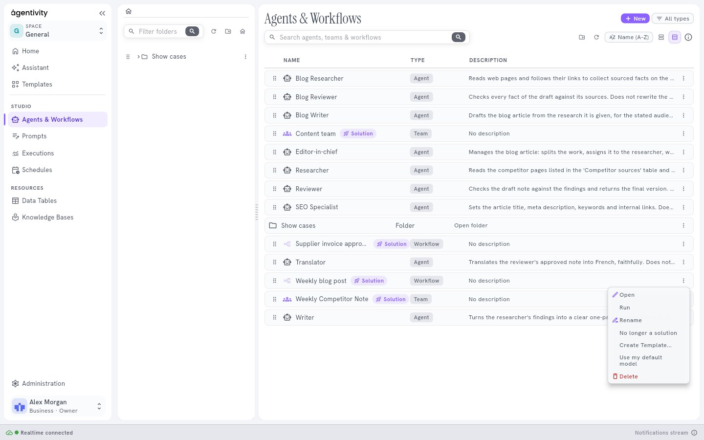

<!-- GENERATED from agentivity_docs/en/studio/lists-of-agents-teams-and-workflows.md. Do not edit here: edit the source and publish again. -->

**Studio** > **Agents & Workflows** lists your agents, your teams and your workflows together, in one list with one set of folders. This is where you open a solution to change it or to run it.

## The list

Each line is an agent, a team, a workflow or a folder. The columns are **Name**, **Type**, shown as a badge, and **Description**. The description is the role you gave it.

Double-click a line to open it in its editor.

### Above the list

The header has two rows. The first holds the title, the button **New** and the type filter. The second holds the search field and the tools.

| Control | What it does |
|---|---|
| **New** | Opens the window "What do you want to create?", with three cards that say what each one is for: **Agent** (does one job, with its own tools), **Team** (several agents share the work, led by a manager) and **Workflow** (fixed steps, in the same order every time). Then it asks for the name. It is created in the folder you are in. |
| **All types** | Shows one type only. Each press moves to the next: **Agents**, **Teams**, **Workflows**, then **All types** again. |
| **Search agents, teams & workflows** | Finds an item by its name, in every folder, not only the one you are in. Each item found shows the folders it is in. |
| The folder button | Creates a folder. |
| The refresh button | Loads the list again. |
| **Name (A–Z)** | Changes the order of the list: by name, in either direction, folders first, or by type. |
| The two view buttons | Switch between the list and the table. |
| The small **i** | Says, in a tip, how to select several lines and drag them. |

### The menu of a line

Select the three dots at the end of a line.

| Entry | What it does |
|---|---|
| **Open** | Opens the item in its editor. |
| **Run** | Workflows only. Opens the workflow and starts it. |
| **Rename** | Workflows only. Changes its name. |
| **Versions** | Workflows only, where versions are kept. Shows its saved versions. |
| **Mark as solution** | Marks it as a Solution, the thing a person launches. The entry then reads **No longer a solution**. See [What a Solution is](/docs/introduction/what-a-solution-is/). |
| **Create Template...** | Packs it, with everything it uses, into one file that you can share. |
| **Use my default model** | Makes it use your own model connection. Use it after you import a Template. See [Choose or change the model of an agent](/docs/agents/choose-the-model/). |
| **Delete** | Removes it from your workspace. For a workflow, the Studio asks you to type its name to confirm. This cannot be undone. |

## The folders

The panel on the left holds your folders. Agents, teams and workflows share them: one folder can hold all three.

- To create a folder, select the folder button at the top of the panel, type a name and select **Create**.
- To put an item in a folder, drag its line onto the folder.
- To move several at once, hold Ctrl (or Cmd on a Mac), select the lines, then drag them.
- Select a folder to see only what it contains. The house button goes back to the top level.

A folder also appears in the list, with **Folder** in the column **Type**.

Data tables and Knowledge Bases keep their own folders.

## Next step

[An editor, its canvas, panels and buttons](/docs/studio/editor/).
