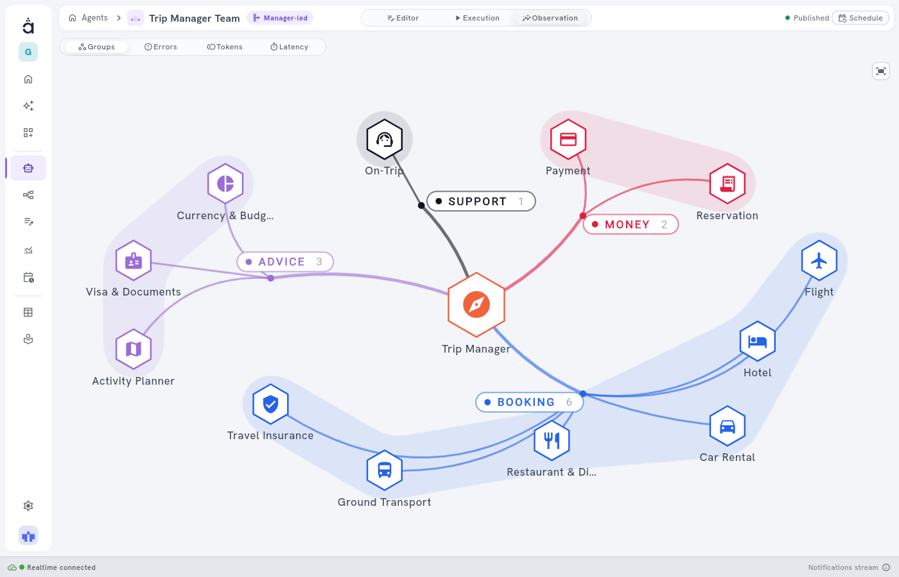
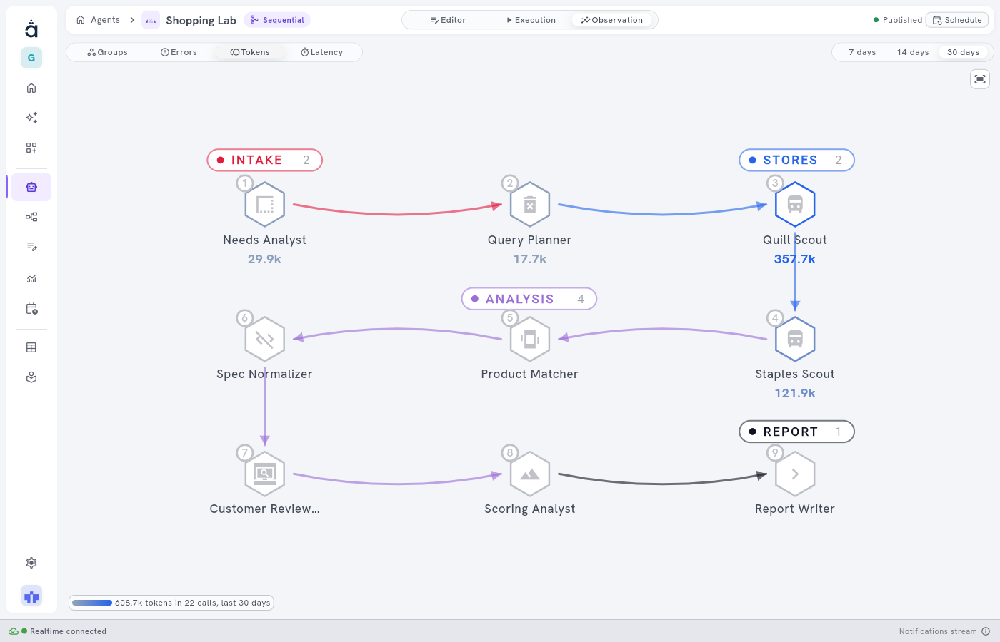
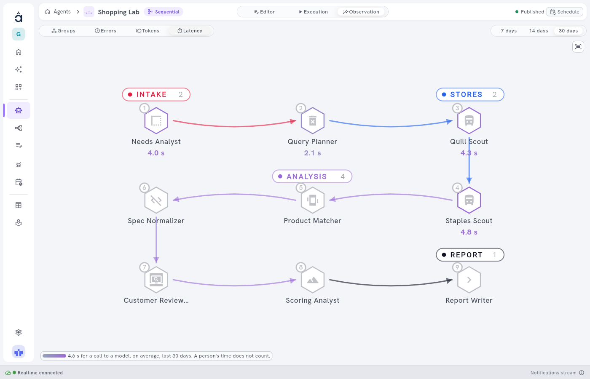
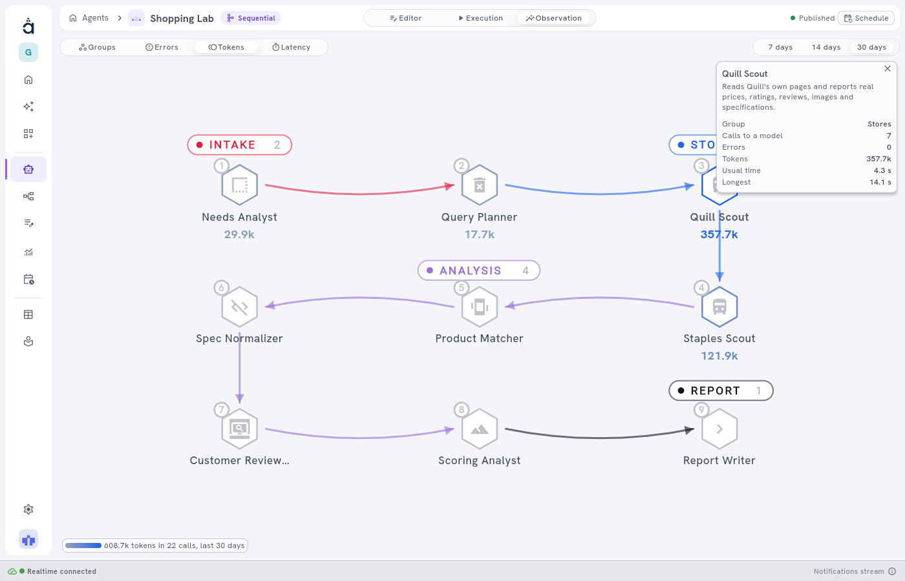

<!-- GENERATED from agentivity_docs/en/studio/observation.md. Do not edit here: edit the source and publish again. -->

The editor of a team and the editor of a workflow have a third tab, **Observation**, beside **Editor** and **Execution**. **Execution** shows one execution in detail. **Observation** shows a period as a whole: which members or steps do the most work, which ones fail, and which ones take time.

You read all this on the drawing you already know. There is no table to learn and nothing to set up.

## What you need

- A team or a workflow, published. **Observation** shows what is published, not the changes you have not published yet. An agent alone has no such tab.
- The **Pro**, **Business** or **Enterprise** plan: see [Plans and their limits](/docs/hosted/plans-and-limits/). Observation is not in the Personal plan or the Community edition.
- Some executions, to see values. Without them, the tab says "No call to a model in the last 30 days."

## Open it

1. Open **Studio** > **Agents & Workflows** or **Studio** > **Agents & Workflows**, then open the team or the workflow.
2. In the switch at the top, select **Observation**.

The bar below the switch has four readings: **Groups**, **Errors**, **Tokens** and **Latency**. The drawing does not move between them, so your eye stays on the same place when you change reading.

## The four readings

| Reading | The question it answers | What you see |
|---|---|---|
| **Groups** | How is the work organised? | The members or steps in their groups, in the colours of the groups. See [Organise a team or a workflow with groups](/docs/teams/organise-with-groups/). |
| **Errors** | Where do calls to a model fail? | The number of failed calls on each step or member. |
| **Tokens** | Where do the tokens go? | The tokens used by each step or member. |
| **Latency** | Where does the time go? | The usual time of a call to a model, for each step or member. |

## Read a measure

**Errors**, **Tokens** and **Latency** are measures. In a measure:

- The backgrounds of the groups step back, so that the values stand out.
- Each step or member gets its value under its name. A strong colour means a high value, on one colour scale for the whole drawing.
- A step or a member with no value has made no call to a model in the period.
- The corner at the bottom left gives the total, in tokens and calls for example, with the period.

At the top right, choose the period: **7 days**, **14 days** or **30 days**. A period longer than the history of your plan shows what is kept: see [How long the history is kept](/docs/hosted/plans-and-limits/#how-long-the-history-is-kept).

### What Tokens counts

**Tokens** counts input, output and cache tokens, for every call to a model, failed calls included. This is true for OpenAI, Anthropic, Gemini, Bedrock and providers compatible with OpenAI. It counts tokens only.

### What Latency counts

**Latency** is the usual time of a call to a model. The time of a person never counts: a team that waits a day for an answer does not look slow. The legend says so: "A person's time does not count."

### What Errors counts

**Errors** counts failed calls to a model, and only those. A step can fail for another reason, such as a wrong value or a tool that does not answer, and it is not counted here. To read why one execution failed, open the tab **Errors** in **Execution**: see [Run a workflow and follow each step](/docs/workflows/run-a-workflow/).

## Open the card of a step or a member

Select a step or a member. A floating card opens with:

| Line | What it says |
|---|---|
| **Group** | The group of the step or the member. |
| **Calls to a model** | How many calls it made in the period. |
| **Errors** | How many of these calls failed. |
| **Tokens** | The tokens of these calls. |
| **Usual time** | The usual time of one call. |
| **Longest** | The longest call. |

Select the cross of the card to close it.

## A team that holds other teams

A team that holds other teams or workflows opens as a whole organisation, in rings, with its own buttons to open and close each part. See [Read a whole AI Company](/docs/teams/read-an-ai-company/).

## How to know it worked

- The tab **Observation** is in the switch at the top of the editor.
- In a measure, the steps or members that worked in the period show a value, and the corner shows a total.

## Good to know

- **Observation** is in the Studio only, not in VibeApps or the SDKs.
- The total in the corner can be higher than the sum of the values on the drawing: it also counts the calls that belong to no step and no member.
- For the whole workspace, in one month, see **Usage** in [Usage, monitoring and the audit journal](/docs/administration/usage-monitoring-and-audit-journal/). It gives the executions and the tokens by model.

## Next step

[The Executions screen](/docs/studio/executions/), to read one execution in detail.
