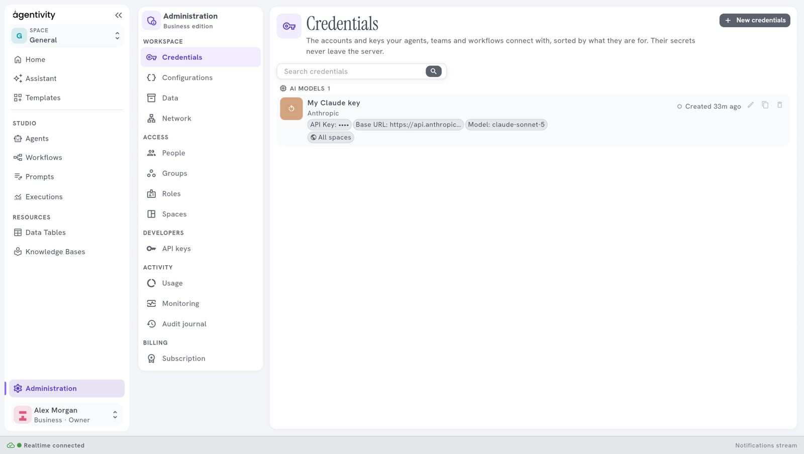

<!-- GENERATED from agentivity_docs/en/studio/settings.md. Do not edit here: edit the source and publish again. -->

In the menu on the left, **Administration** opens with two panes, **Credentials** and **Configurations**. On a workspace with sign-in, they are in the group **Workspace** of **Administration**, with **Data** and **Network**: see [Workspace panes](/docs/administration/workspace-panes/).

## Credentials

Credentials are the keys and the accounts that your agents, teams and workflows connect with: an AI model, a mailbox, a search service.

- The connections are sorted by what they are for, for example **AI models**.
- A secret value, such as an API key, is shown as dots. It is never shown again after you save it.
- **Search credentials** finds a connection by its name.

| Control | What it does |
|---|---|
| **New credentials** | Opens the window **New connection**, where you choose what to connect to. |
| The pencil | Changes a connection. To replace a secret, type the new value. |
| The two sheets | Makes a copy of a connection. |
| The bin | Deletes a connection. The Studio asks you to confirm. |

To add the connection of an AI model, see [Connect an AI model](/docs/guides/connect-a-model/).

## Configurations

**Configurations** lets you look at and change settings of the server. On a new installation the list is empty and says "No configurations available."

## Good to know

- This area was called **Settings** in earlier versions. It is now **Administration**, which also holds the panes for people, roles, spaces, usage and, on a hosted workspace, the subscription: see [Administration, who sees what](/docs/administration/what-administration-is/).
- In the Community edition there is no login. Anyone who can open the Studio can open these panes, and can add, change or delete connections. A secret that is already saved is not shown to them.
- On a workspace with sign-in, a person sees a pane only if their role allows it.

## Next step

[The status bar, the theme and the guide button](/docs/studio/status-bar-and-theme/).
